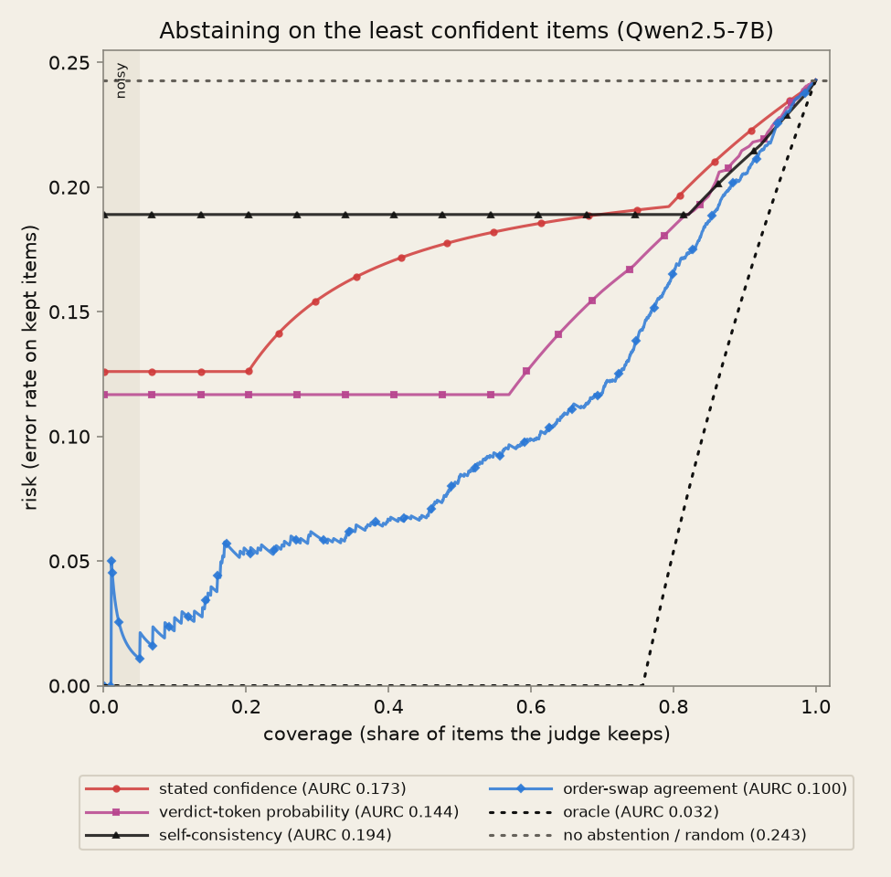

# Glossary

## Calibration
[source: https://arxiv.org/abs/1706.04599]

### Calibration
Calibration means the confidence a model gives a prediction should match the probability that the prediction is correct.
E.g. given 100 predictions, each with confidence 0.8, we expect 80 to be correct. Perfect calibration would look like:
$$
\mathbb{P}(\hat{Y} = Y \mid \hat{P} = p) = p, \quad \forall p \in [0, 1]
$$
where $\hat{Y}$ is a class prediction and $\hat{P}$ is its associated confidence. This probability cannot be computed from a finite number of samples, as $\hat{P}$ is a continuous random variable. Thus we use an empirical approximation (see Binning predictions).

**In this project.** The prediction is the judge's verdict (A or B), "correct" means it matches the human majority, and the confidence is one of the signals (stated confidence, verdict probability, etc.). Qwen's stated confidence averages 0.95 while it is right 76% of the time.

### Binning predictions
To estimate accuracy from finite samples, we group predictions into M bins and compute accuracy and average confidence in each bin. With equal-width bins, $B_m$ is the set of samples with confidence in $(\frac{m-1}{M}, \frac{m}{M}]$.
$$
acc(B_m) = \frac{1}{|B_m|} \sum_{i \in B_m} 1(\hat{y}_i = y_i)
$$
$$
conf(B_m) = \frac{1}{|B_m|} \sum_{i \in B_m} \hat{p}_i
$$
where $\hat{p}_i$ is the confidence for sample i.

**In this project.** I use M = 10 equal-mass bins instead (see Equal-mass vs equal-width bins).

### Exact binning for discrete signals, effective bin count
If a signal takes M or fewer distinct values, each value gets its own bin. No approximation is needed, so this gives the exact ECE. conf_sc takes only 0, 0.25, 0.5, 0.75 and 1.0, and Qwen's stated confidence (conf_verb) takes only 4 values, so both are binned this way (D14).
Because duplicate quantile edges are dropped and discrete signals get one bin per value, the number of bins actually used can differ from M. ece() returns it as n_effective_bins, and every table reports it.

### Reliability diagram

A visual representation of calibration: accuracy plotted against average confidence for each bin. A perfectly calibrated model lies on the diagonal.
Points below the diagonal are overconfident, points above are underconfident.
The meta-model diagram above plots a different quantity: predicted P(judge wrong) against the observed error rate. There, a point below the diagonal predicts more errors than occur, and a point above predicts fewer. Its curve sits slightly above the diagonal below 0.4 and drops below only in the top bin, around 0.7.

**In this project:** 

They use the same bins as ece(), size each marker by its bin's share of the data, and show a histogram of confidences underneath, because most signals pile up near 1 and the bins alone hide that.

### Expected Calibration Error (ECE)
A scalar summary statistic of miscalibration. It approximates the expected difference between confidence and accuracy:
$$
\underset{\hat{P}}{\mathbb{E}} \left[ \left| \mathbb{P}(\hat{Y}=Y \mid \hat{P}=p) - p \right| \right]
$$
ECE partitions predictions into M bins and takes a weighted average of each bin's gap between accuracy and confidence:
$$
ECE = \sum_{m=1}^{M} \frac{|B_m|}{n} \left| acc(B_m) - conf(B_m) \right|
$$
where n is the number of samples and $|acc(B_m) - conf(B_m)|$ is the calibration gap of bin m.

**In this project.** Equal-mass bins, M = 10, or exact bins for discrete signals. Always reported with n_effective_bins, AUROC and the signed overconfidence gap. Padding raises the best signal's ECE by +0.043 [0.011, 0.052].

### Signed overconfidence gap
The calibration gap is an absolute value, so being underconfident by 2 points and overconfident by 2 points count the same, and ECE cannot show the direction. The signed overconfidence gap keeps the direction and needs no bins:
$$
G = \frac{1}{n}\sum_{i=1}^{n} \hat{p}_i - \frac{1}{n}\sum_{i=1}^{n} 1(\hat{y}_i = y_i)
$$
i.e. mean confidence minus accuracy. Positive means overconfident, negative means underconfident. The weighted sum of per-bin signed gaps equals G exactly, so binning changes nothing.

**In this project.** Reported beside every ECE, because a judge overconfident in some bins and underconfident in others can post a small ECE while this number shows the direction overall. 
Qwen's stated confidence: +0.192 [0.172, 0.213]. Padding's effect on the best signal is confirmed on this bin-free measure too (+0.031 [0.012, 0.051]).

### Maximum Calibration Error (MCE)
In high-risk applications, we might want to minimize the worst-case deviation between confidence and accuracy:
$$
\max_{p \in [0,1]} \left| \mathbb{P}(\hat{Y} = Y \mid \hat{P} = p) - p \right|
$$
MCE estimates it by binning, then taking the maximum across all bins:
$$
MCE = \max_{m \in \{1,\dots,M\}} \left| acc(B_m) - conf(B_m) \right|
$$

**In this project.** Computed on the same bins as ece(). ECE says how bad the typical bin is; MCE says how bad the worst one is, which ECE can average away. It is noisy when a bin holds few items.

### Equal-mass (quantile) vs equal-width bins
Equal-width bins split the confidence range into same-sized intervals (0–0.1, 0.1–0.2, …). Equal-mass bins put the same number of predictions in each bin, so the bin edges come from the data's percentiles. When confidence piles up near 0.8, 0.9, 0.95 and 1.0, equal-width bins leave most bins nearly empty and pack the data into one or two, which makes the estimate unstable.

**In this project** `ece()` uses equal-mass bins for continuous signals, because most of them pile up near 1. The verdict probability (conf_lp) is the extreme case: 99.3% of its values are ≥ 0.99, so with 10 equal-width bins almost all 1,836 items land in the top bin. Equal-mass bins aim for about 184 items each and place their edges where the data are.
Duplicate edges are dropped, so the function also reports how many bins it actually used. If a signal has 10 or fewer distinct values, it gets one bin per value instead, which is exact.

### Brier score
The mean squared difference between the confidence and the outcome (1 if the prediction was correct, 0 if not), introduced by Brier (1950):
$$
BS = \frac{1}{n} \sum_{i=1}^{n} \left( \hat{p}_i - 1(\hat{y}_i = y_i) \right)^2
$$
Range 0 to 1, lower is better. It is a strictly proper scoring rule: a model gets its best expected score only by reporting its true probability of being correct. 
Unlike ECE it needs no bins, and it rewards both calibration and discrimination, so a single number cannot tell you which one is failing (see Brier decomposition).

Reference point: a model that always states its overall accuracy $\bar{o}$ scores $\bar{o}(1-\bar{o})$. A useful signal should score below that.

**In this project.** Qwen is right on $\bar{o}$ = 0.757 of items, so the constant baseline is 0.757 × 0.243 = 0.184.
- Stated confidence: 0.215, worse than the constant.
- Verdict probability (conf_lp): 0.242, also worse. Almost all its values are about 1.0, so its Brier is roughly the error rate.
- Self-consistency (conf_sc): 0.205, worse.
- Order-swap signal (conf_bpe, probability form): 0.159, the only single-call-pair signal that beats the baseline.
- Stated confidence averaged over both orders: 0.150, the best.

### Brier decomposition
Murphy's (1973) split of the Brier score, using the same bins as ECE:
$$
BS = \text{Reliability} - \text{Resolution} + \text{Uncertainty}
$$
$$
\text{Reliability} = \sum_{m=1}^{M} \frac{|B_m|}{n} \left( conf(B_m) - acc(B_m) \right)^2
$$
$$
\text{Resolution} = \sum_{m=1}^{M} \frac{|B_m|}{n} \left( acc(B_m) - \bar{o} \right)^2
$$
$$
\text{Uncertainty} = \bar{o}(1 - \bar{o})
$$
- Reliability: the squared calibration gap, the squared cousin of ECE. Lower is better.
- Resolution: how far each bin's accuracy is from the overall accuracy, i.e. whether different confidence levels really mean different accuracy. This is the discrimination part. Higher is better.
- Uncertainty: depends only on the base rate, not on the model.

A signal beats the constant baseline only when resolution is larger than reliability. The identity is exact when every bin holds a single confidence value; for continuous signals in quantile bins it is close but not exact, because spread within a bin is lost. Stephenson et al. (2008) show that this gap is two extra within-bin components of the decomposition; this project does not compute them.

**In this project.** Uncertainty is 0.184 for every signal on the same verdict.
- Stated confidence: reliability 0.042, resolution 0.011. The miscalibration penalty is about four times what the signal earns by separating right from wrong, so it ends up worse than the constant: 0.042 − 0.011 + 0.184 = 0.215. It has 4 distinct values, so this sum matches the Brier score exactly.
- Order-swap signal: reliability 0.015, resolution 0.043. This is the reverse pattern, and that's why it is the only one under 0.184.

### Probability form vs 1 − H form of a signal
Entropy-based signals measure how spread out a probability is. For a binary probability p (in nats):
$$
H(p) = -\left( p \ln p + (1-p) \ln(1-p) \right)
$$
The signal is written 1 − H(p), so higher means more certain. It is a good ranking score but not a probability. At a 50/50 split, H = ln 2 ≈ 0.693, so 1 − H ≈ 0.307, where a probability would be 0.5. Its range is about [0.307, 1], not [0.5, 1].

Example: p = 0.8.
H = −(0.8 ln 0.8 + 0.2 ln 0.2) = 0.179 + 0.322 = 0.500, 
so 1 − H ≈ 0.50,
while the judge actually puts 0.80 on its pick.

The probability form is the probability the signal puts on the verdict: p if the verdict is A, 1 − p if it is B.

Rule: ranking metrics (AUROC, risk–coverage) use the 1 − H form; calibration metrics (ECE, Brier, overconfidence gap) use the probability form. Both are decreasing functions of how far p is from 0.5, so they rank items the same way and AUROC is unaffected. Calibration metrics compare the number with an accuracy, so the scale matters: ECE on 1 − H would partly measure the 0.307-vs-0.5 scale gap rather than miscalibration.

**In this project.** conf_bpe, conf_ens and the kev-8b and auto-j analogues are stored in 1 − H form for AUROC, and each has a _prob version (conf_bpe_prob, conf_ens_prob, ...) from signals.py::prob_on_verdict() for calibration (D7). For conf_bpe, p is P(model A wins) averaged over both answer orders. A confidence is only scored against the verdict it belongs to. Against the order-averaged verdict, the probability form is max(p, 1 − p). Against the single-pass AB verdict it can drop below 0.5 when the two disagree, which happens on flipped items.

### Calibration vs Discrimination
Calibration asks whether the confidence numbers are honest: of the answers given 80% confidence, are about 80% right? ECE and the Brier score measure it. 
Discrimination asks whether confidence separates right answers from wrong ones: are the wrong answers given lower confidence? AUROC measures it. 
The two are independent, so a model can be good at one and bad at the other.

**In this project** I always report ECE with AUROC as either alone can make a bad judge look better. E.g.

For selective evaluation I need both. Discrimination decides which verdicts go to a human. Calibration decides whether a fixed threshold like 0.90 means what it says. Qwen's stated confidence fails both.

## Confidence signals
[sources: https://arxiv.org/abs/2306.13063; https://arxiv.org/abs/2602.13110]

Every signal comes from the recorded calls (src/signals.py, kev_signals.py,
autoj_signals.py). A confidence is always scored against the verdict it
belongs to (D7).

| Signal | Calls | Overconfidence gap | AUROC (error detection) |
|---|---|---|---|
| Stated confidence (conf_verb) | 1 | +0.192 | 0.639 |
| Verdict-token probability (conf_lp) | 1 | +0.242 | 0.715 |
| Self-consistency (conf_sc) | 5 | +0.169 | 0.623 |
| Order-swap agreement (conf_bpe) | 2 | +0.103 | 0.794 |
| Stated confidence, both orders (conf_verb_bidir) | 2 | +0.038 | – |
| 3-prompt ensemble (conf_ens) | 6 | – | 0.793 |
Qwen2.5-7B, clean, N = 1,836. conf_verb_bidir is scored against the
order-averaged verdict (accuracy 0.792); the others against the single-pass
AB verdict (0.757).

### Verbalized (stated) confidence
Verbalized confidence is the score we get by prompting an LLM to state its confidence directly (introduced by Lin et al. 2022; studied zero-shot by Tian et al. 2023 and Xiong et al. 2024). 
LLMs tend to be highly overconfident when verbalizing confidence: the values mostly fall in the 80% to 100% range and are typically multiples of 5, similar to how humans talk about confidence. It is black-box, so it works with any API.

Xiong et al. also found that better prompting (e.g. CoT) lowers ECE mostly by raising accuracy, not by separating right from wrong answers: AUROC stays near chance. GPT-4 with CoT on GSM8K reached a near-optimal ECE of 0.064 by giving 100% confidence to every sample. SCOPE reports the same pattern for judges: on MT-Bench, Qwen2.5-7B's verbalized confidence has AUROC 0.497.

**In this project.** conf_verb is the "confidence" field (a number from 0 to 1) in the judge's JSON output, which comes after 2–4 sentences of reasoning, taken from the greedy AB call. It takes only 4 distinct values. It is the primary signal for "is the judge falsely confident" (D25), because conf_lp is inflated by constrained decoding.
- Overconfidence gap +0.192 [0.172, 0.213]: about 0.95 stated vs 0.757 right.
- AUROC 0.639: weak at ranking errors, but above SCOPE's 0.497. The setups differ (they ask for no reasoning), so I don't claim why.
- Brier 0.215, worse than always saying 0.757 (0.184).
- At a 0.90 auto-accept gate it accepts 99% of verdicts and lets 98.4% of the wrong ones through.
- Vacuum test: more confident on pairs with nothing to judge (0.97) than on real pairs (0.95).

### Token log-probability and p_A
An LLM outputs a probability for every possible next token; the log-probability (logprob) is its logarithm. 
White-box methods read confidence from these, e.g. the probability of the answer token (Kadavath et al. 2022; "key token probability" in Xiong et al. 2024). This needs access to the model's logprobs, so it doesn't work with every API.
For a pairwise judge, the useful quantity is how the probability splits between the two allowed answers at the verdict position:
$$
p_A = \frac{P(A)}{P(A) + P(B)}
$$
SCOPE extracts it the same way: a softmax over only the "A" and "B" logits.

**In this project.** Full per-token logprobs are saved for every call (D4), so every logprob signal is computed from saved data, never re-run. p_A is computed at the verdict token from the top-K candidates. It is None if "A" and "B" are not both among them. It comes from the greedy call only (D6), because vLLM returns temperature-scaled logprobs: on the pilot, p_A differed between T = 0 and T = 0.7 on every item even when the verdict was the same.

### Verdict-token probability (conf_lp)
$$
conf_{lp} = \exp(\text{logprob of the verdict token the judge emitted})
$$
i.e. the probability of whichever answer the judge actually gave.

**In this project.** The output is JSON-constrained, so decoding masks every token except "A" and "B" and renormalizes over those two. That inflates the absolute probability of the chosen token (D25). The ratio p_A survives renormalization unchanged, so p_A and everything built on it is unaffected. conf_lp is therefore reported as an upper bound.
- 99.3% of values are ≥ 0.99; the median is exactly 1.0.
- Overconfidence gap +0.242, the worst signal. Its Brier (0.242) is roughly the error rate.
- AUROC 0.715: better than stated confidence at ranking errors, despite being worse calibrated.
- An ablation without the constraint on 100 items changed 4% of verdicts.

### Self-consistency (conf_sc)
Sample the model several times at a non-zero temperature and use agreement between the samples as confidence (self-consistency: Wang et al. 2023; "consistency" aggregation in Xiong et al. 2024). Correct answers tend to be stable across samples; wrong ones tend to vary. Xiong et al. found it
improves failure prediction over a single verbalized confidence, but with M samples it can take only M + 1 values, which hurts calibration.

**In this project.**
$$
conf_{sc} = \frac{\#\{\text{sampled AB verdicts that match the greedy verdict}\}}{k_{sc}}
$$
k_sc = 4 samples at T = 0.7, clean/P1 only (D6, D21), so it takes 5 values:
0, 0.25, 0.5, 0.75, 1. ECE uses one bin per value (D14).
- 82% of items share its top value (all samples agree), so below 82% coverage it cannot rank errors at all.
- AUROC 0.623, the weakest; overconfidence gap +0.169.
- Part of the weakness is resolution, not information: 4 extra calls buy only 5 levels, while conf_lp and conf_bpe are continuous and free. This is reported as a confound, not fixed by raising k_sc (D14).

### Binary entropy
For a binary probability p, entropy in nats (natural log):
$$
H(p) = -\left[ p \ln p + (1-p) \ln(1-p) \right]
$$
It is 0 when p = 0 or 1 (certain) and largest at p = 0.5, where H = ln 2 ≈ 0.693 (maximally unsure). It is symmetric: H(p) = H(1 − p).

**In this project.** The base of conf_bpe, conf_ens and its decomposition, and the kev-8b and auto-j analogues, all in nats.

### Bidirectional Preference Entropy (BPE)
To get BPE, we query the judge with the responses in both positions and convert the order-averaged preference probability into an entropy-based score. Across several pairwise judging benchmarks, BPE beats standard confidence proxies in calibration and discrimination, because standard predictive probability becomes unreliable when the model systematically favors one position.

Let $x_{fwd} = (q, r_A, r_B)$ denote the original order and
$x_{rev} = (q, r_B, r_A)$ the swapped order.
The probability that the model prefers $r_A$ under each order:
$$
p_{fwd} = P_\theta (r_A \succ r_B \mid x_{fwd}) = P_\theta (y = A \mid x_{fwd})
$$
$$
p_{rev} = P_\theta (r_A \succ r_B \mid x_{rev}) = P_\theta (y = B \mid x_{rev})
$$
Preferring $r_A$ means predicting A in the forward prompt and predicting B in the reverse prompt. We average the two:
$$
\bar{p} = \frac{1}{2}(p_{fwd} + p_{rev})
$$
The final prediction $\hat{y}$ comes from $\bar{p}$, and the BPE score is the binary entropy of $\bar{p}$ (natural log):
$$
s(x) = -\left[ \bar{p} \ln \bar{p} + (1 - \bar{p}) \ln (1 - \bar{p}) \right]
$$
s(x) is an uncertainty: higher means less sure, with a maximum of ln 2 ≈ 0.693 at $\bar{p}$ = 0.5. When the two orders disagree, $\bar{p}$ is pulled toward 0.5 and s(x) rises, so BPE penalizes position bias through the averaged preference rather than measuring it separately. For ECE and AUROC, SCOPE converts it to a confidence: $c(x) = \max(\bar{p}, 1 - \bar{p})$.

*Figure 1 of Badshah, Emami and Sajjad (2026), "SCOPE: Selective Conformal Optimized Pairwise LLM Judging", [arXiv:2602.13110](https://arxiv.org/abs/2602.13110), licensed [CC BY 4.0](https://creativecommons.org/licenses/by/4.0/). Reproduced unchanged.*

Examples:
- Orders agree: p_fwd = 0.95, p_rev = 0.85, so p̄ = 0.90 and s ≈ 0.33
  (SCOPE's Figure 1).
- Orders disagree: p_fwd = 0.90, p_rev = 0.20, so p̄ = 0.55 and s ≈ 0.69,
  almost the maximum. Each call alone looks confident.

SCOPE also compares BPE with Swap-and-Aggregate (Zheng et al. 2023), which uses the same two calls but only a discrete agreement vote. BPE beats it on ECE, AUROC and AUPRC in every model and dataset they test. Limitation: BPE needs the model's probabilities (white-box).

**In this project.**
$$
\bar{p} = \frac{p_A(AB) + \left(1 - p_A(BA)\right)}{2}
$$
p_A(BA) is the probability of the answer shown first, which is $r_B$ under BA, so it is flipped before averaging. Averaging the raw p_A values would mix two different questions. This $\bar{p}$ is exactly SCOPE's $\frac{1}{2}(p_{fwd} + p_{rev})$.
- Stored as conf_bpe = 1 − s(x), so higher means more confident (ranking form, used for AUROC).
- Its calibration form is conf_bpe_prob, the probability $\bar{p}$ puts on the verdict being scored (prob_on_verdict). Against the order-averaged verdict this equals SCOPE's max($\bar{p}$, 1 − $\bar{p}$).
- Results: best error detector for all three judges. Qwen AUROC 0.794 [0.767, 0.819]; AURC 0.100. Overconfidence gap +0.103, the only single signal with Brier below the 0.184 baseline (0.159).
- Abstaining on the least-sure items: error falls from 24% to 14% at 75% coverage and to 8% at 50%.
- Weakness: padding the answers worsens its calibration (ΔECE +0.043 [0.011, 0.052]) without changing accuracy.
- SCOPE reports AUROC 0.685 for Qwen2.5-7B on MT-Bench. Their prompt has no reasoning and their sample differs, so the levels are not directly comparable, but the ordering (BPE well above verbalized) is the same.

### Order-averaged stated confidence (conf_verb_bidir)
The stated-confidence version of averaging over both orders.

**In this project.** Each order's stated confidence c is about its own verdict. It counts as c toward the order-averaged verdict if that order agrees with it, and as 1 − c if it doesn't; then the two are averaged. It is scored against verdict_bidir (accuracy 0.792), not the AB verdict, because a confidence is only meaningful against its own verdict (D7).
- Overconfidence gap +0.038 [0.018, 0.059], down from +0.192 for one order.
- ECE 0.077, Brier 0.150, the best-calibrated single signal.

### Prompt ensemble (conf_ens) and the entropy decomposition
Ask the same judge the same question with several prompts and combine the answers. Variation across prompts adds information that one prompt cannot give. 
My decomposition follows the mutual-information split behind BALD (Houlsby et al. 2011), applied to prompts instead of model weights.

For prompt variants i = 1..3, let $p_i$ be each prompt's order-averaged
P(model A wins), computed as for $\bar{p}$ above:
$$
\text{Total} = H\!\left(\tfrac{1}{3}\textstyle\sum_i p_i\right), \quad
\text{Aleatoric} = \tfrac{1}{3}\textstyle\sum_i H(p_i), \quad
\text{Epistemic} = \text{Total} - \text{Aleatoric} \ge 0
$$
- Aleatoric: how unsure each prompt is on its own.
- Epistemic: the extra uncertainty from the prompts disagreeing.
- Epistemic is never negative, by Jensen's inequality (entropy is concave).

**In this project.** P1 = MT-Bench rubric, P2 = correctness first, P3 = helpfulness first; one sentence differs (D19). 
3 prompts × 2 orders = 6 calls, clean only. conf_ens = 1 − Total; calibration form conf_ens_prob.
Uncertainty is never reported without saying which of the three it is (D20).
- AUROC 0.793 as a raw signal, about the same as conf_bpe at three times the calls. ECE 0.071.
- At a 0.90 gate: accepts 57%, lets 21% of errors through.
- Epistemic is about 0 on 65% of items (all three prompts agree), so the prediction that thresholding on epistemic would beat total failed (AURC 0.273 vs 0.098).
- Check against humans: aleatoric correlates with human consensus (Spearman ρ −0.118 [−0.204, −0.016], higher where humans disagree); epistemic does not.
- RQ5: a Bayesian model on the 2 P1 calls matches its ranking within the data's resolution (−0.017 AUROC per fold, [−0.034, +0.003]) and is better calibrated (ECE 0.030).

### Greedy vs sampled decoding
Greedy decoding (temperature 0) always picks the most likely token, so the output is deterministic. Sampling at temperature T > 0 draws tokens at
random, with higher T flattening the distribution.

**In this project.** Two temperatures (D6): 
T = 0 for the canonical call (sample_idx 0), the source of conf_verb, conf_lp and p_A; 
T = 0.7 for the 4 self-consistency draws. A single temperature of 0 would make every draw identical and conf_sc constant.

### Token-level features (Tier C)
Signals read from the logprobs beyond the verdict token. Used only as meta-model features (RQ4), not as signals on their own.
- Verdict margin = |P(A) − P(B)| = |2p_A − 1| on the greedy AB call.
- Reasoning-token aggregates: mean, minimum, standard deviation and 10th percentile of the reasoning tokens' logprobs, their mean entropy (computed over the top-K candidates only, so it is truncated), and the number of reasoning tokens.
- Each also averaged over the T = 0.7 draws, kept separate by name (D4).

**In this project.** Adding them made the meta-model slightly worse.

### Signals for the other two judges
- kev-8b returns a probability per answer, with no generated text.
  conf_kev = its probability on its chosen answer (the conf_lp analogue);
  conf_kev_bpe = 1 − H of its order-averaged probability (the conf_bpe analogue). 
  AUROC 0.772 / 0.781 (inside / beyond its 1,024-token training range).
- auto-j-13b writes a critique ending in a decision; no logprobs are used.
  conf_sc_autoj = share of sampled verdicts matching the greedy one;
  conf_sc_bpe_autoj = 1 − H built from vote proportions across both orders instead of probabilities, which is coarser. 
  Best AUROC about 0.68. The padded comparison uses the greedy-only version, so clean and padded have the same resolution.

## Error detection and selective evaluation

### Selective prediction / selective evaluation
A selective model may abstain instead of answering: it returns a prediction only when its confidence clears a threshold and otherwise says "I don't know" (the reject option, Chow 1970; formalised for deep networks by Geifman & El-Yaniv 2017). Formally, a selective classifier is a pair (f, g): f makes the prediction and g decides whether to keep it or reject it. The trade-off is between coverage (how much it answers) and risk (how often the kept answers are wrong). Applied to LLM judges, the judge's verdict is accepted when confident and escalated to a human otherwise (Jung et al. 2025; SCOPE).

**In this project.** This is the practical framing of the whole study: trust the judge where it is confident, send the rest to a human. Everything in this section measures how well each confidence signal supports that decision.

### Error detection as a binary task
Also called failure prediction or misclassification detection (Hendrycks & Gimpel 2017). Each prediction gets a label, correct or wrong, and the question is whether an uncertainty score separates the two. It is evaluated like a binary classifier with errors as the positive class, so it measures ranking (discrimination), not calibration.

**In this project.** The label is whether the judge's verdict disagrees with the human majority (24.3% of items for Qwen). The score must point toward error, so a confidence c is passed as 1 − c. Getting either the positive class or the direction backwards silently returns 1 − AUROC (`metrics.py::auroc_error`).

### AUROC (area under the ROC curve)
The probability that a randomly chosen wrong prediction gets a higher uncertainty score than a randomly chosen correct one. Ties count as half (the Mann–Whitney convention):
$$
\text{AUROC} = P(u_{\text{wrong}} > u_{\text{correct}}) + \tfrac{1}{2} P(u_{\text{wrong}} = u_{\text{correct}})
$$
0.5 is chance, 1.0 is perfect ranking. It needs no threshold and does not depend on the base rate, but it says nothing about whether the numbers are calibrated.

Example: 2 wrong items with uncertainty {0.8, 0.4}, 2 correct items with {0.5, 0.1}. Of the 4 (wrong, correct) pairs, 3 are ordered correctly (0.8 > 0.5, 0.8 > 0.1, 0.4 > 0.1) and 1 is not (0.4 < 0.5), so AUROC = 3/4 = 0.75.

**In this project.** RQ2's primary metric. Qwen: conf_bpe 0.794 [0.767, 0.819], conf_lp 0.715, conf_verb 0.639, conf_sc 0.623. Ties matter here: 40% of (wrong, correct) pairs are tied on stated confidence and 58% on self-consistency, against 21% for verdict probability and none for the order-swap signal. Meta-models are scored per fold (D32).

### Abstention
Declining to give a prediction, i.e. sending the item to a human. Abstaining on the least confident items should lower the error rate among the rest.

**In this project.** Abstaining on the items conf_bpe is least sure of cuts Qwen's error rate from 24% to 14% while keeping 75% of items, and to 8% keeping 50%.

### Coverage and selective risk
Coverage is the share of items the model keeps (does not abstain on). Selective risk is the error rate among the kept items:
$$
\text{coverage} = \frac{k}{n}, \qquad \text{selective risk} = \frac{\text{errors among the } k \text{ kept}}{k}
$$
At full coverage the selective risk is just the overall error rate.

**In this project.** At full coverage Qwen's risk is 0.243. Accuracy along the curve is always reported with κ, because dropping items changes the base rate.

### Risk–coverage curve
Sort items from least to most uncertain and keep the k least uncertain, for k = 1 to n. Plot selective risk against coverage. A good signal keeps risk low at low coverage and rises only as the uncertain items are added back. Introduced as the RC-curve by Geifman et al. 2019.

**In this project.** `metrics.py::risk_coverage`. When the cut falls inside a group of tied values, the tied items contribute their error rate pro rata (the expected value under a random tie-break), so the curve never depends on row order (D14). The discrete signals are flat across their largest tied group: 82% of items share conf_sc's top value, so below 82% coverage it cannot rank errors at all.

### AURC (area under the risk–coverage curve)
The mean selective risk over every coverage level, which summarises the curve in one number. Lower is better. Defined by Geifman, Uziel & El-Yaniv (2019):
$$
\text{AURC} = \frac{1}{n} \sum_{k=1}^{n} \text{risk}_k
$$

**In this project.** Integrated from coverage 0, so a signal with few distinct values cannot skip its low-coverage region (D14). Qwen: conf_bpe 0.100 [0.083, 0.120], conf_lp 0.144, conf_verb 0.173, conf_sc 0.194, against 0.243 with no abstention. AURC and AUROC rank the signals the same way.

### Oracle risk–coverage curve
The best possible curve: every correct item is kept before any wrong one. Risk is 0 up to coverage = accuracy, then rises as the errors must be added. With error rate r, its AURC is approximately:
$$
\text{AURC}^* \approx r + (1 - r)\ln(1 - r)
$$
(Geifman et al. 2019). Subtracting it gives the excess AURC (E-AURC), which shows how far a signal is from perfect.

**In this project.** `metrics.py::oracle_risk_coverage`, built by passing wrongness itself as the uncertainty through the same code, so any gap is a property of the signal. With r = 0.243: 0.243 + 0.757 × ln 0.757 = 0.243 − 0.211 = 0.032, matching the reported oracle AURC of 0.032. The real signals run from 0.100 to 0.194, 3.1 to 6.0 times the oracle.

### Tied ranks and random tie-breaking
When a signal gives many items the same value, any order among them is arbitrary. Sorting by row order would make results depend on how the file happens to be sorted. The fair treatment is the expected value under a random tie-break: tied items share the remaining places equally.

**In this project.** Row order in the item table was correlated with correctness, so a stable-sort cut biased conf_verb and conf_sc upward before the fix (D14). The fix is in `risk_coverage()` and `coverage_weights()`; AUROC already counts ties as half.

### Auto-accept gate (confidence threshold)
A pipeline accepts every verdict whose confidence is at least a fixed threshold and escalates the rest. Unlike the risk–coverage curve, which only uses the ranking, a fixed threshold takes the confidence at face value, so it only makes sense for a probability-scaled signal and exposes miscalibration directly. Measures:
- accepted share = accepted / all (work taken off humans)
- slip-through = accepted and wrong / all wrong (errors nobody reviews)
- error among accepted = accepted and wrong / accepted

A lower slip-through is only a gain if the accepted share stays useful, since accepting nothing gives zero slip-through.

**In this project.** Post-hoc and descriptive (not preregistered), `metrics.py::auto_accept_stats`. At ≥ 0.90, Qwen's stated confidence accepts 99.3% and lets 98.4% [97.3, 99.3] of wrong verdicts through. The error among accepted (24.1%) equals the overall error rate, so the gate does nothing. Signals that disagree with the judge's own verdict catch errors, at the cost of escalating more.

## Labels and agreement
[sources: https://doi.org/10.1177/001316446002000104; https://arxiv.org/abs/2306.05685; https://arxiv.org/abs/2606.19544]

### Human majority label (ground truth)
The reference answer a judge is scored against. With several human votes per item, the usual label is the majority vote. It is only as good as the votes behind it: one vote is one person's opinion, and a split vote means humans themselves disagree.

**In this project.** An item is one (question, model pair, turn). The label is the majority among its non-tie votes: frac_prefer_a = n_A / (n_A + n_B), label A if above 0.5, B if below (`data.py::build_items`). Exact 50/50 splits have no label (68 items), leaving N = 1,836. 1,241 of those labels rest on a single vote, so measured error rates are probably lower than the real ones. Items keep the order the voters saw, so a comparison shown both ways becomes two items (754 items, 377 comparisons). In 53 of those pairs the two halves name different winners, so a consistent judge must be wrong on one of them.

### Cohen's κ (kappa)
Agreement between two raters, corrected for the agreement they would reach by chance from their own label frequencies alone (Cohen 1960):
$$
\kappa = \frac{p_o - p_e}{1 - p_e}, \qquad p_e = \sum_{c} P_1(c)\,P_2(c)
$$
p_o is the observed share of items where they agree; p_e is the chance agreement. κ = 1 is perfect, 0 is chance, below 0 is worse than chance. If both raters mostly say "A", p_e is high and κ shrinks the raw agreement accordingly.

Worked step people usually fake (back out p_e from my numbers): Qwen's accuracy is p_o = 0.757 and its κ = 0.514. Solve 0.514 = (0.757 − p_e) / (1 − p_e): 0.514 − 0.514 p_e = 0.757 − p_e, so 0.486 p_e = 0.243 and p_e = 0.50. Labels are close to balanced between A and B, so chance agreement is 50%, and κ is roughly accuracy rescaled from [0.5, 1] to [0, 1].

**In this project.** `metrics.py::cohens_kappa`. Qwen vs human majority: κ = 0.514 [0.471, 0.556]. Order-averaged verdict: κ = 0.585. Always reported next to accuracy, including at every coverage level of the risk–coverage curve and among the verdicts an auto-accept gate keeps.

### Human–human agreement (the ceiling)
How often two humans agree on the same item. A judge should not be expected to agree with humans more than humans agree with each other, so this is the reference point for judge agreement. Zheng et al. report 81% raw agreement between experts on MT-Bench (non-tie votes), using a different metric: the probability that two random raters agree.

**In this project.** κ = 0.683 over 536 items with at least two non-tie votes (`data.py::human_human_kappa`). One pair per item, so every pair is an independent observation: the item's votes are sorted by annotator ID and the first and last are taken. Qwen's 0.514 is well below this ceiling.

### Why accuracy alone can mislead
Raw agreement does not account for chance or for the base rate, so a judge can look good just by matching the majority class or by keeping the easy items. Norman, Rivera & Hughes (2026) found raw agreement overstated chance-corrected agreement by 33.8–41.3 points on MT-Bench for every judge they tested.

**In this project.** Accuracy never appears without κ. On a risk–coverage curve, dropping items changes the base rate, so accuracy can rise for that reason alone. The same holds for ECE: a judge that always says 0.5 has perfect ECE, so ECE always comes with AUROC and the signed gap.

### Human disagreement, d_human
How strongly the human votes on an item agree:
$$
d_{human} = \left|\, \text{frac\_prefer\_a} - 0.5 \,\right|
$$
It runs from 0 (a 50/50 split, maximum disagreement) to 0.5 (unanimous). High d_human means strong consensus, not disagreement, so the disagreement zone is low d_human.

Examples: 2 votes A, 1 vote B gives 0.667 − 0.5 = 0.167. 3 A, 1 B gives 0.25. All votes agreeing gives 0.5.

**In this project.** A continuous covariate, used only on items with at least two votes (N = 595), because a single vote is trivially unanimous (D9). The values are thin at the low end: 564 items at 0.5, 3 at 0.25, 28 at 0.167. Kept continuous rather than bucketed into agreed vs contested because only 31 contested items survive the two-vote filter. Checks: the ensemble's aleatoric uncertainty correlates with it (ρ −0.118 [−0.204, −0.016]), the epistemic part does not.

### Human-agreed items
Items where the label is most trustworthy: all votes agree and there is more than one vote.

**In this project.** human_agreed = unanimous AND at least 2 votes (D16). Without the two-vote floor, single-vote items would count as the most certain ground truth when they are the least informative. It is the primary population for the RQ4 tier ablation (N = 556), chosen in advance for its cleaner labels. It is a much easier subset: accuracy rises from 75.8% to 78.4% and κ from 0.515 to 0.568. The full 1,819 items are run as a sensitivity check.

### H4 interaction
H4 tests whether the meta-model's ability to predict judge error depends on how much humans agree. Fit a logistic regression with an interaction term and check whether the interaction coefficient is non-zero:
$$
\text{correct} \sim \text{oof\_score} \times d_{human}
$$
A positive interaction means the meta-model's score is more predictive of correctness where humans agree.

**In this project.** oof_score is the Tier A logistic regression's out-of-fold P(correct), averaged over the 10 CV repeats, never in-sample (D15). The interval comes from a cluster bootstrap over questions (B = 2,000, refitting each resample), not a default standard error, since rows are not independent. Result: +2.38 [1.68, 3.07], so judge error is learnable where humans agree and much less so where they don't. Size in context: d_human only spans 0.167 to 0.5 here, so across that range the log-odds slope grows by about 2.38 × 0.33 ≈ 0.8. The contested end rests on 31 items from 19 questions. The preregistered bucketed version was not run (only 31 contested items, below its 100-item floor).

### Tie policy (mark_tie_strict)
How to treat human "tie" votes. Options: drop tie votes, count each as half a vote for each side, or mark the whole item as a tie when tie votes dominate.

**In this project.** Strict: an item is a tie only when tie votes outnumber both the A votes and the B votes (n_tie > n_A and n_tie > n_B). Tie items are removed, because the judge must answer A or B and cannot match a "tie" label. Strict was chosen from four policies compared on the real votes (D1). A tie vote is categorical information, not a weak vote for both sides. Unlike the lenient version, strict keeps a 2–1 decisive majority even when two other voters said tie. It follows MT-Bench's own non-tie convention. Result: 1,904 non-tie items out of 2,396.

### Contested vs unanimous items
Contested: at least two votes that disagree. Unanimous: every vote agrees (which a single vote always is).

**In this project.** The preregistration counted 123 contested items, but that included 24 tied items and 68 exact 50/50 splits, which have no majority label. Only 31 remain usable, which is why H4 uses the continuous form only.

## Meta-model and cross-validation
[sources: https://scikit-learn.org/stable/modules/cross_validation.html; https://doi.org/10.1145/1882471.1882479; https://jmlr.org/papers/v11/ojala10a.html; https://doi.org/10.1186/1471-2105-7-91; https://arxiv.org/abs/1503.02531]

### Meta-model (error predictor)
A second, small model that predicts whether the first model (here, the judge) is wrong, using the first model's signals and properties of the input as features. It turns several confidence signals into one score and can be trained to be calibrated.

**In this project.** RQ4, the primary endpoint. Target: correct (the single-pass AB verdict matches the human majority); prediction: P(correct), so the uncertainty used for AUROC is 1 − P(correct). Three models: logistic regression, histogram gradient boosting and a Bayesian hierarchical logistic regression. Headline: no meta-model significantly beats the best single signal. Tier A logistic regression scores +0.019 [−0.008, +0.047] above conf_bpe on agreed items and +0.014 [−0.0005, +0.030] on all items. The data allow a gain of up to about 0.03–0.05 and rule out a loss larger than about 0.01.

### Feature tiers A / B / C
Feature sets added one on top of the other, so each step tests whether a whole family of features adds information.

**In this project.** One shared population of N = 1,819 for every tier, so a score change between tiers reflects the features, not the items.
- Tier A (8): the judge's own uncertainty: conf_verb, conf_lp, conf_sc, conf_bpe, conf_ens and its three entropy parts.
- Tier B (+9): surface features the judge doesn't use as a signal: both response lengths, length ratio, absolute length difference, longer-is-chosen, turn, category, the judge's output length, flipped.
- Tier C (+13): token-level detail: verdict margin and reasoning-token logprob and entropy aggregates, greedy and sampled.
Results: Tier B adds nothing detectable; Tier C makes both models slightly worse on all items (−0.006 to −0.010, significant). Of 37 coefficients in a model with all three tiers, 8 have a CI that excludes zero: 5 from Tier A, 3 from Tier B, none from Tier C. The 5 from Tier A are three distinct signals, not five: three of them are ensemble columns, and conf_ens = 1 − total and total = aleatoric + epistemic hold exactly, so those columns are read as one family.

### Logistic regression
A linear model for a binary outcome: it passes a weighted sum of the features through the sigmoid to get a probability.
$$
P(\text{correct}) = \sigma(\beta_0 + x^\top \beta), \qquad \sigma(z) = \frac{1}{1 + e^{-z}}
$$
C is the inverse of the L2 regularisation strength; C = 1.0 is scikit-learn's default. Coefficients are only comparable across features if the features are on the same scale.

**In this project.** LogisticRegression(C=1.0) inside a Pipeline with StandardScaler, so the scaler is fitted on each training fold only. The best of the RQ4 meta-models, with an out-of-fold ECE of 0.033 (Tier C).

### Histogram gradient boosting
An ensemble of shallow decision trees, each fitted to correct the previous ones' errors, with feature values binned into histograms for speed (scikit-learn's version of the LightGBM approach). Trees capture non-linear effects and interactions and don't need feature scaling.

**In this project.** HistGradientBoostingClassifier(max_depth=3, max_iter=200, learning_rate=0.05), fixed in advance. It is the non-linearity check: it never beats logistic regression, so the signal in these features is roughly linear.

### Data leakage and grouped cross-validation
Leakage is when information from the test data reaches the model during training, so the test score is better than it would be on new data. With clustered data, an ordinary random split is a common cause: near-identical rows from one cluster land on both sides. Grouped cross-validation keeps every row of a group in the same fold.

**In this project.** Items from one MT-Bench question share the prompt and often the same answers, so every split groups by question_id. A test asserts that no question ever appears on both sides of a fold (D8). The same idea appears in the Bayesian model: a held-out question's intercept is drawn from the prior, never fitted, because fitting it would leak.

### StratifiedGroupKFold, repeated over seeds
scikit-learn's splitter that keeps groups intact (Group) and keeps the class balance similar in every fold (Stratified). With shuffle=True and a seed, different seeds give different splits. Repeating the whole K-fold procedure over several seeds shows how much a result depends on the particular split.

**In this project.** 5 folds × 10 seeds (D8). Not plain GroupKFold, because it has no shuffle option, so repeating it over seeds silently gives ten identical splits; a test asserts two seeds give different folds. With only 80 questions, split-to-split variation is real, so for a single model the headline uncertainty is the range over the 10 repeats, not a within-split CI.

### Out-of-fold (OOF) predictions
The prediction for each row from the fold model that did not see it during training. Every row gets exactly one per repeat. OOF predictions behave like predictions on new data, unlike in-sample predictions.

**In this project.** Used for H4, the meta-model's calibration and the auto-accept gate, averaged over the 10 repeats to one score per item. Never in-sample, which would bias the H4 interaction before its CI is even computed (D15).

### Per-fold vs pooled AUROC
Two ways to score a cross-validated model. Pooled: put all folds' OOF predictions together and compute one AUROC. Per fold: compute AUROC inside each fold on its held-out rows, then average. Each fold has its own fitted model, and fold models agree on which items are risky more than on the exact scale, so pooling mixes scales and lowers the AUROC. Forman & Scholz (2010): a pooled AUROC "will downgrade classifiers that rank well if they have poor calibration across folds".

**In this project.** Per fold everywhere (D32), with raw signals scored on exactly the same held-out questions, and the comparison's CI from a paired bootstrap over questions with folds held fixed. A raw signal is never fitted and scores the same either way, so pooling tilts every comparison against the meta-model. Example: the ensemble scores 0.793 both ways; the two-call Bayesian model scores 0.776 per fold and 0.752 pooled. The convention was settled after the first results, and REPORT names the three conclusions that depend on it (RQ5's two-call result, auto-j's turn-1 gain, the RQ4 full-base sensitivity check). Pooled figures stay in the tables.

### Permutation null (shuffled within question)
A test of whether a model's score could arise by chance. Shuffle the labels, rerun the identical pipeline, and repeat many times to get a null distribution; the observed score should sit far above it (Ojala & Garriga 2010). The result is reported as the observed score's percentile in the null.

**In this project.** Every meta-model AUROC gets one (D33). Labels are shuffled within each question, so every question keeps its own error rate. A model that only learns which questions are hard still scores above 0.5 under this null, which makes it stricter than a global shuffle. Results: agreed-items null means 0.534–0.584, full-base 0.507–0.523; every observed AUROC (0.79–0.84) is at the 100th percentile of 50 shuffles; Bayesian models (n = 20 shuffles each, since each is five NUTS fits) have null means of about 0.50. Differences between conditions or tiers are tested with paired bootstrap intervals instead, because a label shuffle says nothing about a difference.

### No hyperparameter tuning and researcher degrees of freedom
Tuning hyperparameters on the same data used to estimate performance makes the estimate optimistic (Varma & Simon 2006). Researcher degrees of freedom are the many small analysis choices that, made after seeing results, can push a finding toward significance.

**In this project.** Every frequentist model setting was fixed and preregistered before the main run (D8, invariant 11). For the Bayesian model, two choices were made later and are named as such: the global intercept's prior and the interval-coverage method (see the Bayesian section). With 80 question groups, tuning would mostly fit noise. Model families that need tuning to work (kernel methods, random forests, XGBoost) were excluded for the same reason.

### Feature standardization per fold
Rescaling each feature to mean 0 and standard deviation 1, with the mean and standard deviation computed on the training fold only and applied to the held-out fold. Computing them on all the data first would leak test information.

**In this project.** For logistic regression, via StandardScaler inside the Pipeline. For the Bayesian model, also so that the prior β ~ Normal(0, 1) means the same for every feature: without it, narrow-range signals such as conf_lp were effectively switched off (D22).

### Distillation: teacher and student
In knowledge distillation (Hinton et al. 2015), a small or cheap student model is trained to reproduce what a large or expensive teacher does. More loosely, the question is how much of the teacher's quality a cheaper method keeps.

**In this project.** RQ5. The teacher is the 3-prompt ensemble (6 calls per item). The student is a Bayesian meta-model on the three signals from the two greedy P1 calls: conf_verb, conf_lp, conf_bpe (2 calls). No LLM is fine-tuned, and the student is trained to predict error, not to copy the ensemble's outputs, so this is distillation in the loose sense. Result: ΔAUROC −0.017 [−0.034, +0.003], so no detectable loss at a third of the calls, keeping 94% of the ensemble's edge over chance. It halves ECE (0.030 vs 0.071). Its uncertainty flags errors far better (+0.207), but mostly because it tracks its own predicted error (Spearman 0.86). It does not rise under padding, the one situation where it would be needed.

### LeaveOneGroupOut transfer test
Cross-validation where each fold holds out one whole group (here a category), so the model is always tested on a kind of item it never saw. It checks whether the model generalises across groups or learns a group-specific shortcut.

**In this project.** Transfer test 2: train Tier A on 7 MT-Bench categories, test on the 8th, for each category. One fixed split per category, so there is no spread over repeats. Logistic regression ranges from 0.739 (writing) to 0.864 (STEM); gradient boosting from 0.753 (extraction) to 0.852 (math). Every category beats its permutation null (highest null run 0.66). No category collapses, and coding is mid-range, so the predictor is not just learning "coding is hard". Writing and reasoning are the weakest.

## Statistical inference
[sources: https://doi.org/10.1214/aos/1176344552; https://doi.org/10.1017/CBO9780511802843; Kish 1965, Survey Sampling (Wiley); https://doi.org/10.1136/bmj.311.7003.485; https://doi.org/10.1073/pnas.1708274114; https://sites.stat.columbia.edu/gelman/research/unpublished/forking.pdf; https://doi.org/10.1111/j.2517-6161.1995.tb02031.x]

### Non-independent items and effective sample size
Most standard errors and tests assume every row is an independent draw. When rows come in clusters that resemble each other (pupils in a class, items from one question), they carry less information than their count suggests. Kish's design effect makes this concrete: with clusters of size m and intra-cluster correlation ρ, the effective sample size is
$$
n_{\text{eff}} = \frac{n}{1 + (m - 1)\rho}
$$
Even a modest ρ shrinks n_eff a lot when clusters are large. Treating clustered rows as independent gives intervals that are too narrow and p-values that are too small.

**In this project.** 1,836 items come from only 80 MT-Bench questions, so each question contributes about 23 items that share the prompt and often the same answers, and some questions are simply harder than others. For anything that varies between questions the effective N is closer to 80 than to 1,836. This drives every choice below: intervals resample questions, cross-validation groups by question, the permutation null shuffles within question, and the Bayesian model gives each question its own intercept.

### Bootstrap confidence interval
A way to estimate the uncertainty of any statistic without a formula (Efron 1979). Resample the data with replacement to the same size, recompute the statistic, repeat B times, and read the interval off the spread of the B values. The percentile interval takes the 2.5th and 97.5th percentiles for a 95% interval. The point estimate is the statistic on the real data; the replicates measure only its spread.

**In this project.** B = 2,000, 95% percentile intervals, used for every number with a bracket after it (`src/boot.py`). Bootstrap intervals are used everywhere because ECE, AUROC, AURC and κ have no simple standard-error formula under clustering.

### Cluster bootstrap
A bootstrap for clustered data: resample whole clusters with replacement and keep every row of each drawn cluster (a cluster drawn twice appears twice). This keeps the within-cluster correlation in every replicate, so the interval reflects the real number of independent units (Davison & Hinkley 1997).

**In this project.** Clusters are question_id: each replicate draws 80 questions with replacement and takes all their items. A row-level bootstrap would treat 1,836 items as independent and give intervals that are too narrow. Example: Qwen's overconfidence gap +0.192 [0.172, 0.213].

### Paired bootstrap
When the same items are measured two ways, the uncertainty of interest is in the per-item difference, not in each measurement separately. A paired bootstrap resamples once per replicate and uses that same draw for both sides before subtracting. Computing two separate intervals and checking whether they overlap throws the pairing away and is much less sensitive.

**In this project.** `paired_cluster_bootstrap`: resamples questions once and computes stat(A) − stat(B) on the same draw. Used for clean vs padded, signal vs signal and one verdict vs another. Example: padding's effect on conf_bpe's ECE, +0.043 [0.011, 0.052]. For meta-models, `paired_per_fold_bootstrap` resamples questions with each row's fold held fixed and recomputes the per-fold AUROC difference (D32). Not used for position bias: flipped and stable items are two different subsets, not the same items twice, so that gap uses a single cluster bootstrap that recomputes the group difference inside each replicate.

### Reading significance from an interval
A 95% interval that excludes 0 corresponds to a difference that is significant at the 5% level (two-sided). One that includes 0 means the data cannot tell the difference from zero. That does not mean the difference is zero: absence of evidence is not evidence of absence (Altman & Bland 1995). An interval is more useful than a yes/no verdict because its ends show which effects the data rule out.

**In this project.** RQ4's headline is read this way: Tier A logistic regression vs the best signal is +0.019 [−0.008, +0.047], "not significant", but the interval also says the data allow a gain of up to about 0.05 and rule out a loss larger than about 0.01. The same reading gives RQ5's "no detectable loss at a third of the calls" (−0.017 [−0.034, +0.003]).

### Multiple comparisons
Every test at the 5% level has a 5% chance of a false positive when there is no real effect. Run many tests and some will come out significant by chance alone. Corrections such as Bonferroni (divide α by the number of tests) or Benjamini–Hochberg (control the share of false discoveries) adjust for this, at the cost of power.

**In this project.** About 210 intervals with no correction, so a few false positives are expected. Results within a few thousandths of zero, the likeliest false positives, are flagged where they appear. Two of them (the stated-confidence AUROC drop under padding, and conf_bpe's correlation with human consensus) cross zero under some bootstrap seeds and are read as borderline.

### Preregistration; confirmatory vs exploratory; post-hoc
Preregistration means writing down the questions, hypotheses, data and analysis before seeing the results (Nosek et al. 2018). It separates confirmatory analyses, planned in advance and allowed to support claims, from exploratory ones, which generate hypotheses. A post-hoc analysis is one decided after seeing data. Preregistration guards against the "garden of forking paths" (Gelman & Loken 2013): many small analysis choices made after looking, each defensible, that together inflate false positives.

**In this project.** `PREREGISTRATION.md` fixed the research questions, the confirmatory/exploratory split and the analysis settings before the full run. RQ1, RQ2 and RQ4 are confirmatory. RQ3 and RQ5 are exploratory. RQ6 and RQ7 were added later and are exploratory. The auto-accept analysis is post-hoc and descriptive. Five departures are listed in REPORT: RQ5's student counted in calls not prompts; H4's bucketed test not run (31 contested items, below its 100-item floor); RQ6/RQ7 added; per-fold scoring settled after the first results (three conclusions depend on it); extra checks added (permutation nulls, full-base sensitivity check, auto-j's no-verdict bound, and after the presentation review (D34) a CI for the vacuum gap, a bootstrap seed/resample check, a multi-vote sensitivity check and RQ5's convergence figure).

### Primary endpoint
The single result a study is designed around, fixed in advance, so that the main conclusion cannot be chosen after seeing which result looks best.

**In this project.** RQ4: whether a meta-model's AUROC beats the best single signal, under repeated grouped cross-validation, against a permutation null. It was designed so every outcome is reportable: "the signals are redundant" (the actual result), "error is predictable from features the judge ignores", "the signal lives in the token distribution", or "error isn't predictable from cheap features".

### Interaction term
In a regression, an interaction term x₁ × x₂ lets the effect of one variable depend on the value of another. In logistic regression its coefficient is the change in the log-odds slope of x₁ per unit of x₂. Because the scale is log-odds, a large coefficient on a variable with a narrow range can be a modest effect.

**In this project.** H4: correct ~ oof_score × d_human. Coefficient +2.38 [1.68, 3.07], from a cluster bootstrap that refits each replicate (D15). d_human only spans 0.167 to 0.5 here, so across the observed range the slope changes by about 0.8.

### Range over CV repeats vs confidence interval
Two different kinds of uncertainty. The range over repeated cross-validation splits shows how much a result depends on the particular split of the same data. A bootstrap interval over questions shows how much it would change with a different sample of questions. The first leaves out sampling noise and is usually much narrower, so the two cannot be compared by overlap.

**In this project.** A single model's AUROC is reported with its range over the 10 repeats (D8). Comparisons with signals or between models always use a paired bootstrap over questions instead.

## Bayesian hierarchical model
[sources: https://doi.org/10.1017/CBO9780511790942; https://doi.org/10.1201/b16018; https://doi.org/10.1201/9780429029608; https://arxiv.org/abs/1206.1901; https://arxiv.org/abs/1111.4246; https://doi.org/10.1214/ss/1177011136; https://arxiv.org/abs/1903.08008; https://arxiv.org/abs/1701.02434; https://doi.org/10.1214/aos/1056562461; https://doi.org/10.1214/088342307000000014; https://arxiv.org/abs/1312.0906; https://arxiv.org/abs/1912.11554]

### Prior, likelihood, posterior
Bayesian inference treats unknown parameters θ as random and updates beliefs about them with data, by Bayes' theorem:
$$
\underbrace{p(\theta \mid y)}_{\text{posterior}} \propto \underbrace{p(y \mid \theta)}_{\text{likelihood}} \; \underbrace{p(\theta)}_{\text{prior}}
$$
The prior is what is assumed before seeing data. The likelihood says how probable the data are for each value of θ. The posterior combines both: a whole distribution over θ rather than one best value, so uncertainty about the parameters is carried into every prediction.

**In this project.** θ = (α, σ_q, α_q, β); y = whether each judge verdict was correct. The posterior is represented by 4,000 draws per fit (2 chains × 2,000).

### Hierarchical (multilevel) logistic regression
A regression whose parameters are themselves given a distribution at a higher level, so groups share information (Gelman & Hill 2007). For a binary outcome with one intercept per group:
$$
\text{correct}_i \sim \text{Bernoulli}\left(\sigma(\alpha + \alpha_{q[i]} + x_i^\top \beta)\right)
$$
$$
\alpha \sim N(0,1), \quad \alpha_q \sim N(0, \sigma_q), \quad \sigma_q \sim \text{HalfNormal}(1), \quad \beta \sim N(0,1)
$$
α is the global intercept, α_q how much easier or harder question q is than average, β the effect of each feature, σ_q how much questions differ.

**In this project.** D22, `bayesian.py::hierarchical_logit_model`, fitted with NumPyro. Features standardized on each training fold. Tier A, N = 1,819, the same 5 × 10 grouped CV as the other meta-models; about 9 minutes on a CPU for all 50 fits.

### Random intercept per question, α_q
A separate baseline log-odds for each group, drawn from a shared distribution rather than estimated independently. It absorbs differences between groups that the features don't explain.

**In this project.** Captures that some MT-Bench questions are hard for the judge whatever the signals say. It also matches the clustered structure the bootstrap and grouped CV deal with: the model knows items from one question are related.

### Partial pooling
The middle ground between two extremes. No pooling fits each group on its own data only, which is noisy for small groups. Complete pooling ignores groups and fits one intercept, which misses real differences. Partial pooling shrinks each group's estimate toward the overall mean, more strongly when the group has little data or when groups don't differ much (small σ_q). σ_q is learned from the data, so the data decide how much to pool.

Intuition, using the normal-model approximation (exact only for normal data): a group's estimate is roughly a weighted average of its own mean and the overall mean, with weight on its own data
$$
w_q = \frac{n_q}{n_q + \sigma_y^2 / \sigma_q^2}
$$
More data in the group (larger n_q) or more real spread between groups (larger σ_q) means trusting the group's own data more.

**In this project.** The standard tool for few groups (80), which is why this model fits the spirit of "no tuning on 80 groups" rather than being an exception to it (D22). Result: partial pooling buys no discrimination or calibration on Tier A (see below); what it adds is a posterior.

### MCMC (Markov chain Monte Carlo)
For most models the posterior has no closed form. MCMC builds a random walk through parameter space whose long-run distribution is the posterior, so the visited points can be used as draws from it. The draws are correlated with each other, not independent, and the walk must first reach the high-probability region.

**In this project.** Every fold fit is an MCMC run; its draws feed predictions, intervals and the entropy decomposition.

### Hamiltonian Monte Carlo and NUTS
Hamiltonian Monte Carlo (HMC) uses the gradient of the log posterior to make long, directed moves instead of a random walk, simulating a particle sliding over the negative log posterior (Neal 2011). It needs a step size and a number of steps. NUTS (the No-U-Turn Sampler, Hoffman & Gelman 2014) chooses the trajectory length automatically by stopping when the path starts to turn back, and tunes the step size during warmup.

**In this project.** NumPyro's NUTS, the first rung of a preregistered fallback ladder (NUTS → Laplace approximation → bootstrap ensemble of logistic regressions). NUTS was sufficient, so the other rungs were never built.

### Chains and warmup
A chain is one independent MCMC run from its own starting point. Running several chains lets you check that they all reach the same distribution. Warmup (burn-in plus adaptation) is the first part of each chain, used to reach the posterior and tune the sampler, then discarded.

**In this project.** 2 chains, 500 warmup and 2,000 kept draws each, per fit. At 1,000 draws, 13 of 50 fits sat just above R-hat 1.01, which is why 2,000 are used. At least 2 chains are required in code, because with one chain R-hat cannot be computed and NumPyro silently returns NaN.

### R-hat
A convergence check comparing the variance between chains with the variance within chains (Gelman & Rubin 1992; rank-normalised version, Vehtari et al. 2021). If all chains explore the same distribution, the two agree and R-hat ≈ 1. If chains are stuck in different regions, between-chain variance is larger and R-hat > 1. Vehtari et al. recommend R-hat < 1.01.

**In this project.** Reported for every fit, maximum over every parameter, so one badly mixed intercept flags the fit (`convergence_diagnostics`). Threshold 1.01, at full precision: `az.summary` rounds to two decimals by default, which hid values like 1.014. Centered model 1.07; non-centered 1.01 on the same fold; final runs worst 1.008, 0 of 50 fits flagged.

### Effective sample size (ESS)
MCMC draws are correlated, so N draws carry less information than N independent ones. ESS is the number of independent draws with the same precision:
$$
\text{ESS} = \frac{N}{1 + 2\sum_{t=1}^{\infty} \rho_t}
$$
where ρ_t is the autocorrelation at lag t. Bulk ESS covers the centre of the distribution and tail ESS the extremes (Vehtari et al. 2021). A common rule of thumb is at least about 100 per chain.

**In this project.** Minimum of bulk and tail ESS over all parameters. Centered model ESS 21 out of 4,000 draws, i.e. like 21 independent draws: the sampler was barely moving. Non-centered: 791. Final runs: lowest 611.

### Divergences
A divergent transition is when HMC's simulated trajectory goes numerically unstable because the posterior curves too sharply for the step size. Divergences mean the sampler failed to explore part of the posterior, so the draws may be biased even if R-hat looks fine (Betancourt 2017).

**In this project.** Counted for every fit; any divergence flags it. RQ4 Bayesian model: none. RQ5 two-call model: 16 divergent draws out of 200,000, in 8 of 50 fits, plausibly because its three features are strongly correlated, which gives the posterior a ridge. Not tuned away, and the conclusions don't rest on them.

### Neal's funnel and non-centered parameterization
In a hierarchical model written directly (centered form, α_q ~ N(0, σ_q)), the scale σ_q and the group effects α_q are strongly coupled. When σ_q is small, every α_q is squeezed near 0; when it is large they spread out. The posterior looks like a funnel: wide at the top, very narrow at the neck (Neal 2003). No single step size works in both regions, so the sampler gets stuck or diverges in the neck. The non-centered form samples a standard normal and scales it:
$$
\alpha_q^{\text{raw}} \sim N(0, 1), \qquad \alpha_q = \sigma_q \cdot \alpha_q^{\text{raw}}
$$
It is the same prior, but in the sampled space α_q^raw does not depend on σ_q, so the funnel disappears (Papaspiliopoulos, Roberts & Sköld 2007; Betancourt & Girolami 2015).

**In this project.** The centered form hit the funnel on real data: R-hat 1.07, and more warmup made it worse (1.20), which showed a geometry problem, not too few draws. Non-centered on the same fold and settings: R-hat 1.01, ESS 21 → 791 (about 38×).

### Priors: Normal(0, 1) and HalfNormal(1)
A Normal(0, 1) prior on a coefficient says effects are probably within about ±2 on the log-odds scale: weakly informative, ruling out absurd values without forcing a direction. HalfNormal(1) is a normal folded at 0, for parameters that must be positive such as a standard deviation. Such priors only mean the same thing for every feature if features share a scale, hence standardization.

**In this project.** β ~ N(0, 1), σ_q ~ HalfNormal(1), α_q ~ N(0, σ_q), preregistered in D22. α ~ N(0, 1) was not specified there and was chosen to match β's scale, which is named as an unverified choice in REPORT. Without per-fold standardization, conf_lp (standard deviation 0.014) would need a coefficient around 70 to matter, which N(0, 1) all but rules out, so it was effectively switched off.

### Marginalizing a held-out intercept over the prior
A question in the test fold was never seen in training, so it has no fitted α_q. Using some other fitted value would leak. The honest prediction averages over what its intercept could be: for each posterior draw d, draw a fresh α_q^new ~ N(0, σ_q^(d)), shared by all rows of that question, and predict with it. Uncertainty about how hard a new question is then shows up in the prediction.

**In this project.** `predict_held_out()`. Training and test questions are indexed separately, so looking up a held-out question's intercept raises an error instead of silently reading one; a test asserts this. The verbose-shift check is the exception: clean and padded share all 80 questions, so it uses the fitted intercepts (`predict_in_sample()`), so that only the feature values differ between the two conditions.

### Posterior predictive distribution
The distribution of a new outcome after averaging over the posterior: for each posterior draw, compute the prediction, and keep all of them.
$$
p(\tilde{y} \mid y) = \int p(\tilde{y} \mid \theta)\, p(\theta \mid y)\, d\theta \;\approx\; \frac{1}{D} \sum_{d=1}^{D} p(\tilde{y} \mid \theta^{(d)})
$$
The mean of the draws is the point prediction; their spread is parameter uncertainty. The same entropy split as the prompt ensemble applies, with posterior draws in place of prompts: total = H(mean p), aleatoric = mean H(p_d), epistemic = total − aleatoric.

**In this project.** Every prediction keeps all 4,000 draws (`oof_draws`). `posterior_predictive_entropy_decomposition()` gives the meta-model-level uncertainty used in RQ5. Its epistemic term flags errors far better than the ensemble's (+0.207 AUROC), but it moves almost in step with the model's own predicted error (Spearman 0.86), so it is not a separate kind of uncertainty. Verbose-shift check: a model fit on clean scored on clean and padded. Epistemic uncertainty did not rise under padding; it fell slightly (−0.0003 [−0.0006, −0.0001]). The model does not recognise the shift.

### Negative log-likelihood (NLL)
How surprised the model is by what actually happened: the average of −log of the probability it gave to the true outcome. It is a proper scoring rule, like Brier, but punishes confident mistakes much harder. For a Bayesian model the right version averages the likelihood over posterior draws first and then takes the log (the log predictive density), not −log of the mean prediction.
$$
\text{NLL} = -\frac{1}{n}\sum_{i=1}^{n} \log\left(\frac{1}{D}\sum_{d=1}^{D} p(y_i \mid \theta^{(d)})\right)
$$

**In this project.** 0.4446 on Tier A. Reported for the Bayesian model only; logistic regression has no posterior to average over.

### Interval coverage
Whether the model's 90% credible intervals contain the truth about 90% of the time. Lower coverage means the intervals are too narrow (overconfident); higher means too wide. A single 0/1 outcome cannot fall inside a probability interval, so for binary outcomes coverage is checked on groups.

**In this project.** Bin-aggregate coverage, using ece()'s quantile bins: does each bin's observed error rate fall inside that bin's pooled 90% interval? Result 0.80, below the nominal 0.90, so the intervals are somewhat too narrow. This method was not specified in D22 and was chosen here.

### Bayesian vs frequentist model, head to head
Both on Tier A, N = 1,819, same folds.

**In this project.**
- Per-fold AUROC: Bayesian 0.7995 vs logistic regression 0.8061 (difference not tested; no ordering claimed).
- ECE 0.034 vs 0.037; Brier 0.1430 vs 0.1431.
- Only the Bayesian model has NLL (0.4446) and interval coverage (0.80).
- Permutation null (n = 20): mean 0.501, highest run 0.553.
Partial pooling buys no ranking or calibration here. What it adds is the posterior: NLL, credible intervals, and the draws behind RQ5's uncertainty decomposition and the two-call distillation student.

## Kinds of uncertainty
[sources: https://doi.org/10.1016/j.strusafe.2008.06.020; https://arxiv.org/abs/1703.04977; https://arxiv.org/abs/1910.09457; https://arxiv.org/abs/1112.5745; https://arxiv.org/abs/1710.07283; https://arxiv.org/abs/1802.10501]

### Aleatoric vs epistemic uncertainty
Two sources of uncertainty in a prediction (Der Kiureghian & Ditlevsen 2009; Kendall & Gal 2017; Hüllermeier & Waegeman 2021).
- Aleatoric ("dice") uncertainty is in the data itself: the outcome is genuinely ambiguous, so even a perfect model would be unsure. More data does not reduce it. Example: two answers of genuinely equal quality, where humans also split.
- Epistemic ("knowledge") uncertainty is the model's own ignorance: it could be resolved with more data or a better model. It shows up as disagreement between plausible models (ensemble members, posterior draws, prompts) that each fit the data.
The distinction matters for what to do next: epistemic uncertainty says "get more information or a better model", aleatoric says "this item is inherently unclear, escalate or accept the ambiguity".

**In this project.** "Uncertainty" is never reported without saying which of the three components it is (D20). Two levels are decomposed: judge-level, across the three prompts P1–P3 (conf_ens), and meta-model-level, across the Bayesian model's posterior draws.

### Total / aleatoric / epistemic entropy decomposition
Given M probability predictions p_1 … p_M for the same item (from ensemble members, prompts or posterior draws), with binary entropy H:
$$
\underbrace{H\!\left(\tfrac{1}{M}\textstyle\sum_m p_m\right)}_{\text{total}} \;=\; \underbrace{\tfrac{1}{M}\textstyle\sum_m H(p_m)}_{\text{aleatoric}} \;+\; \underbrace{\left[\text{total} - \text{aleatoric}\right]}_{\text{epistemic}}
$$
- Total: entropy of the averaged prediction, all the uncertainty.
- Aleatoric: average entropy of each member alone, how unsure each one is.
- Epistemic: what is left, the extra uncertainty that appears only from members disagreeing. Never negative, by Jensen's inequality (entropy is concave).
(Depeweg et al. 2018; Malinin & Gales 2018.)

Worked examples (nats, three members):
- All confident and agree, p = 0.9, 0.9, 0.9: total = H(0.9) = 0.325, aleatoric = 0.325, epistemic = 0.
- Disagree, p = 0.9, 0.1, 0.5: mean 0.5 so total = ln 2 = 0.693; aleatoric = (0.325 + 0.325 + 0.693)/3 = 0.448; epistemic = 0.245.
- All unsure and agree, p = 0.5, 0.5, 0.5: total = 0.693, aleatoric = 0.693, epistemic = 0.
The step people usually fake: H(0.9) = −(0.9 ln 0.9 + 0.1 ln 0.1) = 0.095 + 0.230 = 0.325. The third example is the important one: epistemic is 0 both when members are all sure and when they are all unsure, so low epistemic means "the members agree", not "the members are sure".

**In this project.** Judge level (D20): p_i is prompt i's P(model A wins), averaged over both answer orders; conf_ens = 1 − total. Meta-model level: the same formula over the Bayesian model's 4,000 posterior draws (`posterior_predictive_entropy_decomposition`).

### Mutual information / BALD
The epistemic term equals the mutual information between the prediction and the model (the member, prompt or parameter draw): how much learning which member is right would tell you about the outcome. In active learning, BALD (Bayesian Active Learning by Disagreement, Houlsby et al. 2011) picks the examples with the highest mutual information, i.e. where models disagree most, because labelling them reduces model uncertainty most.

**In this project.** The judge-level epistemic term is BALD applied to prompts instead of model weights (D20). Treating prompt variation as epistemic uncertainty is an analogy: the three prompts play the role of three plausible models. It is checked against humans below rather than assumed.

### The blind spot of epistemic uncertainty
Because epistemic is near 0 both when members confidently agree and when they all sit near 50/50, ranking items by epistemic alone can put coin flips among the "most trustworthy" items.

**In this project.** 65% of items have judge-level epistemic below 10⁻⁶. The lowest-epistemic decile has accuracy 46% (vs 75.7% overall): in 94% of them all three prompts flip with answer order, so each sits near 50/50 and median total entropy is ln 2. The 701 items where all three prompts are confident are right 94% of the time. So the preregistered prediction failed: thresholding on epistemic was far worse than on total (AURC 0.273 vs 0.098; gap +0.175 [0.142, 0.208]). Total and aleatoric curves nearly coincide, because total ≈ aleatoric when epistemic ≈ 0.

### Checking the decomposition against human disagreement
A model-free check of whether the labels "aleatoric" and "epistemic" mean what they claim. If aleatoric uncertainty is ambiguity in the item itself, it should be higher where humans also disagree; epistemic, being about the model, should not track human disagreement.

**In this project.** N = 595 items with at least two votes, Spearman correlation with d_human (high d_human = strong consensus, so the expected sign is negative), cluster-bootstrap CIs (D23). Aleatoric ρ = −0.118 [−0.204, −0.016]: modest but real, higher where humans disagree. Epistemic ρ = 0.014 [−0.071, 0.099]: no relationship. Human votes were never used to build the decomposition, so this is an independent check, and it comes out the way the vocabulary says it should. d_human takes only three values here, with 31 contested items, so the effect is small and rests on few items.

### Meta-model-level epistemic uncertainty and distribution shift
In principle, a Bayesian model's epistemic uncertainty should rise on inputs unlike its training data, which would make it a built-in shift detector.

**In this project.** It doesn't. The two-call Bayesian model fit on clean items and scored on padded ones shows epistemic falling slightly, −0.0003 [−0.0006, −0.0001], and aleatoric falling too, −0.020. Its epistemic signal ranks errors well (+0.207 AUROC over the ensemble's), but mostly because it tracks the model's own predicted error (Spearman 0.86), not because it measures a separate kind of uncertainty.

### Truncated entropy
Entropy of the next-token distribution computed over only the top-K candidate tokens the inference engine returns, not the full vocabulary. It is a biased, lower-bound estimate, not the model's predictive entropy.

**In this project.** Top-20 logprobs are saved for every token (D4), so Tier C's per-token entropies are truncated and labelled that way, never "predictive entropy". None of the Tier C features helped the meta-model.

## Models and infrastructure
[sources: https://arxiv.org/abs/2412.15115; https://arxiv.org/abs/2310.05470; https://arxiv.org/abs/2609.26550; https://arxiv.org/abs/2210.17323; https://arxiv.org/abs/2309.06180]

### Qwen2.5-7B-Instruct (primary judge)
An open-weight, 7-billion-parameter instruction-tuned model from Alibaba's Qwen2.5 family (Qwen Team 2024). General-purpose, not trained specifically for judging.

**In this project.** The judge for RQ1–RQ5. Chosen because it has open weights, returns token log-probabilities, and fits a single Colab L4 GPU. Prompted with the MT-Bench pairwise template (P1) plus two rubric variants, asked for 2–4 sentences of reasoning, then a verdict and a confidence in JSON, with output capped at 512 tokens. Accuracy 0.757, κ 0.514, overconfident by +0.192 on stated confidence. The longest padded prompt (11,746 tokens) is well within its context window, so no items are dropped for length.

### kev-8b, a decision-only judge
A decision-only judge returns a probability for each option and no generated text. kev-8b is an open model built as an independent stand-in for TypeSafe AI's proprietary decision-only judge Jev: Qwen3-8B-Base with a LoRA adapter and a pointer head, one deterministic forward pass per request. Its README reports 90–93% agreement with Jev's outputs on 324 held-out examples (the authors' own, unreviewed figures).

**In this project.** RQ6, exploratory (D27). It was trained on short classification and QA tasks (Banking77, BoolQ, AG News, NLI, spam) and never on pairwise judging, so every result is an out-of-domain test, not evidence about Jev. Signals: its probability on its chosen answer (conf_kev) and an order-swap entropy (conf_kev_bpe). Its confidence field is excluded because it is exactly 2·p − 1, and there is no self-consistency because it is deterministic. Served through its own HTTP API in bf16 with merging off (merging forces fp32, which runs out of memory on an L4). Results: order-swap signal best, AUROC 0.772 / 0.781; calibration holds up under padding, unlike Qwen's. Two other candidates were rejected on prompt-length grounds (Bespoke-Nimble-9B rejects prompts over 2,048 tokens; circuit-8b covers too little of the data).

### auto-j-13b, a fine-tuned judge
auto-j (Li et al., ICLR 2024) is Llama-2-13B fine-tuned on GPT-4-distilled critiques and verdicts over Chatbot Arena conversations, so it is built for exactly this task. It writes a free-text critique ending in "So, the final decision is Response 1 / Response 2 / Tie".

**In this project.** RQ7, exploratory (D28). The authors' pairwise template and verdict extractor are used unchanged. No log-probabilities are used, because free text has no fixed verdict-token position, so both signals come from agreement between calls. A "Tie" counts as no verdict (2.35% of calls). Results: still overconfident; flips about half as often as the other two judges (12.5% / 13.8%); under padding gives no verdict on up to 39.8% of turn-2 calls. It differs from Qwen in training, base model, size, quantization and prompt format, so the comparison cannot say which of these causes a difference.

### GPTQ 4-bit quantization
Quantization stores model weights in fewer bits to cut memory and speed up inference. GPTQ (Frantar et al. 2023) quantizes weights after training, layer by layer, choosing rounded values that minimise the error in each layer's output. 4-bit weights take about a quarter of fp16's memory, at some cost in accuracy that varies by model and task.

**In this project.** auto-j runs as `GAIR/autoj-13b-GPTQ-4bits` with vLLM's Marlin GPTQ kernel, so a 13B model fits on one L4. The authors note quantized behaviour "might be different" from the full model, so quantization is one of the confounds when comparing auto-j with the other judges. A full-precision run is listed as an extension.

### vLLM
An open-source inference engine for LLMs. Its PagedAttention manages the attention key-value cache in fixed-size blocks, like virtual-memory pages, so many requests can be batched with little wasted memory, giving much higher throughput than naive generation (Kwon et al. 2023). It supports structured (JSON-schema) decoding and returns per-token log-probabilities.

**In this project.** Pinned at 0.28.0, used for Qwen and auto-j on Colab. Generation requests the top-20 logprobs for every token (`SamplingParams(logprobs=20)`). Structured decoding enforces the JSON schema, which is what renormalizes the verdict probability over A and B. vLLM returns temperature-scaled logprobs, which is why logprob signals come only from the T = 0 call (D6). Greedy decoding is not perfectly repeatable here: identical prompts gave different verdicts 0.9% of the time.

### Context limit and training coverage
A model's context limit is the maximum number of tokens it can read plus write in one call. Separately, a model may technically accept long inputs but have been trained only on shorter ones, so its behaviour on longer inputs is untested ("out of coverage"). Padding attacks push prompts toward both limits.

**In this project.** Padding multiplies prompt length by 2.9 on average (median 849 → 2,473 tokens).
- Qwen: no exclusions.
- kev-8b: results are split at 1,024 input tokens (its training coverage), N = 1,310 in and 526 beyond. Calibration is not worse beyond it. A measured serving ceiling of 8,160 tokens excludes 52 padded items, and their clean counterparts are dropped from the paired test.
- auto-j: prompts over 7,168 tokens (8,192 context minus a 1,024-token output budget) are skipped: 362 of 15,232 calls, almost all padded turn 2. Separately, the 1,024-token output limit is where its long critiques run out before a verdict; the limit was deliberately not raised and the failure is reported as a finding.

### Saved logprobs and reproducibility
Saving every raw output and every token's log-probabilities at generation time means all signals can be recomputed later from files, without re-running the GPU.

**In this project.** Full top-20 per-token logprobs for every call go to `runs/{model}/logprobs/*.jsonl.gz` (D4); `src/parse.py` derives every logprob signal from those files. Greedy and sampled statistics are stored under separate names so they can't be mixed. Seed 1234 throughout, per-call seed = seed + sample index.

### Compute: Colab L4 GPU and local CPU
GPU inference is the expensive part of an LLM study; the analysis afterwards usually needs only a CPU.

**In this project.** All judge inference ran on Google Colab with a single NVIDIA L4 (24 GB), across three runs (Qwen, kev-8b, auto-j). Everything after that runs locally on CPU, including the Bayesian model (NumPyro on CPU JAX, D24): about 9 minutes for the full 5 × 10 cross-validation.
