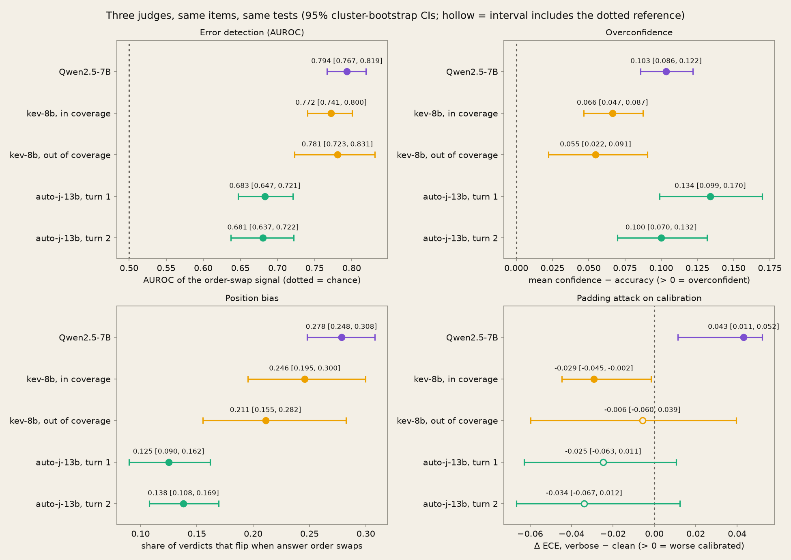
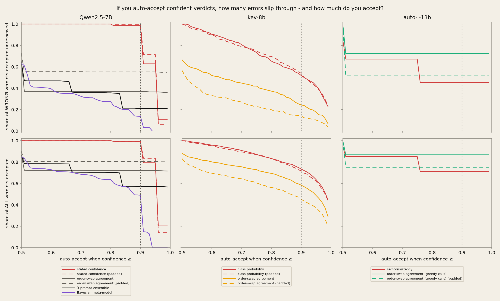

# Do LLM judges know when they're wrong?

**Calibration and selective evaluation of open-weight LLM judges on MT-Bench human judgments**

Shubham Sengupta · capstone report · October 2026 ·
[code](https://github.com/senguptashubham/judge-calibration) ·
[interactive site](https://senguptashubham.github.io/judge-calibration/)

---

## Abstract

Using an LLM judge in a production pipeline raises two questions: how confident is
the judge in each verdict, and can that confidence be trusted to decide which verdicts
go through without a human? There are several ways to get a confidence out of a judge,
such as asking it to state one, reading the probability of its verdict token, sampling
it several times, or checking whether its verdict survives swapping the two answers.
Calibration metrics such as ECE and the Brier score measure how well each one tracks
accuracy. Less is known about whether these signals hold up when the judge is misled,
for example by the order of the answers or by padding one answer to make it longer.

I study this empirically for Qwen2.5-7B-Instruct on 1,836 human-labelled pairwise
comparisons from MT-Bench. I ask whether the judge's stated confidence matches its
accuracy, whether any cheap uncertainty signal detects its errors better than chance,
and whether those signals flag errors caused by position and length bias. I then test
whether a frequentist or Bayesian meta-model beats the best single signal, whether
averaging over three judge prompts improves uncertainty, and whether the findings hold
for two other judges, kev-8b and auto-j-13b.

The judge's stated confidence overstates its accuracy by 0.19. The best signal,
agreement between the two answer orders, detects errors with AUROC 0.79 (stated
confidence: 0.64), but 27.8% of verdicts flip when the answers swap, and padding makes
it worse calibrated. No meta-model beats it, and the prompt ensemble does not
improve on it. All three judges are overconfident. In practice, auto-accepting verdicts
stated at 90% confidence or more would let 98.4% of the judge's wrong verdicts through.

## Contents

- [Introduction](#introduction)
- [Method](#method)
- [Related work](#related-work)
- [RQ1 — Is the judge's stated confidence calibrated?](#rq1--is-the-judges-stated-confidence-calibrated)
- [RQ2 — Is any cheap uncertainty signal informative about error?](#rq2--is-any-cheap-uncertainty-signal-informative-about-error)
- [RQ3 — Does uncertainty flag bias-induced errors?](#rq3--does-uncertainty-flag-bias-induced-errors-or-is-the-fooled-judge-confident)
- [RQ4 — Can a cheap meta-model beat the best single signal?](#rq4--can-a-cheap-supervised-meta-model-beat-the-best-single-signal-at-predicting-judge-error)
- [RQ5 — Does a prompt ensemble help, and does it survive distillation?](#rq5--does-marginalizing-over-the-judge-prompt-improve-uncertainty-quality-and-does-that-improvement-survive-distillation-to-single-call-cost)
- [RQ6 — kev-8b](#rq6--an-open-stand-in-for-a-decision-only-judge-kev-8b)
- [RQ7 — auto-j-13b](#rq7--generalizing-across-training-objective-auto-j-13b)
- [Three judges side by side](#three-judges-side-by-side)
- [What would auto-accepting cost? (post-hoc)](#what-would-auto-accepting-cost-post-hoc)
- [Discussion](#discussion) · [Limitations](#limitations) · [Extensions](#extensions)
- [Methods notes](#methods-notes) · [References](#references)

---

## Introduction

As software has moved from deterministic systems to probabilistic ones, many outputs
no longer have a single correct answer to test against. An LLM's open-ended answer, a
RAG system's summary or an agent's plan has to be judged, and human judgment has two
problems: it is expensive, and it becomes the bottleneck as the system scales. Using
one LLM to judge another (LLM-as-a-judge) has therefore become common, and more so with
the growth of RAG and agent-driven workflows. MT-Bench (Zheng et al., 2023) made it
standard practice for pairwise comparison: two answers to the same question are rated
by human evaluators and by an LLM judge, and the judge is trusted to the extent that
it agrees with the humans. Small open-weight judges are attractive in this role
because they are cheap and can be self-hosted.

A judge does not have to agree with humans every time to be useful. Humans do not
always agree with each other either, and Zheng et al. found GPT-4's agreement with
experts to be about as high as the experts' agreement with each other. Qwen2.5-7B,
the main judge studied here, disagrees with the human majority on about a quarter of
the items. That is acceptable if the judge can say when it is unsure. A pipeline could
then accept its confident verdicts and pass the rest to a human: selective evaluation,
or abstain-and-escalate. The open question is whether the judge's confidence can be
trusted for that decision. In testing terms, a judge is an automated oracle, and an oracle is only useful if you know when not to trust it.

Prior work has mostly measured judge accuracy and bias (Zheng et al., 2023; Shi et
al., 2025). Calibration has been measured on objective-answer benchmarks across many
judges (Tian et al., 2025), and there is little evidence for a small open-weight judge
scored against human labels. The selective-evaluation methods that set a confidence
threshold (Jung et al., 2025; SCOPE) do not test answers modified to look better than
they are. It is therefore unclear whether a judge's uncertainty catches the errors
caused by bias, or whether a misled judge stays confident. Finally, judges trained
specifically to judge, and decision-only judges that return a probability for each
label instead of text, are now available, which raises the question of whether they
avoid these failures.

This study asks seven questions:

1. Is the judge's stated confidence calibrated?
2. Is any cheap uncertainty signal informative about its errors?
3. Does that uncertainty flag errors caused by position and length bias, or is the
   misled judge confident?
4. Can a cheap meta-model, frequentist or Bayesian, beat the best single signal?
5. Does averaging over three judge prompts improve uncertainty, and does the
   improvement survive distillation to a single call?
6. Does kev-8b, an open model built in imitation of Jev, a commercial decision-only
   judge, resist the same failures?
7. Does auto-j-13b, a judge trained specifically for pairwise judging, resist them?

To make the results trustworthy, the design was preregistered before the full run.
The 1,836 items come from only 80 questions, so every confidence interval resamples
questions rather than items, and the 1,836 are never treated as independent. Every
accuracy is reported with Cohen's κ.

This study makes the following contributions:

1. a comparison of four confidence signals on one judge, scored against human labels;
2. a bias stress test, showing whether each signal catches the errors that answer
   order and padding cause;
3. a test of whether a meta-model or a prompt ensemble improves on the best single
   signal;
4. a comparison of three judges on the same benchmark;
5. released code, result tables and an interactive site for exploring the results.

The rest of this report is organised as follows. The Method section describes the data,
the judges, the confidence signals and the statistics, and Related work places the
study in the literature. One section per research question follows, then a side-by-side
comparison of the three judges and a post-hoc analysis of what auto-accepting confident
verdicts would cost. The report closes with the Discussion, Limitations and Extensions.

---

## Method

The design was frozen in `PREREGISTRATION.md` before the full run. Every design
decision and its reasoning is in `DECISIONS.md` (D1–D30), cited below by number.

### Data

- **Source.** `lmsys/mt_bench_human_judgments`, `human` split: 3,355 expert votes
  comparing the answers of six models (GPT-4, GPT-3.5-turbo, Claude-v1,
  Vicuna-13B, Alpaca-13B, LLaMA-13B) to MT-Bench's 80 two-turn questions
  (Zheng et al., 2023). Each row is one vote, not one item.
- **Items.** An item is one (question, model pair, turn); the votes collapse to
  2,396 items. An item is a **tie** when tie votes strictly outnumber both
  sides (D1, chosen against three alternatives on the real vote distribution);
  ties are excluded, leaving **1,904 non-tie items**. Of those, 68 split exactly
  50/50 and have no majority label, leaving **N = 1,836** labelled items. That is
  the population for RQ1–RQ3 and for the calibration checks in RQ6 and RQ7. RQ4
  and RQ5 use N = 1,819, dropping 17 items whose length features are undefined.
- **Human consensus.** `d_human = |frac_prefer_a − 0.5|` measures how strongly the
  voters agreed (D9). An item is `human_agreed` only if it is unanimous *and* has
  at least two votes (D16), since a single vote is trivially unanimous. Agreement
  between human voters is κ = 0.683 (N = 536), the ceiling a judge's κ
  is read against.
- **Clustering.** The 1,836 items come from only 80 questions, and items from the
  same question share a prompt and often the same answers. The effective sample
  size for any between-question variation is therefore about 80, not 1,836, and
  every interval and every cross-validation split below is grouped by question.

### Conditions

Every item is judged under two conditions, each in both answer orders:

- **`clean`** — the original answers.
- **`verbose`** — each answer padded with Zheng et al.'s "repetitive list" attack
  (`src/perturb.py::verbose_pad`): the answer is kept verbatim, then its own
  sentences are restated as a numbered list three times. This adds length and no
  information.
- **Order.** Each condition is judged with the answers shown as (A, B) and again
  swapped as (B, A). Order is an axis of every condition, not a condition of its
  own (D5).

### Judges

| | Qwen2.5-7B-Instruct (primary) | kev-8b (RQ6) | auto-j-13b (RQ7) |
|---|---|---|---|
| What it is | general instruction-tuned model | open decision model built in imitation of Jev, returning one probability per option; trained on short classification tasks, **never on judging** | Llama-2-13B fine-tuned on GPT-4 critiques for **pairwise response judging** (Li et al., 2024) |
| How it was run | vLLM 0.28.0, offline batch, Colab GPU; output constrained to JSON `{reasoning, verdict, confidence}`, reasoning first and 2–4 sentences | its own HTTP server; one deterministic forward pass returning a probability per option | vLLM, 4-bit GPTQ weights; its own prompt format, a free-text critique ending in a decision |
| Calls per item | greedy (T = 0) in both orders for each condition and each of three prompts; 4 samples at T = 0.7 for clean/P1 in AB order | one per condition and order | greedy in both orders for each condition; 4 samples at T = 0.7 for clean in AB order |
| Exclusions | none | 52 padded items over its 8,160-token serving limit | 181 of 3,808 item-conditions (362 calls) over a 7,168-token prompt limit, almost all padded turn-2 |
| Split reported by | — | input ≤ 1,024 tokens (its training range) vs above | turn 1 vs turn 2 |

The primary judge also runs three rubric variants on `clean` (D19): **P1**, the
general MT-Bench rubric, which RQ1–RQ4 use alone; **P2**, correctness first; and
**P3**, helpfulness first. Only one sentence differs between them
(`src/prompts.py`). Prompt templates are frozen and hashed, and every call row
records its model, prompt hash, git commit, seed, condition, order and sample
index (`src/judge.py`).

### Verdicts and labels

- **`judge_verdict`** is the greedy verdict with the answers in their original
  order, and `correct` means it matches the human majority.
- **`verdict_bidir`** averages the judge's probability for each side across the
  two orders and takes the larger (D7). It is reported as a second verdict, never
  substituted for the first.

### Confidence signals

All signals are computed from the recorded calls in `src/signals.py` (and
`src/kev_signals.py`, `src/autoj_signals.py`); analysis code never reads raw
model output.

| signal | what it is | judges |
|---|---|---|
| stated confidence (`conf_verb`) | the number the judge writes in its answer | Qwen |
| verdict probability (`conf_lp`, `conf_kev`) | the probability of the chosen letter at the verdict token; for kev-8b, its class probability | Qwen, kev-8b |
| self-consistency (`conf_sc`, `conf_sc_autoj`) | share of the 4 sampled verdicts that match the greedy one | Qwen, auto-j |
| order-swap agreement (`conf_bpe` and analogues) | SCOPE's Bidirectional Preference Entropy (Badshah et al., 2026): average P(answer 1 wins) over both orders, score 1 − its binary entropy | all three |
| 3-prompt ensemble (`conf_ens`) | the same entropy over the average of P1, P2 and P3, split into aleatoric and epistemic parts (D20) | Qwen |
| meta-models | logistic regression, gradient boosting and a Bayesian hierarchical logistic regression predicting `correct` from the signals and item features (RQ4) | all three |

An entropy score ranks errors but is not a probability (a 50/50 split scores
0.307), so every calibration number is computed on a signal's probability form,
scored against the verdict it is a confidence in (D7; methods note
"Calibration forms").

### Statistics

- **Intervals.** 95% intervals come from a cluster bootstrap with B = 2,000:
  resample questions with replacement and keep all their items (`src/boot.py`).
  A row-level bootstrap would treat the 1,836 items as independent and give
  intervals that are too narrow.
- **Paired comparisons.** When the same items are scored two ways (clean vs
  padded, one verdict vs another, one feature set vs another), the interval is on
  the per-item difference, from a paired cluster bootstrap.
- **Calibration.** ECE uses equal-mass bins, or exact per-value bins when a signal
  takes ten or fewer values (D14). It is always reported with accuracy, Cohen's κ,
  AUROC and the signed overconfidence gap (mean confidence − accuracy), because a
  judge that always says 0.5 has perfect ECE and no use (figure
  `results/figures/ece_auroc_orthogonal.png`, two hand-built cases: one ranks
  perfectly and is miscalibrated, the other is calibrated and ranks nothing).
  Accuracy never appears without κ, including along a risk–coverage curve, since
  dropping items changes the base rate.
- **Error detection.** AUROC of uncertainty against error, the risk–coverage
  curve and its area (AURC; Geifman and El-Yaniv, 2017).
- **Meta-models (RQ4).** `StratifiedGroupKFold(5)` grouped by question, repeated
  over 10 seeds; the spread across repeats is the headline uncertainty (D8).
  Hyperparameters are fixed in advance, with no tuning: `LogisticRegression(C=1.0)`,
  `HistGradientBoostingClassifier(max_depth=3, max_iter=200, learning_rate=0.05)`.
  Every AUROC is compared with a permutation null that shuffles `correct` within
  each question.
- **Bayesian model (D22).** Logistic regression with one random intercept per
  question, fitted by NUTS in NumPyro (2 chains, 500 warm-up and 2,000 draws each).
  It reports R-hat, effective sample size and divergences with every fit. A held-out
  question's intercept is drawn from the population prior, never fitted, so no
  information leaks across folds.

---

## Related work

**LLM-as-a-judge and its biases.** Zheng et al. (2023) introduced MT-Bench and
the human judgments used here, found that GPT-4's agreement with experts matches
the experts' agreement with each other, and documented position, verbosity and
self-enhancement bias. Their "repetitive list" attack is this project's `verbose`
condition. Shi et al. (2025) measured position bias in 15 judges on MT-Bench and
DevBench. It varied by judge and task, was strongly affected by the quality gap
between the two answers, and only weakly by their length. Norman, Rivera and Hughes (2026) evaluated 21 judges on
MT-Bench, JudgeBench and RewardBench. Raw agreement overstated chance-corrected
agreement by 33.8–41.3 points on MT-Bench for every judge, which is why κ
accompanies every accuracy here. Measured as the correlation between length and
verdict on unmodified pairs, verbosity bias was small across their cohort.

**Calibration of judges.** Tian et al. (2025) evaluated 14 judges on JudgeBench
with stated, sampled and token-probability confidence and found all three
overconfident in most models. They propose an ensemble that fuses several judges'
verdicts and critiques. This project measures the same three kinds of confidence
for a single small open judge, against human rather than objective labels.

**Selective evaluation.** Jung, Brahman and Choi (2025) choose a confidence
threshold on a small calibration set by fixed-sequence testing, guaranteeing a
chosen level of human agreement among the verdicts accepted. They build confidence
by simulating diverse annotators, and escalate from Mistral-7B to GPT-3.5 and
GPT-4. The guarantee held when calibration and test pairs came from disjoint sets
of models. The items their judges abstained on had lower human agreement, which
RQ2 and RQ5 test for here through `d_human`. Badshah, Emami and Sajjad (2026,
SCOPE) introduce the order-swap signal used here (Bidirectional Preference
Entropy) and set the threshold by conformal risk control, which bounds the error
among accepted verdicts while calibration and deployment data are exchangeable.
Neither paper tests answers modified to look better than they are.

**Judges trained to judge, or trained to be calibrated.** auto-j (Li et al., 2024)
is a 13B judge fine-tuned on GPT-4 critiques of Chatbot Arena pairs; RQ7 evaluates
it. Jev, a proprietary model from TypeSafe AI, is a decision-only judge: it returns a
probability for every label and no generated text. Li, Miao, Krishnan and Padman
(2026) evaluated it directly as a judge, noting that a typed probability output does
not by itself make a judge accurate or calibrated. It rarely reverses a verdict when the answers swap, and its confidence is
informative about its errors. But on pairs where the wrong answer is more
elaborately written, the error among its confident verdicts rises. kev-8b, the
open stand-in RQ6 evaluates, was built in imitation of Jev and is not Jev.

**Uncertainty decomposition.** The split of the ensemble's entropy into an
aleatoric part (the average entropy of each prompt) and an epistemic part (the
extra entropy from the prompts disagreeing) is the mutual-information
decomposition behind BALD (Houlsby et al., 2011), applied here to prompts instead
of model weights.

---

## RQ1 — Is the judge's stated confidence calibrated?

*Data: `results/items_qwen2.5_7b_instruct.parquet`, filtered to `condition == "clean" AND prompt_variant == "P1"` (invariant 14) and `human_label` non-null — this drops 68 of the 1904 non-tie items, each a genuine 50/50 non-tie human split with no majority label (`data.py::build_items()`; not a data bug), leaving **N = 1836**. Analysis: `analysis/rq1.py`. Figures: `results/figures/reliability_{conf_verb,conf_lp,conf_sc,conf_bpe}_qwen2.5_7b_instruct.png`. All CIs are cluster bootstraps, B=2000, grouped on `question_id` (invariant 2).*

**Headline: the judge is measurably overconfident.** Its own verbalized confidence
(`conf_verb`) overstates its actual accuracy by **0.192 [0.172, 0.213]** when scored
against a single canonical pass (`judge_verdict`). Every confidence signal is
overconfident, with every CI clear of zero.

**Full results.** Each confidence is scored against the verdict it is a confidence
*in*: `judge_verdict` (the single canonical AB pass) or `verdict_bidir`
(order-averaged, D7). The order-swap signal is scored through its probability form
(explained below).

| confidence | verdict def. | accuracy | κ | ECE | MCE | Brier | overconfidence gap |
|---|---|---|---|---|---|---|---|
| `conf_verb` | judge_verdict | 0.757 [0.735, 0.778] | 0.514 [0.471, 0.556] | 0.192 | 0.383 | 0.215 | 0.192 [0.172, 0.213] |
| `conf_lp` | judge_verdict | 0.757 [0.735, 0.778] | 0.514 [0.471, 0.556] | 0.242 | 0.492 | 0.242 | 0.242 [0.221, 0.264] |
| `conf_sc` | judge_verdict | 0.757 [0.735, 0.778] | 0.514 [0.471, 0.556] | 0.183 | 0.313 | 0.205 | 0.169 [0.150, 0.187] |
| `conf_bpe_prob` | judge_verdict | 0.757 [0.735, 0.778] | 0.514 [0.471, 0.556] | 0.103 | 0.229 | 0.159 | 0.103 [0.086, 0.122] |
| `conf_verb_bidir` | verdict_bidir | 0.792 [0.771, 0.813] | 0.585 [0.542, 0.626] | 0.077 | 0.174 | 0.150 | **0.038 [0.018, 0.059]** |
| `conf_lp_bidir` | verdict_bidir | 0.792 [0.771, 0.813] | 0.585 [0.542, 0.626] | 0.096 | 0.229 | 0.159 | 0.068 [0.047, 0.090] |

**Every signal is overconfident, by 4 to 24 points depending on which one you trust.**
`conf_lp` (raw exp(verdict-token logprob)) is the worst — 0.242 overconfident under `judge_verdict`, worse than `conf_verb`. This traces directly to its distribution: 99.3% of `conf_lp` values sit at or above 0.99 (median is exactly 1.0) — the model is essentially always "sure" of the token it generated, regardless of whether the underlying judgment was right, a well-documented property of greedy-decoded token probabilities, not a bug in how it's computed.

**The order-swap signal is SCOPE's Bidirectional Preference Entropy.** `conf_bpe`
follows Badshah, Emami and Sajjad's BPE (*SCOPE*, ICML 2026, arXiv:2602.13110):
average the probability that `model_a` wins across the two answer orders, then take
its binary entropy. One construction detail differs:
- **SCOPE** reads that probability from a single preference token, answered with no
  rationale.
- **Here** it is read at the verdict token *after* the judge's 2–4-sentence written
  reasoning: `p_a = P(A) / (P(A) + P(B))` at that position. Constrained decoding does not
  distort this ratio (D25).

So the two are not interchangeable, and numbers should not be compared across the papers
without that caveat. For example, SCOPE reports an AUROC of 0.685 for BPE with
Qwen2.5-7B-Instruct on a different 2,000-item MT-Bench sample; RQ2 finds 0.794 here.

**The order-swap signal needs its probability form to be scored for calibration.**
`conf_bpe` = 1 − H(p), with p the order-averaged P(model_a wins). It ranks errors
well (RQ2), but it is not a probability: a 50/50 split gives 1 − ln 2 = 0.307, not 0.5,
so ECE on it measures that difference in scale, not calibration. Its calibration
is scored on `conf_bpe_prob`, the same p read as the probability of the AB verdict
(`signals.py::prob_on_verdict`). So scored, it is the best-calibrated of the four
AB-verdict signals, and still overconfident by 0.103 [0.086, 0.122]. An earlier
version of this table scored raw `conf_bpe` and found its gap indistinguishable
from zero; that was the scale difference (methods note, "Calibration forms").

**Asking twice, with the answers swapped, removes most of the stated overconfidence.**
A confidence scored against `verdict_bidir` has to describe the order-averaged
verdict. `conf_verb_bidir` averages the two orders' stated confidences toward it
(each order counts c when it agreed with `verdict_bidir` and 1 − c when it didn't).
`conf_lp_bidir` = max(p, 1 − p) is the order-averaged verdict probability, which is
also `conf_bpe`'s probability form for this verdict. `conf_verb_bidir`'s gap is
0.038 [0.018, 0.059], against 0.192 for the single pass: on items where the two
orders disagree, the two stated confidences pull toward 0.5 instead of both
sitting near 0.95. `conf_sc` has no `verdict_bidir` row, because its sampled draws
exist in AB order only.

**Debiasing by averaging both orders buys a real, statistically confirmed accuracy
gain.** Accuracy moves from 0.757 to 0.792 going from `judge_verdict` to `verdict_bidir` — a difference that could just be noise if judged by eye from two separate CIs, so it was tested properly: a **paired** cluster bootstrap on the per-item accuracy difference (invariant 3 — same 1836 items scored two ways is not two independent samples) gives **+0.0354 [0.0177, 0.0531]**, a CI that excludes zero. Concretely: averaging both orders flips 157 items from wrong to right, and only 92 from right to wrong — a net gain of 65/1836 = 0.0354, matching the bootstrap exactly. The debiasing gain is real, not just directionally plausible.

κ improves in step (0.514 → 0.585), but both remain well below the human-human ceiling of κ=0.683 (N=536). That population is smaller and not perfectly matched to RQ1's 1836 items, so treat the comparison as approximate — but debiasing clearly closes only a small fraction of the gap to human-level agreement.

**Corroborating evidence the false confidence is not just a calibration-curve
artifact.** The vacuum test (methods notes) found the judge's mean `verbalized_conf` on
pairs with *no real content difference to judge* (0.970 identical, 0.973 empty) was, if anything, slightly *higher* than on real items (0.949) — a judge that recognized "there is no basis for a decision here" should show measurably lower confidence on those degenerate pairs, and doesn't.
RQ1's overconfidence finding and the vacuum test's false-confidence finding are two independent measurements pointing at the same underlying problem: the judge's stated confidence tracks something other than its actual likelihood of being right.

**Caveat for `conf_lp`/`conf_bpe`'s `reliability`/`resolution` numbers specifically.**
`brier_decomposition()`'s reconstruction identity (`brier = reliability - resolution + uncertainty`) is exact only when every bin shares one literal confidence value — true for the two discrete signals here (`conf_verb`: 4 unique values, `conf_sc`: 5), so their reconstruction matches `brier()` to floating-point precision. The continuous ones (`conf_lp`, `conf_bpe_prob`, `conf_lp_bidir`) fall through `ece()`'s `"auto"` strategy to quantile binning instead, where `reliability`/`resolution` are computed from each bin's *mean* confidence rather than each item's own value — a real, expected "grouping loss" gap from `brier()`, not a bug. `results/rq1_table_qwen2.5_7b_instruct.csv` reports `reliability`/`resolution` alongside `ece`/`mce`/`brier` (computed directly, unaffected by this); treat the former two as describing the *binned* forecast for these signals, not a claim they reconstruct `brier()` to the letter.

---

## RQ2 — Is any cheap uncertainty signal informative about error?

*Data: same population as RQ1 — `results/items_qwen2.5_7b_instruct.parquet` filtered
to `(clean, P1)` and `human_label` non-null, **N = 1836** (invariant 14). Analysis:
`analysis/rq2.py` (per-signal risk-coverage) and `analysis/rq5.py` (entropy threshold
sweep). Figures: `results/figures/risk_coverage_qwen2.5_7b_instruct.png` (the thesis figure),
`results/figures/entropy_threshold_sweep_qwen2.5_7b_instruct.png`. Tables: `results/rq2_table_qwen2.5_7b_instruct.csv`,
`results/rq5_threshold_sweep_table_qwen2.5_7b_instruct.csv`. All CIs are cluster bootstraps, B=2000,
grouped on `question_id` (invariant 2). AURC is the mean error rate of the kept
items over every coverage level from 1/n to 1 (Geifman and El-Yaniv, 2017).
`accuracy@c%`/`κ@c%` keep the c% most confident items. Where the cut, or a point
of the curve, falls inside a group of tied values, the tied items share the
remaining places equally: the expected value under a random tie-break
(`src/metrics.py::risk_coverage`, `coverage_weights`), so no number depends on
row order. RQ1's accuracy/κ at 100% coverage (0.757 [0.735, 0.778] /
0.514 [0.471, 0.556]) is the no-abstention reference point.*

**Headline: every real signal beats chance, none comes close to the oracle, and
AURC and AUROC rank the signals the same way.** The oracle's AURC is **0.032**;
the real signals run from 0.100 (`conf_bpe`) to 0.194 (`conf_sc`), 3.1–6.0x the
oracle, against 0.243 with no abstention at all. In order: `conf_bpe` (AURC 0.100,
AUROC 0.794), `conf_lp` (0.144, 0.715), `conf_verb` (0.173, 0.639), `conf_sc`
(0.194, 0.623). The two discrete signals are flat across their most-confident tied
group in the figure: 82% of items share `conf_sc`'s top value (all five samples
agree), so below 82% coverage it keeps a random part of one group and cannot rank
errors at all. That is why its accuracy and κ are identical at 75% and 50%.

**Full results:**

| signal | AURC | AUROC | accuracy@90% | κ@90% | accuracy@75% | κ@75% | accuracy@50% | κ@50% |
|---|---|---|---|---|---|---|---|---|
| `conf_verb` | 0.173 [0.146, 0.201] | 0.639 [0.608, 0.672] | 0.779 [0.756, 0.801] | 0.557 [0.512, 0.600] | 0.809 [0.785, 0.832] | 0.616 [0.567, 0.663] | 0.821 [0.795, 0.846] | 0.639 [0.587, 0.687] |
| `conf_lp` | 0.144 [0.124, 0.167] | 0.715 [0.682, 0.746] | 0.785 [0.763, 0.807] | 0.568 [0.525, 0.611] | 0.830 [0.805, 0.852] | 0.659 [0.608, 0.704] | 0.883 [0.859, 0.906] | 0.766 [0.717, 0.811] |
| `conf_sc` | 0.194 [0.174, 0.214] | 0.623 [0.601, 0.647] | 0.789 [0.765, 0.811] | 0.575 [0.529, 0.618] | 0.811 [0.790, 0.831] | 0.617 [0.574, 0.655] | 0.811 [0.790, 0.831] | 0.617 [0.574, 0.655] |
| `conf_bpe` | **0.100 [0.083, 0.120]** | **0.794 [0.767, 0.819]** | **0.795 [0.769, 0.817]** | **0.589 [0.537, 0.633]** | **0.861 [0.830, 0.887]** | **0.721 [0.661, 0.774]** | **0.916 [0.892, 0.941]** | **0.832 [0.784, 0.883]** |

**`conf_bpe` is the strongest signal on every metric** (bold): lowest AURC, best
AUROC, and the highest accuracy and κ at all three coverage levels. `conf_verb`, the
judge's own stated confidence and RQ1's headline signal, is close to the bottom: only
`conf_sc` ranks errors worse. Being badly overconfident (RQ1) doesn't automatically
make a signal uninformative for *ranking* errors, but here it is both.

**Entropy threshold sweep (RQ5): the preregistered prediction did NOT
hold.** D23 predicted epistemic thresholding would beat total thresholding on AURC,
since epistemic is the reducible part of the uncertainty. The opposite happened, and
by a wide margin: AURC(`ens_entropy_total`) = 0.098, AURC(`ens_entropy_aleatoric`) =
0.099, AURC(`ens_entropy_epistemic`) = 0.273 — a paired cluster-bootstrap on the gap
gives **epistemic − total = +0.175 [0.142, 0.208]**, a CI entirely on the "epistemic is
worse" side of zero. The `total`/`aleatoric` curves are visually indistinguishable in
the figure (distinct linestyles/markers used specifically so they stay legible despite
this) because they're nearly numerically identical: **65% of items have epistemic
entropy below 10⁻⁶, effectively zero** (all three prompt variants agree), so `total ≈ aleatoric`
for most of the population by construction (`total - aleatoric` exactly equals
`epistemic`, verified). The mechanism: ensemble agreement (low epistemic) does not
mean the ensemble is *right* — among the lowest-decile-epistemic items, accuracy is
only **46%**, far below the 75.7% overall baseline. The judge's three prompt variants
can be confidently, uniformly wrong together just as easily as confidently right
together; low epistemic uncertainty is actively misleading as a trust signal here, not
merely uninformative.

**Human disagreement: does judge behavior track genuine human
consensus strength at all?** Population for both: `(clean, P1)` further restricted to
`n_human_votes >= 2` (D9 — `d_human` is undefined-as-a-disagreement-signal below 2
votes), **N = 595**. `d_human = |frac_prefer_a - 0.5|` takes only **3 distinct values**
here and is badly imbalanced — **0.167** (28 items, 4.7%), **0.25** (3 items, 0.5%),
**0.5** (564 items, 94.8%), a direct consequence of MT-Bench's small (2-5) per-item
vote counts. D9's secondary bucketed (unanimous/strong-majority/contested) comparison
is correctly out of scope (`n_contested = 31` in this population, below D9's
`n_contested >= 100` bar — a different, smaller population than the
`n_contested = 123` in `PREREGISTRATION.md`, computed on the full 2396-item corpus).

Both `correct` and `conf_verb` rise with `d_human` (i.e. are lower on more-contested
items), CI-backed under both a linear and a rank-only assumption
(`results/figures/human_disagreement_qwen2.5_7b_instruct.png`, table
`results/human_disagreement_table_qwen2.5_7b_instruct.csv`):

| target | OLS slope | Spearman ρ |
|---|---|---|
| `correct ~ d_human` | 0.803 [0.208, 1.376] | 0.141 [0.036, 0.237] |
| `conf_verb ~ d_human` | 0.059 [0.016, 0.100] | 0.113 [0.031, 0.190] |

Spearman was added specifically because 3 points can't support a linear-shape claim;
both CIs excluding 0 under the weaker, monotonic-only assumption is what makes this
finding hold up, not just the OLS number in isolation. Extended to all four original
signals (Spearman only, same population,
`results/figures/d_human_correlations_qwen2.5_7b_instruct.png`):

| signal | Spearman ρ | 95% CI |
|---|---|---|
| `conf_verb` | 0.113 | [0.031, 0.190] |
| `conf_lp` | 0.091 | [-0.004, 0.181] |
| `conf_sc` | 0.024 | [-0.054, 0.123] |
| `conf_bpe` | 0.101 | [0.002, 0.185] |

All four are weak (ρ ≤ 0.11), and **two of four (`conf_lp`, `conf_sc`) don't clear
zero** at this sample size. If judge confidence tracked
genuine task ambiguity, it should track `d_human` meaningfully; instead none of the
four does more than weakly. Combined with RQ1's overconfidence finding and the vacuum
test's false-confidence result, this is a third, independent line of evidence for the
same conclusion — the judge's confidence signals track something other than the
actual difficulty/ambiguity of the item. (Caveat: with
94.8% of `d_human`'s weight at one value, this reads as a comparison between the
dominant near-unanimous group and a small 5.2% minority, not a fine-grained trend
across many disagreement levels — more human votes would require new annotation,
outside this project's scope. D3, RewardBench 2 augmentation, was declined "for now"
in `PREREGISTRATION.md` §6 with an explicit reopen condition — "an unexpectedly thin
subgroup for a specific analysis" — that this arguably meets; revisiting it is a
deliberate scope decision, not a default.)

A genuine floating-point bug was found and fixed while building this analysis:
`d_human` values from 1/3 vs. 2/3 vote splits (both mathematically 1/6) landed on
adjacent float64 values (~6e-17 apart), which `get_bin_edges`' exact-value branch
treated as 2 bins instead of 1, and independently corrupted the Spearman ranking too
(ranks need exact ties detected as ties) until `d_human` was rounded to 6dp once in
`load_disagreement_items()`, upstream of every consumer. Confirmed this does not
affect any already-reported RQ1 number (`conf_verb`/`conf_sc`/`conf_lp` show no such
mismatch; `conf_bpe` does, 1521 raw vs. 797 real unique values, but is always
quantile-binned regardless since it has far more unique values than `n_bins=10`
either way).

---

## RQ3 — Does uncertainty flag bias-induced errors, or is the fooled judge confident?

*RQ3a data: same population as RQ1/RQ2 — `results/items_qwen2.5_7b_instruct.parquet`
filtered to `(clean, P1)` and `human_label` non-null, **N = 1836**. This is a
deliberate scope choice, not a data requirement: flip rate and confidence-on-flipped
don't need `human_label` at all (they're pure judge-behavior signals, nothing to do
with correctness) — the maximal population would be all 1904 clean/P1 items. RQ1's
1836-item population is reused instead so the whole report cites one canonical N
across every RQ1–RQ4 core analysis, rather than a second, 68-item-different
population for no analytical reason. RQ3b data: the same 1836 items, paired —
`(clean, P1)` vs. `(verbose, P1)`, both filtered identically; the
two conditions share an exactly identical 1904-item population, so filtering each
side the same way keeps them paired 1:1. Analysis: `analysis/rq3.py`. Figures:
`results/figures/rq3a_confidence_gap_qwen2.5_7b_instruct.png` (RQ3a),
`results/figures/rq3b_deltas_qwen2.5_7b_instruct.png` (RQ3b — two forest panels, Δ ECE
and Δ AUROC, sharing one signal ordering). Tables:
`results/rq3a_table_qwen2.5_7b_instruct.csv` (RQ3a), `results/rq3_table_qwen2.5_7b_instruct.csv`
(RQ3b). CI is a cluster bootstrap, B=2000, grouped on `question_id` (invariant 2);
RQ3b's deltas use the *paired* cluster bootstrap (invariant 3) since both sides are
the same items scored twice, not independent samples.*

**RQ3a — position bias.** The judge's canonical verdict flips between presentation
orders (AB vs. BA) on **27.8% [24.8%, 30.8%]** of items — a large, common failure
mode, not a rare edge case. The money question: is the judge's own confidence lower
on exactly those items where it got fooled by order?

**Full results** (mean confidence on flipped vs. unflipped items, and the gap
between them):

| signal | conf. when flipped | conf. when stable | gap (flipped − stable) | 95% CI |
|---|---|---|---|---|
| `conf_verb` | 0.935 | 0.955 | −0.0199 | [−0.0248, −0.0152] |
| `conf_lp` | 0.999 | 1.000 | −0.0009 | [−0.0031, 0.0005] |
| `conf_sc` | 0.844 | 0.957 | −0.1127 | [−0.1337, −0.0924] |
| `conf_bpe` | 0.307 | 0.998 | −0.6911 | [−0.6921, −0.6899] |

**Headline: `conf_verb` does track position bias, but only weakly.** Its gap is
small (−0.02) but the CI sits entirely below zero — the judge's stated confidence
*is* measurably lower on items its own order-flip just revealed to be shaky. Read
alongside RQ1's overconfidence finding: the direction is right, but a ~2-point
confidence drop is a faint signal to hang an abstention policy on for a bias this
common (28% of items).

**`conf_lp`'s gap is not distinguishable from zero** (CI crosses 0) — consistent
with D25's finding that constrained-decoding renormalization pins `conf_lp` near
its ceiling almost everywhere, leaving little room for it to move in either
direction.

**`conf_bpe`'s near-total collapse (0.307 vs. 0.998) is expected by construction,
not an independent discovery.** `conf_bpe = 1 - entropy(mean p_a across both
orders)` — it is *built from* cross-order agreement, so it is close to definitionally
minimized exactly when the two orders disagree (a flip). A signal computed directly
from the same order machinery it is being evaluated on will look artificially good
on that specific axis. `conf_sc`'s
gap (−0.11) is real and worth noting but sits in between — self-consistency
sampling doesn't use cross-order information directly, so its correlation with
flipping is a genuine empirical finding, not a mechanical one.

**Caveat on the bootstrap method used for the gap.** The flipped/unflipped groups
are two *disjoint* subsets of one item population, not the same items measured
twice — `paired_cluster_bootstrap()` (used elsewhere for e.g. `judge_verdict` vs.
`verdict_bidir`) doesn't apply here, since it requires both sides to share the same
`question_id` universe, which a question with zero flipped items would violate. The
gap and its CI instead come from a single `cluster_bootstrap()` call with a
group-difference `stat_fn` computed inside each resampled replicate — the standard
tool for a two-disjoint-subgroup comparison under clustering.

**RQ3b — verbosity bias.** Same N = 1836 items, each scored under both `clean` and
`verbose` (Zheng et al.'s repetitive-list padding). Unlike RQ3a, this *is* a genuine
paired comparison — same items, two conditions — so the deltas below are
`paired_cluster_bootstrap()` CIs on `stat_fn(verbose) − stat_fn(clean)` (invariant 3).
`conf_sc` is excluded — self-consistency sampling only runs for `clean/P1` (D19/D21),
so `verbose` has no `conf_sc` values to compare at all, not a smaller or noisier
sample of them; `conf_verb`, `conf_lp`, and `conf_bpe` are unaffected, since each only
needs the greedy call at both orders, which `verbose` does collect.

| signal | ECE clean | ECE verbose | Δ ECE (verb−clean) | 95% CI | AUROC clean | AUROC verbose | Δ AUROC | 95% CI |
|---|---|---|---|---|---|---|---|---|
| `conf_verb` | 0.192 | 0.182 | −0.0098 | [−0.0268, 0.0079] | 0.639 | 0.611 | −0.0276 | [−0.0571, −0.0023] |
| `conf_lp` | 0.242 | 0.232 | −0.0106 | [−0.0279, 0.0074] | 0.715 | 0.670 | −0.0447 | [−0.0740, −0.0170] |
| `conf_bpe` | 0.103 | 0.147 | **+0.0431** | **[0.0114, 0.0521]** | 0.794 | 0.766 | −0.0278 | [−0.0494, −0.0064] |

`conf_bpe`'s ECE columns are computed on its probability form, `conf_bpe_prob` (RQ1);
its AUROC columns on `conf_bpe` itself.

Accuracy itself barely moves and isn't significant for any signal (0.757 → 0.768,
Δ +0.0109 [−0.0070, 0.0281], identical across all three rows since accuracy only
depends on `judge_verdict`, not the signal) — verbosity padding doesn't measurably
change how often the judge is *right*.

**Headline: verbosity doesn't fool the judge into more wrong verdicts, but it
quietly breaks the uncertainty signals meant to flag them.** All three surviving
signals' AUROC(uncertainty → error) drops significantly under `verbose` — their CIs
sit entirely below zero. The signal-specific story is sharper still: `conf_bpe` was
RQ1/RQ2's best performer on clean data (lowest ECE, highest AUROC of the four
original signals), and it is the *only* signal whose calibration itself significantly
degrades under verbose (ECE +0.043, CI excludes 0) — while `conf_verb` and `conf_lp`'s
ECE shifts are numerically negative but not significant. Read together with RQ3a:
position bias barely moves confidence at all (a ~2pp gap); verbosity moves accuracy
even less, but erodes exactly the signal — cross-order agreement — that RQ1/RQ2
found most useful for catching errors on clean data. An abstention policy tuned on
`clean` data and deployed where responses vary in verbosity would silently lose
reliability without any accuracy-side symptom to warn it.

---

## RQ4 — Can a cheap supervised meta-model beat the best single signal at predicting judge error?

*The question this
section actually answers is **which feature family carries the signal**, not
"how good is my model." Three feature tiers (`src/features.py`): **Tier A** (8
cols) — the judge's own uncertainty signals (`conf_verb`, `conf_lp`, `conf_sc`,
`conf_bpe`, `conf_ens` + its total/aleatoric/epistemic entropy decomposition).
**Tier B** (+9 cols) — surface properties the judge itself doesn't use as a
signal (response lengths, turn, category, the judge's own output length,
order-flip). **Tier C** (+13 cols) — token-distribution detail (verdict
margin, CoT logprob/entropy aggregates, greedy and sampled). Every tier is
built on one shared population — `features.py::load_rq4_population()`,
`(clean, P1)`, `human_label` non-null, minus 17 items with an undefined
`len_ratio`/`longer_is_chosen` (3 zero-length responses, 14 exact-length
ties) — **N = 1819** — dropped uniformly across all three tiers so a score
change between tiers is a real signal-content difference, never a population
artifact. Two frequentist models throughout (invariant 11): `LogisticRegression(C=1.0)`
and `HistGradientBoostingClassifier(max_depth=3, max_iter=200,
learning_rate=0.05)` — no hyperparameter search, no kernel methods/RandomForest/XGBoost
(rejected at design time: indefensible tuning burden at ~80 groups). A third
model, the Bayesian hierarchical logistic regression (D22, `src/bayesian.py`),
is added below. CV protocol throughout: `StratifiedGroupKFold(5)`,
repeated over 10 seeds (D8) — the across-repeat spread is the headline
uncertainty, never a within-split CI, since only ~80 questions means
fold-to-fold variance is real at that scale. Analysis: `analysis/rq4.py`.
Every point estimate not from D8's own repeated-CV spread is a cluster
bootstrap, B=2000, grouped on `question_id` (invariant 2); condition/tier/model
comparisons on the same item set use the *paired* cluster bootstrap
(invariant 3).*

**Headline: the judge's own uncertainty signals already carry essentially all
the recoverable signal — engineered surface and token-distribution features
add nothing measurable, at either the tier level or the individual-feature
level.** This holds up two independent ways: the tier-level ablation
found the apparent A→B→C AUROC decline is statistically indistinguishable
from no change at all (every paired-progression CI crosses zero), and the
finer-grained coefficient analysis confirms it isn't just underpowered
noise hiding a real pattern — of 37 features in a model containing all three
tiers at once, only 8 have a coefficient whose CI clears zero, and **not one
of Tier C's 13 CoT/token-distribution features is among them.**

### Tier ablation — A → B → C, `human_agreed` items only

*Population: `load_rq4_population()` further restricted to `human_agreed`
(D16: `human_unanimous AND n_human_votes >= 2`) — **N = 556** (79/80 question
groups), a much larger, non-population-neutral cut than it looks (69% of the
base population dropped; accuracy rises 75.8%→78.4% on this easier subset,
confirmed empirically) — so the baseline signal's own AUROC is recomputed on
this exact population rather than reused from RQ2's table, which was scored
on the full 1836-item base. Baseline = the best of the four original signals
(`analysis/rq1.py::SIGNALS`) by point AUROC on this population, selection on
the point estimate alone, never a CI-based tie-break (a signal with a
genuinely higher point estimate but a noisier CI must still win).*

| tier | model | AUROC | 95% spread (D8) |
|---|---|---|---|
| baseline (`conf_bpe`) | — | 0.8196 | [0.7746, 0.8622] |
| A | logreg | 0.8239 | [0.8155, 0.8331] |
| A | histgbm | 0.8188 | [0.8080, 0.8282] |
| B | logreg | 0.8120 | [0.7943, 0.8228] |
| B | histgbm | 0.8084 | [0.7983, 0.8176] |
| C | logreg | 0.8065 | [0.7827, 0.8196] |
| C | histgbm | 0.8048 | [0.7943, 0.8156] |

Every cell clears chance decisively — a **permutation null** (invariant 12,
n=50 per cell) centers at 0.531–0.568 across all six tier/model cells, and
every observed AUROC (0.80–0.82) sits at the **100th percentile** of its own
null. The null shuffles `correct` *within* each question, so every question
keeps its own error rate: a model that only picks up which questions are hard
still scores above 0.5 under it, which is why the null sits above chance. It
is the stricter test for these clustered labels; a global shuffle (null
≈0.50) gives the same verdict. That rules
out "this is noise" for the whole-model AUROC, but not for the *pattern*
across tiers — Tier A looks marginally best and C marginally worst in the
table above, and that apparent decline needed its own, sharper test: a
**paired cluster bootstrap** (invariant 3, same 556 items, different
feature sets) on each step of the progression.

| model | step | Δ AUROC | 95% CI |
|---|---|---|---|
| logreg | A − baseline | +0.0053 | [−0.0310, 0.0389] |
| logreg | B − A | −0.0068 | [−0.0479, 0.0267] |
| logreg | C − B | −0.0042 | [−0.0187, 0.0106] |
| histgbm | A − baseline | +0.0051 | [−0.0157, 0.0257] |
| histgbm | B − A | −0.0052 | [−0.0270, 0.0137] |
| histgbm | C − B | +0.0008 | [−0.0135, 0.0171] |

**Every single CI crosses zero.** The apparent A>B>C decline in the raw table
is not statistically real at this sample size, for either model, at any
step. Honest reading: Tier A's own uncertainty signals already capture
whatever surface and token-distribution features have to offer — adding
them neither measurably helps nor measurably hurts. Figures:
`rq4_ablation_qwen2.5_7b_instruct.png` (every cell next to the baseline, with the permutation-null range shaded),
`rq4_progression_qwen2.5_7b_instruct.png` (forest plot of the 6 paired deltas),
`rq4_permutation_nulls_qwen2.5_7b_instruct.png` (every null AUROC against the observed one, per cell). Tables:
`rq4_ablation_qwen2.5_7b_instruct.csv`, `rq4_ablation_progression_qwen2.5_7b_instruct.csv`,
`rq4_ablation_null_qwen2.5_7b_instruct.csv`.

### H4 — does the predictor's edge track human consensus?

*Population: clean/P1, `human_label` non-null, `n_human_votes >= 2` (D9's own
population, deliberately not the tier ablation's `human_agreed`-restricted one — H4 needs
every contested item) — **N = 595** (79/80 groups). "The predictor" = Tier A
+ logreg specifically, a documented choice: 5.5 found no tier/model reliably
beats another, so Tier A is representative rather than arbitrary, and it
avoids a second population cut Tier B/C's `len_ratio` requirement would
force. Method (D15, mandatory): out-of-fold `P(correct)` from the fixed
10×5 repeated CV, averaged across repeats to one score per item (never
in-sample, which would bias the interaction before the CI method even
matters); fit `correct ~ oof_score * d_human`; cluster-bootstrap (B=2000,
refitting each resample) on the interaction coefficient.*

**Result: interaction coefficient +2.3752 [1.6849, 3.0739] — the CI clears
zero comfortably, H4 holds.** The predictor's edge genuinely grows with
human consensus: judge error is learnable where humans agree (epistemic,
reducible) and much less so where they don't (aleatoric, irreducible) — a
clean positive result, in real contrast to the tier ablation's null finding
above. `h4_interaction_qwen2.5_7b_instruct.png` has two panels, probability
and log-odds, because the probability-space panel alone visually undersells
the effect — sigmoid
saturation compresses the slope difference exactly where most of the real
data sits (high `oof_score`), while the log-odds panel shows it undistorted.
Table: `rq4_h4_interaction_qwen2.5_7b_instruct.csv`.

### Transfer test 1 — train on clean, test on verbose

*Population: `analysis/rq3.py::load_rq3b_items()` (**N = 1836**, the same
paired clean/verbose population RQ3b uses). **Feature-parity fix (D21,
mandatory for every model compared, not a Bayesian-specific carve-out):**
`verbose` never collects `conf_sc` or the `conf_ens` family (D19 — self-consistency
sampling and the P2/P3 ensemble are both clean/P1-only), so the feature set
here is Tier A minus those five columns — just `{conf_verb, conf_lp,
conf_bpe}` — for every model this test touches, including the Bayesian one
in RQ5's verbose-shift check. Two numbers per model on the identical reduced feature set, so the
comparison isolates the transfer effect from the feature-drop effect:
in-domain (repeated CV, D8, on `clean` alone) vs. transfer (fit once on all
of `clean`, frozen, evaluated on `verbose`, cluster-bootstrap CI over
`verbose`'s own `question_id`).*

| model | in-domain AUROC | 95% spread | transfer AUROC | 95% CI | Δ AUROC |
|---|---|---|---|---|---|
| logreg | 0.7703 | [0.7662, 0.7773] | 0.7705 | [0.7440, 0.7967] | +0.0001 |
| histgbm | 0.7889 | [0.7859, 0.7925] | 0.7635 | [0.7378, 0.7887] | −0.0254 |

**This refutes, not supports, the headline hypothesis** *("the abstention
layer trained offline degrades exactly when the judge is attacked")*.
`logreg`'s transfer AUROC is statistically indistinguishable from its own
in-domain number; `histgbm` shows a small drop but the CIs still heavily
overlap. This stands in real contrast to RQ3b's own finding that each
*individual* signal's AUROC drops significantly under `verbose` — a model
that *combines* `conf_verb`/`conf_lp`/`conf_bpe` appears to buy real
robustness no single signal has on its own, since AUROC only needs the
combined rank-ordering to survive, not each signal's own calibration.
Figure: `rq4_transfer_qwen2.5_7b_instruct.png`.

### Transfer test 2 — `LeaveOneGroupOut` over category

*Population: the full RQ4 base (N=1819) — never restricted, since this test
never leaves `clean`, so the D21 exclusion doesn't apply. Full Tier A, all 8
columns. For each of the 8 MT-Bench categories in turn, fit on the other 7,
evaluate on the held-out one — fully deterministic (no shuffle/seed), one
fixed split per category, so no repeat-spread the way D8's protocol has one.*

| model | weakest category | strongest category | full range |
|---|---|---|---|
| logreg | `writing` (0.739) | `stem` (0.864) | [0.739, 0.864] |
| histgbm | `extraction` (0.753) | `math` (0.852) | [0.753, 0.852] |

**Every category clears chance comfortably; no collapse anywhere.**
Notably, `coding` is *not* the weak point for either model (logreg 0.821,
histgbm 0.795 — solidly mid-range both times) — `writing` and `reasoning`
are the real weak spots. Reading: the predictor generalizes reasonably
across task types rather than learning a "coding is hard" shortcut.
The "coding is hard" expectation in the original plan was an illustrative
phrase, not a reasoned hypothesis about this specific judge/dataset — the figure
(`rq4_category_transfer_qwen2.5_7b_instruct.png`, categories sorted
weakest-to-strongest) deliberately does not single `coding` out, for the
same reason. Table: `rq4_category_transfer_qwen2.5_7b_instruct.csv`.

### Meta-model calibration and coefficients

*Population: the full RQ4 base (N=1819). Model: **Tier C + logreg**
specifically — Tier C because it's the only tier containing all three
feature families at once, which is what a coefficient-level "which family
carries the signal" question needs; `logreg` because raw coefficients are
only directly interpretable for the linear model. Reliability diagram/ECE:
out-of-fold `P(correct)` from the standard 10×5 repeated CV, averaged
across repeats (never in-sample). Coefficients: `LogisticRegression(C=1.0)`
fit once on the full population (a coefficient is a property of one fit,
not a per-repeat quantity), CI via a purpose-built cluster bootstrap that
resamples once per replicate and refits the whole 37-coefficient vector
together (not one call per feature, which would both refit ~37× more than
necessary and wrongly treat correlated features' bootstrap draws as
independent).*

**Calibration: OOF AUROC 0.7986, ECE 0.0357 (10 effective bins)** — reasonably
well-calibrated, with the reliability curve sitting a little below the
diagonal (mild overconfidence about `P(wrong)`) in the 0.4–0.7 range.

**Coefficients: 8 of 37 have a CI excluding zero — 5/8 in Tier A, 3/16 in
Tier B, 0/13 in Tier C.** This is the coefficient-level echo of the tier
ablation's null finding above, but sharper, since it isolates individual
features rather than whole tiers: `conf_verb`, `conf_sc`, `conf_ens`
(and its exact algebraic mirror, `ens_entropy_total` — the pair is
perfectly collinear, `conf_ens = 1 - ens_entropy_total`, so standardization
splits one real effect into two equal-and-opposite coefficients, not two
independent findings), and `ens_entropy_aleatoric` carry real, non-zero
weight from Tier A. From Tier B: `abs_len_diff`, `longer_is_chosen`, and
`category_reasoning` (negative — the `reasoning` category's own dummy). From
Tier C: **nothing** — not one of the 13 CoT/token-distribution features
clears zero, at the coefficient level, exactly matching the tier-level
null. Figures: `rq4_coefficients_qwen2.5_7b_instruct.png` (the 8 significant
coefficients only — the full 37-row version was unusably tall for a slide
at the annotated forest-plot spacing, ~35in — kept as a dense, unannotated
appendix, `rq4_coefficients_full_qwen2.5_7b_instruct.png`) and
`reliability_rq4_meta_model_qwen2.5_7b_instruct.png`. Table:
`rq4_coefficients_qwen2.5_7b_instruct.csv` (all 37 rows).

### The Bayesian hierarchical model

*`src/bayesian.py` implements D22's hierarchical logistic regression —
`correct ~ Bernoulli(σ(α + α_q[question] + Xβ))`, question-level random
intercepts with partial pooling, `α_q ~ Normal(0, σ_q)`, fit with
NumPyro/NUTS under the identical D8 protocol. One obstacle surfaced
during fitting: the direct ("centered") form of `α_q` hit
**Neal's funnel** on real data — `max_rhat = 1.07` (flagged) at the starting
settings, and *more* warmup made it measurably worse (1.07→1.20), confirming
a posterior-geometry problem rather than an insufficient-sample-count one.
Fixed with the standard non-centered reparameterization (`α_q_raw ~
Normal(0,1)`, `α_q = σ_q · α_q_raw` as a deterministic transform —
mathematically the identical prior, decoupled geometry): `max_rhat` dropped
to 1.01, effective sample size rose ~38× (21→791), at the same settings, on
the same real fold. NUTS (fallback ladder rung 1) was sufficient throughout
— Laplace/bootstrap-ensemble fallbacks were never needed. Real, measured
runtime for the full 5-fold×10-repeat protocol (not extrapolated): about
**9 minutes**, N=1819, Tier A, with all 10 repeats.
Every fit uses 2 chains × 2,000 draws after 500 warmup. Convergence at that
full scale: **0/50 fold-fits flagged** — worst R-hat 1.008, lowest ESS 611,
no divergences — visible in `rq4_bayesian_convergence_qwen2.5_7b_instruct.png`
(R-hat per real fold-fit, D22's 1.01 threshold line). At 1,000 draws, 13/50
fits sat just above 1.01 (worst 1.016), which is why 2,000 are used. Features are standardized on each
training fold, exactly as for the logistic regression: `β ~ Normal(0, 1)`
only means the same thing for every feature once they share a scale;
without it, the prior would all but switch off narrow-range signals such as
`conf_lp` (standard deviation 0.014).*

**Head-to-head, Tier A on both arms for a fair comparison:**

| | AUROC | 95% CI/spread | ECE | Brier | NLL | 90% coverage |
|---|---|---|---|---|---|---|
| frequentist `LogisticRegression` | 0.7962 | [0.7932, 0.7986] | 0.0366 | 0.1431 | — | — |
| Bayesian hierarchical | 0.7949 | [0.7914, 0.7968] | 0.0344 | 0.1430 | 0.4446 | 0.80 |

*NLL is the proper posterior-predictive log-likelihood — the mean Bernoulli
likelihood averaged across posterior draws first, then `-log`, never a
point-NLL on the mean probability (which would just be Brier with extra
steps and discard exactly what makes this quantity Bayesian). `coverage_90`
required a methodological decision D22 does not specify: a single 0/1 draw
can't meaningfully "fall inside" a probability interval the way a
continuous value can, so it's computed as **bin-aggregate coverage** —
reusing `ece()`'s own quantile binning, does each bin's real, aggregated
wrong-rate fall inside that bin's own pooled 90% credible interval. Both
NLL and coverage use posterior draws pooled across all 10 repeats
(concatenated, not averaged), since each repeat is an independent full
refit on a different fold partition.*

**The Bayesian model matches the frequentist one on every shared metric** —
AUROC 0.795 vs. 0.796 (spreads overlap), ECE 0.034 vs. 0.037, Brier tied.
Partial pooling over questions buys no discrimination or calibration here
on Tier A. What it adds is structural: the frequentist model has no native
posterior, so NLL and credible-interval coverage don't exist for it, and the
posterior draws are what RQ5's meta-model-level entropy decomposition is
built from. Table:
`rq4_bayesian_comparison_qwen2.5_7b_instruct.csv`. Figures:
`reliability_rq4_bayesian_meta_model_qwen2.5_7b_instruct.png`,
`rq4_bayesian_convergence_qwen2.5_7b_instruct.png`.

### Limitations carried forward from RQ4 into RQ5's Bayesian-model sections

Two choices here were not independently re-verified once made and are worth
naming rather than treating as settled: **`α`'s own prior** (`Normal(0,1)`) —
D22's formula names `α` but never states its prior (only `α_q`/`σ_q`/`β`
are preregistered); `Normal(0,1)` was chosen to match `β`'s own scale, a
reasonable but not uniquely-determined choice. **Tier A's use for every
Bayesian-model task** — inherited from the tier ablation's finding that tiers don't
reliably differ for the *frequentist* models; never independently checked
whether that null result also holds for the Bayesian model specifically.
Neither is expected to change the qualitative findings above, but neither
has been empirically stress-tested either.

---

## RQ5 — Does marginalizing over the judge prompt improve uncertainty quality, and does that improvement survive distillation to single-call cost?

*RQ5's threshold sweep (does epistemic
thresholding beat total thresholding on AURC?) is written up in
RQ2's section above, alongside RQ2's other
risk-coverage work. This section covers the other three
parts: distillation, human-disagreement validation
and verbose-shift validation (D23). Two entropy decompositions recur throughout,
sharing one formula (D20) at two different levels: **judge-level**
(`conf_ens`, `signals.py`, over the P1/P2/P3 prompt ensemble — `clean` only,
D19) and **meta-model-level** (`posterior_predictive_entropy_decomposition()`,
`src/bayesian.py`, over the Bayesian model's own posterior predictive draws
— works on any condition the model can be evaluated on, including
`verbose`). Both decompose one total entropy into Aleatoric (mean entropy
within each individual opinion) + Epistemic (the extra entropy that only
appears once you average across opinions — disagreement, not individual
uncertainty).*

**Headline: the single-call Bayesian model is not a worse version of the
3-call ensemble — on the metrics that matter for deployment it is
arguably the better one, except for the one property (recognizing
distribution shift) it was specifically supposed to have.** It retains
essentially all the ensemble's discrimination benefit at a third of the
inference cost, is far better calibrated than the ensemble's own raw
signal, and its own uncertainty is a dramatically better error-predictor
than the ensemble's judge-level uncertainty. But its uncertainty does not
correctly widen under an adversarial distribution shift — the one behavior
that would make it trustworthy specifically under attack, which is exactly
the condition where it would need to be trusted most.

### Distillation comparison — ensemble (teacher) vs. single-call Bayesian (student)

*Population: `load_rq4_population()` (**N = 1819**) — deliberately RQ4's own,
smaller, common population, not RQ5's own wider N=1836 (confirmed
empirically: RQ4's population is a strict subset of RQ5's, differing by
exactly the 17 known `len_ratio`-undefined items) — using the mismatched
wider population for the ensemble side would conflate "which items" with
"which method." Teacher = the 3-call ensemble's `conf_ens` /
`ens_entropy_epistemic` (D20); RQ1/RQ2 leave `conf_ens` out, so its AUROC
and ECE appear here for the first time. Student = the
1-call Bayesian model (RQ4, Tier A, P1-only features).*

| | AUROC | 95% CI | ECE | entropy-quality AUROC | 95% CI |
|---|---|---|---|---|---|
| ensemble (3-call) | 0.7931 | [0.7660, 0.8199] | 0.0714 | 0.5585 | [0.5141, 0.6019] |
| Bayesian (1-call) | 0.7892 (point) | — | **0.0344** | **0.7786** | [0.7487, 0.8072] |

*"Entropy-quality AUROC" = AUROC(epistemic → error) for each arm's own
epistemic signal — the ensemble's judge-level one vs. the Bayesian model's
own meta-model-level one. Every gap below is a **paired** cluster bootstrap
(invariant 3, same items, two methods), the same rename-to-a-shared-column
trick used throughout this project for one-item-set, two-score comparisons.*

**Headline: the single-call model retains 98.7% of the ensemble's AUROC edge
over chance (0.5)** — paired gap +0.0039 [−0.0108, 0.0198], CI includes
zero, not statistically distinguishable. **ECE favors the Bayesian model**
(0.034 vs 0.071) — expected, since `conf_ens` is a raw judge signal that has
never itself been calibrated via cross-validation, unlike the trained OOF
meta-model. The ensemble's ECE is computed on its probability form,
`conf_ens_prob` (the three-prompt average p on the AB verdict's side), for
the same reason as RQ1's `conf_bpe_prob`; scoring 1 − entropy directly had
given 0.101. **The genuinely surprising result is entropy quality, and it
runs in the opposite direction the "how much survives" framing would
predict:** paired gap −0.2201 [−0.2670, −0.1715], entirely below zero — the
single-call model's *own* epistemic signal is a *much better* error
predictor than the expensive ensemble's judge-level epistemic signal, not
merely comparable to it. Reading: these are conceptually different
quantities that happen to share the name "epistemic." The ensemble's
captures *prompt-disagreement* — does the judge's raw verdict wobble
depending on how the question is phrased. The Bayesian model's captures the
*meta-model's own task-targeted parameter uncertainty* — how confident is a
model trained specifically to predict error about its prediction for this
item. The task-targeted signal wins decisively, even though it costs a
third as much to obtain.

**Why the comparison is fair although the two signals measure different
things.** AUROC does not ask whether two signals measure the same quantity. It
asks only whether a signal ranks the judge's wrong verdicts above its right
ones, and it depends only on that ranking, not on the signal's scale or units.
That is exactly the job both signals are offered for here: a per-item score that
decides which verdicts to escalate to a human. A practitioner choosing between
them needs to know which one does that job better, whatever each one measures,
so comparing them by AUROC on the same items is the right test. The result also
has a plausible explanation. The ensemble's epistemic signal measures something
related to error only indirectly (whether rewording the prompt changes the
verdict), and three prompts can agree and still be wrong together, as RQ2's
threshold sweep showed. The Bayesian model's signal comes from a model trained
directly to predict error, so it targets the quantity the triage decision needs.
What the comparison does not show is that one kind of uncertainty is better in
general: the ECE comparison above, unlike AUROC, does depend on scale, and favours
the model that was trained and calibrated for the purpose. Figure: `rq5_distillation_qwen2.5_7b_instruct.png`
(the Bayesian AUROC is deliberately shown as a point without an interval,
rather than borrowing RQ4's differently-typed D8-across-repeat-spread
interval and implying a false equivalence with the ensemble's own
cluster-bootstrap CI). Tables: `rq5_distillation_qwen2.5_7b_instruct.csv`, and the paired gaps in
`rq5_distillation_gaps_qwen2.5_7b_instruct.csv`.

### Human-disagreement validation

*Population: `analysis/human_disagreement.py::load_disagreement_items()`
(D9's own — clean/P1, `n_human_votes >= 2`) — **N = 595**, the same
population RQ2's human-disagreement analysis uses, including its
`d_human` float-tie rounding fix. It reuses that analysis's
Spearman-plus-cluster-bootstrap recipe unmodified, over
`ens_entropy_aleatoric`/`ens_entropy_epistemic`: a validation against the
existing `d_human` machinery, not new statistical infrastructure.*

**The direction of the test.** `d_human = |frac_prefer_a - 0.5|`
(`src/data.py`), so *high* `d_human` means *strong consensus* (votes near
0% or 100% for one side), not disagreement; the disagreement zone is *low*
`d_human`, near the 50/50 split. This matches D23's framing and H4's result
(the predictor's edge grows with human *consensus*). The test is therefore:
does aleatoric correlate *negatively* with `d_human` (high aleatoric where
consensus is weak)?

| signal | Spearman ρ | 95% CI |
|---|---|---|
| `ens_entropy_aleatoric` | **−0.1181** | **[−0.2041, −0.0156]** |
| `ens_entropy_epistemic` | 0.0141 | [−0.0705, 0.0985] |

**A clean validation.** Aleatoric is negatively correlated with `d_human`
(CI excludes zero, modest but real magnitude — this is a genuine, if not
large, relationship at this sample size) — the estimated aleatoric signal
does track real human disagreement. Epistemic shows no such relationship
(CI includes zero). The aleatoric/epistemic vocabulary this project has
used throughout holds up against this independent, model-free check: real
human votes were never used to build the entropy decomposition, and it
still lines up with them exactly the way the vocabulary claims it should.
Figure: `d_human_correlations_ensemble_entropy_qwen2.5_7b_instruct.png` (extends
`plot_d_human_correlations()`, RQ2's figure function, written under its own
filename).
Table: `rq5_human_disagreement_qwen2.5_7b_instruct.csv`.

### Verbose-shift validation

*Population: `analysis/rq3.py::load_rq3b_items()` (**N = 1836**, the same
paired clean/verbose population the transfer test uses). Feature set:
`TRANSFER_SAFE_COLUMNS` (D21), the same reduction as the transfer test. The model is fit
**once** on all of `clean` (no CV split — mirrors the transfer test's "one
offline-trained model" design), then evaluated on both `clean` itself and
`verbose`.*

**A methodological question was worked through explicitly before running
real data, not fixed reflexively.** The obvious approach — reuse
`predict_held_out()`, already built for "evaluate on data the model wasn't
trained on" — would have been a real mistake here. `clean` and `verbose`
are paired on the *exact same 80 questions* (confirmed empirically:
identical `question_id` sets, identical `item_id` sets, same row order) —
`verbose`'s rows are not unseen the way a genuinely held-out CV fold's are.
`predict_held_out()`'s marginalization would have discarded real, valid
fitted information *and* confounded the test itself: marginalization
inflates predictive spread on any input, clean or shifted alike, so an
apparent "epistemic rises on verbose" finding could just measure
marginalization noise rather than the model correctly recognizing
distribution shift. A new function, `predict_in_sample()`, uses the
model's real fitted `α_q` (via the training fold's own
`question_id → index` mapping) for both evaluations instead — isolating
the actual variable of interest, since only the *feature values* differ
between the two conditions, not the questions themselves.

A second, subtler concern was raised and checked empirically rather than
assumed: evaluating `clean` *in-sample* (the same rows the model was
fit on) has a theoretical reason to *understate* its own epistemic
uncertainty — posterior parameter uncertainty is smallest exactly where
the likelihood was fit. This would bias the test *toward* a false
"epistemic rises" confirmation, never away from one. Rather than building
an untested, more complex held-out-baseline mechanism on a theoretical
argument alone, the simple version was run first and the real result used
to decide whether the added complexity was actually necessary.

| | clean | verbose | gap (verbose − clean) | 95% CI |
|---|---|---|---|---|
| aleatoric | 0.4501 | 0.4304 | **−0.0197** | [−0.0302, −0.0096] |
| epistemic | 0.0041 | 0.0038 | **−0.0003** | [−0.0006, −0.0001] |

**The preregistered prediction did not hold, in either direction.**
Aleatoric did not stay flat — it fell, significantly. Epistemic did not
rise — it also fell, significantly (both CIs sit entirely below zero).
**This null/contrary result is strengthened, not weakened, by the
in-sample-baseline concern above**: that bias could only ever inflate an
apparent epistemic *rise*, so finding a significant *fall* despite a bias
stacked in the opposite direction makes the fall more credible, not
less — the more complex held-out-baseline check was never actually needed.
Separately notable: epistemic's absolute scale (~0.004 nats) is roughly
100× smaller than aleatoric's (~0.43–0.45 nats) on both conditions — this
simple 3-feature model's parameter uncertainty is nearly negligible next
to the irreducible per-item noise, a real finding about the model itself,
not a side effect of the shift test. Figure:
`rq5_verbose_shift_qwen2.5_7b_instruct.png` (each gap with its CI, on separate
axes, since epistemic's scale is ~100× smaller than aleatoric's). Table:
`rq5_verbose_shift_qwen2.5_7b_instruct.csv`.

**Reading: this Bayesian model's meta-model-level epistemic signal does not
correctly recognize the verbose distribution shift.** If anything, both
uncertainty components read *more* confident under the attack, the opposite
of what a trustworthy triage signal would do under adversarial conditions.
This is a genuine, real limitation to carry forward, not a result to
explain away — the same model that performed well in every other RQ4/RQ5
comparison above (AUROC level with the frequentist model, far better
calibrated than the raw ensemble signal, a task-targeted epistemic signal
that beat the expensive ensemble's own)
fails specifically at the one property — out-of-distribution awareness —
that its Bayesian construction is supposed to provide close to "for free."

### Limitations specific to this section

- **`epistemic-AUROC` (distillation) and `epistemic` (verbose shift, in nats) are not
  directly comparable to each other** — different feature sets (Tier A's 8
  columns vs. `TRANSFER_SAFE_COLUMNS`' 3), different fitting protocols
  (10-repeat CV vs. a single fit), different units entirely (a ranking
  statistic vs. raw entropy). Both are real, correctly-computed findings on
  their own terms; neither should be read against the other's absolute
  scale.
- **Bin-aggregate coverage (RQ4, distillation) and the pooled-draws NLL
  construction are this project's own methodology** — D22 does not
  specify either. Defensible and internally consistent, but not a
  preregistered, externally-validated method; treat `coverage_90`
  specifically as the most method-dependent number in this section.
- **The verbose-shift check used a single NUTS fit, one seed** — mirroring the transfer test's "frozen
  model" design deliberately, but meaning there is no measure of how
  much the reported gaps would move under a different seed's own posterior
  draw. Consistent with established project precedent; still a real,
  uncharacterized source of variance specific to this one result.

---

## RQ6 — An open stand-in for a decision-only judge (kev-8b)

*Design and judge selection: `DECISIONS.md` D27.*

**Out-of-domain caveat, stated here first because it must never be a
footnote: kev-8b was never trained on pairwise response judging.** TypeSafe
AI's Jev is a proprietary decision-only judge: it returns a probability for
every label and no generated text. Its size, training recipe and data are
not public (Li et al., 2026), and when this arm was designed (D27) no
independent evaluation of it existed. `kev-8b` (`jaredpalmer/kev`,
Apache-2.0) is an independently built open model that its README describes
as inspired by Jev. It is not a distillation of Jev. The README also reports
its agreement with Jev's output on 324 held-out examples (93.21% and 90.12%
in two settings, against 66.36% for the untrained base model). These are
the authors' own figures, not a peer-reviewed result, but they were the
strongest evidence among the candidates considered that it is a reasonable
proxy. Two other open stand-ins (`Bespoke-Nimble-9B`,
`circuit-8b`) and a fourth candidate (`SemIf`, a cluster of non-canonical
hobbyist repos with unverifiable benchmark claims) were evaluated and
rejected on token-cap and evidentiary grounds — full comparison in
`DECISIONS.md` D27. But `kev-8b`'s own training data is Banking77, BoolQ,
AG News, customer-service tickets, NLI, spam — short-context
classification/QA, never a pairwise judgment task. Every result below is
an out-of-domain generalization test, not an apples-to-apples "best-in-
class judge" comparison.

**Jev itself has since been evaluated directly.**
Li, Miao, Krishnan and Padman (*JEV-as-a-Judge*, arXiv:2609.26550, first
posted 22 Sep 2026) test Jev 1.13 through its hosted API
against sixteen other judges on RewardBench, JudgeBench, HaluEval and RM-Bench.
They find that:
- it comes close to GPT-6 wherever a verdict can be read off the text;
- its confidence is informative about its own errors (AUROC 0.73–0.88 by task);
- it rarely reverses its verdict when the answers swap places (3.7% of
  RewardBench pairs, 11.1% of JudgeBench pairs);
- confidence routing works least well when a more elaborately written answer is
  the wrong one. On those RM-Bench pairs, the error rate among verdicts given at
  0.9 or more rises from 1.5% to 7.9%.

**Those are findings about Jev. Everything in this section is about kev-8b, an
out-of-domain open stand-in, and is not evidence about Jev.**

*Population: 1,904 MT-Bench items, both AB/BA orders, `clean` and
`verbose` conditions — the harness (`src/judge_kev.py`) reuses
`load_full_items_df()`/`verbose_pad()`/`apply_order()` from the primary
judge's own pipeline unchanged, so it is the identical item set. kev-8b's
real, empirically-measured serving ceiling (not the documentation's 8,192)
is 8,160 tokens — see D27 for the full diagnostic trail, including a
genuine non-deterministic instability zone confirmed across two
independent probe sessions. This excludes 52 items (104 `verbose` call-
rows, both orders) from `verbose` only — 0 from `clean`. Two signals:
`conf_kev` (`probabilities[choice]`, symmetric in [0.5, 1], the direct
analog of `conf_lp`) and `conf_kev_bpe` (order-corrected bidirectional
entropy across AB/BA, the direct analog of `conf_bpe` — this project's own
best-performing signal). kev's own `confidence` field is deliberately
excluded throughout: confirmed from kev's actual source
(`kev/api.py::choice_confidence`) to be an exact algebraic rescaling of
`conf_kev` for a 2-option question, not an independently-trained signal —
not a judgment call, a proven redundancy. Results are reported across two
coverage regimes — **in-coverage** (`input_tokens` ≤ 1,024, kev's own
disclosed training extent) and **out-of-coverage** (1,024–8,160) — using
each item's stable, unpadded `clean`-side length, so the same item never
carries a different regime label depending on which condition is in
front of you.*

**Headline: kev-8b's best signal is its order-swap signal, as for the primary
judge — overconfident, but tracking its own position-bias errors strongly —
and unlike the primary judge, its calibration does not break under the
verbosity attack. A Bayesian meta-model over both signals again does not
beat the better one alone.** Calibration is not worse out-of-coverage, which
cuts against the "leaves its training range, degrades" story a naive reading
of the out-of-domain caveat might predict.

### Calibration check

*Population: N=1,836 (`clean`, human-labeled — identical population size
to RQ1's own, same filter). `analysis/rq6.py::main_calibration`, reusing
`src/metrics.py::ece`/`brier`/`overconfidence_gap`/`auroc_error` unchanged.
ECE, Brier and the gap for `conf_kev_bpe` use `conf_kev_bpe_prob`; AUROC uses
`conf_kev_bpe` itself.*

| Regime | Signal | ECE | 95% CI | Overconfidence gap | AUROC | 95% CI |
|---|---|---|---|---|---|---|
| in-coverage (N=1,310) | `conf_kev` | 0.1525 | [0.1247, 0.1814] | +0.1525 | 0.6972 | [0.6596, 0.7335] |
| in-coverage | `conf_kev_bpe` | **0.0664** | [0.0544, 0.0932] | **+0.0664** | **0.7722** | [0.7407, 0.8005] |
| out-of-coverage (N=526) | `conf_kev` | 0.1297 | [0.0942, 0.1766] | +0.1297 | 0.7074 | [0.6472, 0.7652] |
| out-of-coverage | `conf_kev_bpe` | **0.0619** | [0.0442, 0.1062] | **+0.0547** | **0.7806** | [0.7231, 0.8313] |

**`conf_kev_bpe` beats `conf_kev` on every metric, in both regimes.** This
replicates, on a completely different kind of model (one forward pass, one
probability per option, no generated text), the
exact pattern this project already found for the primary Qwen judge — its
own bidirectional-entropy signal, `conf_bpe`, was RQ1/RQ2's best performer
too. Both signals are overconfident: `conf_kev` by +0.13 to +0.15,
`conf_kev_bpe` by +0.05 to +0.07 (every CI above zero). `conf_kev_bpe`'s
calibration columns use its probability form, `conf_kev_bpe_prob`, the same
treatment as the primary judge's `conf_bpe` (RQ1); scored as raw 1 − entropy
it had looked mildly *underconfident*, which was the scale difference.
**Out-of-coverage is not
worse than in-coverage** — AUROC is marginally *higher* out of range for
both signals, though the CIs overlap substantially at N=526 vs. 1,310.
This does not support a simple "leaves its training range, degrades"
story for calibration specifically. Figures:
`reliability_conf_kev{,_bpe}_{in,out_of}_coverage_kev_8b.png`. Table:
`rq6_calibration_kev_8b.csv`.

### Position-swap attack

*Same population and recipe as RQ3a (`analysis/rq3.py::compute_flip_rate`/
`compute_confidence_gap`, reused unchanged — both are already generic over
any DataFrame carrying `flipped`/`question_id`/a named signal column,
which `items_kev_8b.parquet` provides under the identical names).*

| Regime | Flip rate | 95% CI | Signal | Confidence gap (flipped − unflipped) | 95% CI |
|---|---|---|---|---|---|
| in-coverage | 24.6% | [19.5%, 30.0%] | `conf_kev` | **−0.0964** | [−0.1174, −0.0777] |
| in-coverage | " | " | `conf_kev_bpe` | **−0.4901** | [−0.5101, −0.4675] |
| out-of-coverage | 21.1% | [15.5%, 28.2%] | `conf_kev` | **−0.0798** | [−0.1167, −0.0453] |
| out-of-coverage | " | " | `conf_kev_bpe` | **−0.4659** | [−0.5027, −0.4262] |

**Both signals track their own position-bias-induced errors strongly, and
significantly, in both regimes** (every CI excludes zero). `conf_kev_bpe`'s
large gap (−0.47 to −0.49) is expected by construction — the same caveat
RQ3a raised for `conf_bpe`: it is built from the same AB/BA pair that
defines `flipped`. The informative number is `conf_kev`'s, which reads the
AB call alone. It is a notably *stronger* result than the primary judge's own RQ3a finding: its
`conf_verb` gap was −0.0199 [−0.0248, −0.0152] — `conf_kev`'s gap
(−0.096) is roughly **5× larger** on the identical test. This diagnostic
direction was foreshadowed by an earlier, informal probe during token-cap
diagnostics (D27): with content-free filler padding, kev-8b's verdict was
found to be 100% determined by which side of the input the real content
sat on. That earlier finding was explicitly a probe-script observation,
not a controlled result — this section is the controlled version, with
real MT-Bench content on both sides and a proper cluster-bootstrap CI,
and it confirms substantial, statistically real position-sensitivity,
even if not the literal 100%-deterministic effect the content-free probe
showed. Figure: `rq6_position_swap_gap_kev_8b.png` (both regimes).
Table: `rq6_position_swap_kev_8b.csv`.

### Verbosity attack

*Population: 1,784 paired items — the intersection of `clean` and
`verbose` (D27's pairing requirement: an item missing on either side is
dropped from **both** sides for this specific test, not just the missing
side, or the paired bootstrap silently loses its pairing). Reuses
`analysis/rq3.py::compute_signal_rq3b_metrics` unchanged.*

| Regime | Signal | ΔECE (verbose − clean) | 95% CI | ΔAUROC | 95% CI |
|---|---|---|---|---|---|
| in-coverage (n=1,310) | `conf_kev` | +0.0092 | [−0.0088, 0.0267] | −0.0058 | [−0.0452, 0.0328] |
| in-coverage | `conf_kev_bpe` | **−0.0292** | **[−0.0446, −0.0015]** | +0.0055 | [−0.0116, 0.0259] |
| out-of-coverage (n=474) | `conf_kev` | +0.0213 | [−0.0188, 0.0691] | −0.0241 | [−0.0868, 0.0406] |
| out-of-coverage | `conf_kev_bpe` | −0.0057 | [−0.0598, 0.0395] | +0.0050 | [−0.0324, 0.0443] |

**The verbosity attack does not break either signal's calibration.**
`conf_kev` shows no significant change in either regime. `conf_kev_bpe`
(ECE on `conf_kev_bpe_prob`) slightly *improves* in-coverage, −0.029
[−0.045, −0.002], and doesn't move out-of-coverage. This is the one clear
difference from the primary judge, whose best signal (`conf_bpe`, ΔECE
+0.043 [0.011, 0.052]) was the one the attack broke (scored on the
probability form; see the methods note "Calibration forms").
AUROC does not move significantly for either signal in either regime —
unlike the primary judge, where AUROC dropped significantly for all three
surviving signals under the same attack. Accuracy itself does not move
significantly either (Δ −0.014 to −0.025, both CIs include zero) —
verbosity does not make kev-8b more wrong, the same qualitative pattern
the primary judge showed. Figures:
`rq6_verbosity_deltas_kev_8b.png` (both regimes). Table:
`rq6_verbosity_kev_8b.csv`.

### Bayesian recalibration check

*Full D8 protocol (`StratifiedGroupKFold(5)` × 10 repeats, NUTS) — the
same rigor as the primary judge's own RQ4 Bayesian arm, despite kev's
much smaller 2-feature set.
Reuses `repeated_stratified_group_kfold_bayesian`/`build_xyg`/
`encode_features` unchanged; `encode_features` is a no-op on two pure-
float columns, the same way it already is on the primary study's own
Tier A.*

| Regime | Meta-model AUROC | D8 spread | Best single signal AUROC | Fold-fits flagged |
|---|---|---|---|---|
| in-coverage | 0.7719 | [0.7692, 0.7748] | 0.7722 | **7/50** |
| out-of-coverage | 0.7752 | [0.7670, 0.7836] | 0.7806 | 1/50 |

**The meta-model does not beat the best single signal in either regime**
— essentially tied in-coverage, slightly *worse* out-of-coverage.
Convergence is mostly but not entirely clean. In-coverage, 7/50 fold-fits
are flagged: one at R-hat 1.012, the other six for divergences (11 in total,
out of 200,000 post-warmup draws). Out-of-coverage, one fit has 2
divergences. Worst R-hat is 1.012 and lowest ESS 569 across both regimes.
The two features are strongly correlated, and once standardized they give
the posterior a ridge that NUTS occasionally steps off - a plausible
reading, not one checked separately. The conclusion doesn't rest on the
flagged fits: the across-repeat AUROC spread is tight and sits on or below
the single signal in both regimes. This null is methodologically
sound, not a red flag to explain away: `conf_kev` is a function of one
number (`prob_a` from the AB call alone), `conf_kev_bpe` a function of two
(`prob_a` from AB *and* BA, order-corrected) — they share one of two
inputs, correlated but not collinear the way `confidence`/
`probabilities[choice]` was (confirmed exact algebraic identity, which is
why that one was excluded entirely rather than just noted). D22's proper
`Normal(0,1)` priors keep correlated, non-identical predictors identifiable
- the flagged fits above are the cost of that correlation, not a failure
of it. The check also
never interprets individual coefficients (unlike this project's own
`conf_ens`/`ens_entropy_total` collinearity, D20, where that really would
have split one effect into two misleading numbers) — it only compares
holistic AUROC, a comparison correlated features don't invalidate. Two
signals built from largely overlapping information having limited
independent value to combine is the expected, coherent outcome, not a
modeling failure. Figures:
`rq4_bayesian_convergence_kev_8b_{in,out_of}_coverage.png`. Table:
`rq6_bayesian_recalibration_kev_8b.csv`.

### Limitations specific to this section

- **Every result here is an out-of-domain generalization test, restated:**
  kev-8b was never trained on pairwise response judging. A weaker
  or absent effect could mean this kind of model resists the failure, or could mean the
  task is simply unfamiliar to the model in a way that has nothing to do
  with calibration quality — this project cannot fully separate the two
  explanations, and neither should any reading of the results above.
- **The out-of-coverage regime is the smaller population throughout**
  (N=474–526 vs. 1,310) — every regime-comparison claim above ("worse
  out-of-coverage," "not worse out-of-coverage") is reported honestly with
  its own CI, but should be read as suggestive at this sample size, not as
  confirmed as strongly as the in-coverage numbers.
- **The regime boundary (1,024 tokens) comes from kev's own GitHub
  README, not a peer-reviewed source** — the best available disclosure,
  not an independently-verified ground truth for where kev-8b's
  calibration genuinely starts to degrade.
- **The position-bias diagnostic finding (D27) that motivated the
  position-swap test was a content-free filler-padding probe, not a
  controlled experiment** — this section's own position-swap result (real
  content, proper CIs) is the controlled version and is what should be
  cited as the actual finding; the earlier probe should be read only as
  the reason this test was prioritized, not as evidence in its own right.
- **`kev-8b` is one open stand-in for one proprietary system.** Its own
  authors' 90–93% agreement with real Jev output was the best evidence
  available when it was chosen (D27). Jev itself has since been evaluated
  directly through its API (Li et al., 2026; see the update at the top of
  this section), so claims about Jev should cite that study, not this one.
  On position bias, the one axis the two studies both measure, the stand-in is
  not a close proxy: kev-8b flips 21–25% of its verdicts when MT-Bench answers
  swap places, against 3.7–11.1% for Jev on RewardBench and JudgeBench. The
  benchmarks differ, so this is a warning, not a measured gap.

---

## RQ7 — Generalizing across training objective (auto-j-13b)

*Design, template and population decisions: `DECISIONS.md` D28.*

**Purpose-built-for-judging framing, stated here first — the inverse of
RQ6's own caveat.** Where kev-8b (RQ6) was never trained on pairwise
response judging at all, `auto-j-13b` (`GAIR/autoj-13b`, Li et al., ICLR
2024, arXiv:2310.05470) is a Llama-2-13B model **purpose-trained
specifically for this task** — fine-tuned on GPT-4-distilled critique-
and-verdict data over `lmsys/chatbot_arena_conversations`. This closes
the gap RQ6 could not: if a model actually built and trained to judge
still shows the same failure modes RQ1–RQ3 found in a general-purpose
judge, that is a materially stronger generalization claim than either RQ1
or RQ6 alone. Served here via its 4-bit GPTQ quantization (confirmed
working on this project's pinned `vllm==0.28.0` via a real Colab smoke
test) rather than the full fp16 model, for GPU-cost reasons (`DECISIONS.md`
D28) — the authors' own documentation notes quantized behavior "might be
different" from the full model, a real caveat restated below, not
dropped.

*Population: 1,904 MT-Bench items, both AB/BA orders, `clean` and
`verbose` conditions, **both turns** — `src/judge_autoj.py` reuses
`load_full_items_df()`/`verbose_pad()`/`apply_order()` from the primary
judge's own pipeline unchanged. Unlike RQ6, there is no coverage-regime
split: auto-j's disclosed 8,192-token context comfortably covers this
population (a small, skip-and-logged exclusion of 362/15,232 calls over a
conservative 7,168-token ceiling, concentrated in `verbose`/turn=2 — see
D28). Two signals, both self-consistency-based since auto-j exposes no
native per-call confidence or probability the way kev-8b did:
`conf_sc_autoj` (direct port of the primary judge's own `conf_sc`
formula, `clean` only — no sampled draws exist on `verbose`) and
`conf_sc_bpe_autoj` (an order-swap bidirectional-entropy analog, built
from self-consistency proportions rather than a per-call logprob ratio).
`verbose` has only the two greedy calls, so the verbosity attack uses
`conf_sc_bpe_autoj_greedy` — the same signal built from the two greedy
calls on both sides — to keep the paired comparison like-for-like. Both turns are
always reported. `verbose`/turn=2's much higher failure rate is stated
as its own finding below, never used to drop data (D28).*

**Headline: purpose-built training does not solve the calibration
problem, but it is not a wash either — it measurably cuts one specific
failure mode roughly in half while introducing a new one neither the
primary judge nor kev-8b ever showed.** Overconfidence and the Bayesian
meta-model's inability to beat the best single signal both replicate
exactly, for a third architecture in a row. Position-swap flip rate is
roughly **half** the primary judge's and kev-8b's own — the first real
evidence in this project that purpose-built training can reduce a failure
mode itself, not just report it more honestly. Set against that: under
the verbosity attack, auto-j fails to produce **any** usable verdict at
all in a meaningful fraction of cases (up to 39.8% for `verbose`/turn=2)
— a qualitatively different, more severe failure than a calibration gap,
and one neither the schema-constrained primary judge nor the deterministic
kev-8b could exhibit by construction. Among the verdicts it does produce,
verbosity does *not* break auto-j's uncertainty signal the way it broke
the primary judge's best signal: calibration is unchanged and error
detection measurably improves.

### Calibration check

*Population: N=1,797 (`clean`, human-labeled, `correct` present).
`analysis/rq7.py::main_calibration`, reusing
`src/metrics.py::ece`/`brier`/`overconfidence_gap`/`auroc_error`
unchanged; ECE, Brier and the gap for `conf_sc_bpe_autoj` use its
probability form, `conf_sc_bpe_autoj_prob` (RQ1). Unlike RQ6's kev arm, auto-j's two signals have genuinely
different null patterns from each other and from `correct` even on
`clean` (real Tie/parse-failure rates there), so each signal's own row
below uses its own filtered N, not one shared population size.*

| Turn | Signal | N | ECE | 95% CI | Overconfidence gap | AUROC | 95% CI |
|---|---|---|---|---|---|---|---|
| turn=1 | `conf_sc_autoj` | 889 | 0.1465 | [0.1182, 0.1810] | +0.1105 | 0.6778 | [0.6346, 0.7194] |
| turn=1 | `conf_sc_bpe_autoj` | 872 | 0.1438 | [0.1136, 0.1782] | +0.1339 | 0.6832 | [0.6469, 0.7210] |
| turn=2 | `conf_sc_autoj` | 908 | 0.1242 | [0.0980, 0.1547] | +0.0906 | 0.6794 | [0.6343, 0.7235] |
| turn=2 | `conf_sc_bpe_autoj` | 898 | 0.1402 | [0.1131, 0.1688] | +0.1000 | 0.6806 | [0.6371, 0.7217] |

**Both signals are meaningfully overconfident, in both turns** (+0.09 to
+0.13), the same side as every signal of the other two judges. Turn=1 and turn=2 are close to each other in magnitude
despite the sharp gap in their *failure rates* (see Verbosity attack,
below) — calibration quality among the calls that do succeed doesn't
itself degrade much turn-to-turn. AUROC (~0.68 for both signals, both
turns) is **the weakest of the three judges tested in this project** —
below the primary judge's own best signal (`conf_bpe`, 0.794) and
kev-8b's (`conf_kev_bpe`, 0.772–0.781). This needs a real caveat, stated
in full below: auto-j's signals are self-consistency-proportion-based, a
structurally coarser construction than either of the other two judges'
continuous, logprob-derived signals, so this is not a fully clean
apples-to-apples comparison — but it at least argues against "purpose-
built judge training obviously yields sharper uncertainty for free."
Figures: `reliability_conf_sc{,_bpe}_autoj_turn{1,2}_autoj_13b_gptq_4bits.png`.
Table: `rq7_calibration_autoj_13b_gptq_4bits.csv`.

### Position-swap attack

*Same population and recipe as RQ3a/RQ6's own position-swap test
(`analysis/rq3.py::compute_flip_rate`/`compute_confidence_gap`, reused
unchanged). N=1,770 (`clean`, human-labeled, `flipped` present).*

| Turn | Flip rate | 95% CI | Signal | Confidence gap (flipped − unflipped) | 95% CI |
|---|---|---|---|---|---|
| turn=1 | 12.5% | [9.0%, 16.2%] | `conf_sc_autoj` | **−0.2317** | [−0.3094, −0.1621] |
| turn=1 | " | " | `conf_sc_bpe_autoj` | **−0.5574** | [−0.5835, −0.5305] |
| turn=2 | 13.8% | [10.8%, 16.9%] | `conf_sc_autoj` | **−0.2649** | [−0.3285, −0.2073] |
| turn=2 | " | " | `conf_sc_bpe_autoj` | **−0.5512** | [−0.5754, −0.5233] |

**The standout result of this arm: auto-j's own flip rate (12.5%/13.8%)
is roughly half the primary judge's (27.8%) and kev-8b's (21.1–24.6%) on
the identical test.** This is the first evidence in this project that
purpose-built judge training can *reduce* position bias itself, not just
report it more honestly after the fact — every other cross-architecture
comparison so far (calibration, the Bayesian meta-model check) has been a
replication or a null result, not an improvement.

`conf_sc_bpe_autoj`'s large gap (−0.55) is expected by construction, the
same caveat RQ3a raised for `conf_bpe`: it is built from the same two
greedy calls that define `flipped`, so it is close to definitionally
minimized on a flip. The informative number is `conf_sc_autoj`'s gap
(−0.23/−0.26), which uses the AB draws alone: auto-j's self-consistency
does drop on items whose verdict the order swap changes — a stronger
tracking signal than the primary judge's `conf_verb` (−0.020) and closer
to its `conf_sc` (−0.11). Figures:
`rq7_position_swap_gap_autoj_13b_gptq_4bits.png` (both turns). Table:
`rq7_position_swap_autoj_13b_gptq_4bits.csv`.

### Verbosity attack

*Population: 1,137 paired items — the intersection of `clean` and
`verbose` where both the signal and `correct` are valid on both sides (an
item missing on either side is dropped from **both** sides, or the paired
bootstrap silently loses its pairing — the same requirement D27/D28
already established for kev-8b). The signal is `conf_sc_bpe_autoj_greedy`:
`verbose` has only the two greedy calls, so the pooled `conf_sc_bpe_autoj`
(5 AB draws on `clean`) would compare two different signal constructions
and fold a change in resolution into the verbosity delta. `conf_sc_autoj`
is excluded outright — it has no `verbose` values at all, mirroring D21's
`conf_sc` exclusion for the primary judge.*

**Before the calibration numbers: a real, severe failure mode neither the
primary judge nor kev-8b could exhibit.** Measured directly against the
full 15,232-call dataset, the rate at which auto-j fails to produce *any*
parseable verdict at all:

| Condition / turn | Generated calls | Parse failures | Rate |
|---|---|---|---|
| `clean` / turn=1 | 5,688 | 2 | 0.04% |
| `clean` / turn=2 | 5,736 | 2 | 0.04% |
| `verbose` / turn=1 | 1,862 | 253 | 13.6% |
| `verbose` / turn=2 | 1,584 | 630 | **39.8%** |

The mechanism is exact, not approximate: every failure traces to
`finish_reason == "length"` (the completion was truncated at 1,024 tokens
before reaching a decision line) — every completion that finished
naturally parsed successfully, 0% failure. A handful of truncated
completions were inspected by eye; some showed a coherent critique running
out of room, others showed genuine model-level degenerate token
repetition from the first few tokens (e.g. looping on a single phrase
dozens of times) — consistent with the GPTQ-quantization caveat stated
above, though the exact cause (quantization instability vs. `verbose_pad`'s
own repetitive-list structure priming repetition) is not resolved here.
This is a materially more severe failure than a calibration gap: neither
the primary judge (schema-constrained decoding, effectively guarantees a
verdict) nor kev-8b (a single deterministic classifier forward pass,
always returns something) could fail this way at all.

| Turn | Signal | ΔECE (verbose − clean) | 95% CI | ΔAccuracy | 95% CI | ΔAUROC | 95% CI |
|---|---|---|---|---|---|---|---|
| turn=1 (n=709) | `conf_sc_bpe_autoj_greedy` | −0.0247 | [−0.0630, 0.0106] | −0.0282 | [−0.0569, 0.0040] | **+0.0626** | **[0.0123, 0.1154]** |
| turn=2 (n=428) | `conf_sc_bpe_autoj_greedy` | −0.0339 | [−0.0667, 0.0123] | **−0.0421** | **[−0.0791, −0.0028]** | **+0.0704** | **[0.0144, 0.1277]** |

**Calibration does not move under verbosity (ΔECE −0.02 to −0.03, CI crosses zero
at both turns), and error detection gets significantly *better* (ΔAUROC
+0.06/+0.07, both CIs above zero).** Calibration holding matches kev-8b;
the primary judge's best signal is the only one the attack broke. The mechanism shows up in the same paired sample: under verbosity,
auto-j's errors become much more often order-inconsistent (47.6% of wrong
verdicts flip between AB and BA on `verbose`, vs. 28.4% on `clean`), and
an order-swap signal assigns exactly those items its lowest confidence.
**Accuracy itself drops significantly for turn=2** (−0.042, CI excludes
zero) — unlike both the primary judge and kev-8b, where verbosity never
measurably changed accuracy. Combined with the failure-rate table above,
turn=2 is the one population in this project where the verbosity attack
makes the judge measurably more likely to be wrong, or to not answer at
all — but the judge's own uncertainty signal flags those new errors
rather than hiding them.
Figure: `rq7_verbosity_deltas_autoj_13b_gptq_4bits.png` (both turns). Table:
`rq7_verbosity_autoj_13b_gptq_4bits.csv`.

### Bayesian recalibration check

*Full D8 protocol (`StratifiedGroupKFold(5)` × 10 repeats, NUTS) — same
rigor as the primary judge's and kev-8b's own Bayesian arms. Clean-only
population, restricted to rows where both signals are simultaneously
valid.*

| Turn | Meta-model AUROC | D8 spread | Best single signal AUROC | Fold-fits flagged |
|---|---|---|---|---|
| turn=1 | 0.6802 | [0.6715, 0.6906] | 0.6832 | 0/50 |
| turn=2 | 0.6714 | [0.6502, 0.6842] | 0.6806 | 1/50 |

**The meta-model does not beat the best single signal in either turn** —
essentially tied-to-slightly-worse in both, the same qualitative pattern
already found for the primary judge (RQ4) and kev-8b (RQ6): three
architectures, three null results. `conf_sc_autoj` and `conf_sc_bpe_autoj`
share one of their two underlying self-consistency proportions
(correlated, not collinear, the same distinction D28 already draws for
kev's own signal pair), so a coherent null is the expected outcome, not a
modeling failure. Convergence is clean: 0/50 flagged at turn=1, and at
turn=2 one fit with a single divergence; worst R-hat 1.007, lowest ESS 410. Figures:
`rq4_bayesian_convergence_autoj_13b_gptq_4bits_turn{1,2}.png`. Table:
`rq7_bayesian_recalibration_autoj_13b_gptq_4bits.csv`.

### Limitations specific to this section

- **auto-j-13b is served here as a 4-bit GPTQ quantization, not the full
  fp16 model**, for GPU-cost reasons stated up front, not hidden — the
  authors' own documentation notes quantized behavior "might be
  different." The degenerate-repetition failures found in the verbosity
  attack (above) are consistent with, but not proven to be caused by,
  this choice; the full model was not tested for comparison.
- **The two signals are self-consistency-proportion-based, structurally
  coarser than either the primary judge's or kev-8b's own continuous
  signals** (`conf_sc_autoj` in particular takes only `k_sc+1` discrete
  values, the same resolution limitation D14 already found for the
  primary judge's own `conf_sc`). The AUROC comparison against the other
  two judges (Calibration check, above) should be read with this in mind
  — a like-for-like signal-construction comparison was not attempted.
  `conf_lp`-style logprob-based signals were considered and deferred
  (D28): auto-j is not schema-constrained, so locating a clean two-
  candidate decision token is real, unsolved work, not attempted here.
- **Auto-j's own template offers a third "Tie" option** (2.35% of
  generated calls) the rest of this project's `A|B|None` schema was never
  built for. Tie is treated as a missing verdict for every analysis above
  — the same treatment as a genuine parse failure — but tracked
  separately via a raw label column in `calls_autoj_13b_gptq_4bits.parquet`,
  so a future reader can distinguish "the model explicitly declined to
  choose" from "the model failed to answer" if that distinction matters.
- **The verbosity attack runs on a pre-selected sample.** The paired
  population keeps only items auto-j answered on both sides, so the
  verbose/turn=2 failures documented above are excluded from the
  calibration and AUROC comparison entirely. The deltas describe the calls
  auto-j completed, not the attack's full effect.
- **The verbosity test must use the greedy-only signal.** The pooled
  `conf_sc_bpe_autoj` has 5 AB draws on `clean` but 1 on `verbose`, so a
  paired delta on it mixes the attack with a change in resolution (it gives
  ΔECE ≈ +0.04, ΔAUROC ≈ −0.02, neither significant). The like-for-like
  greedy-only version above is the valid paired test.
- **Dropping `turn=2` was considered and rejected.** After a smoke test
  showed `verbose`/turn=2's failure rate, a turn=1-only version was briefly
  planned, then reverted before any calibration number existed (D28). The
  failure rate and the turn=2 accuracy drop are reported here as measured.
- **Unlike kev-8b, auto-j-13b is not standing in for anything** — it is
  evaluated directly, not as a proxy for an inaccessible proprietary
  system. This section carries no analog of RQ6's own "is this a fair
  proxy" caveat; the trade-off made here instead is fidelity to the full
  model (traded for GPU cost via quantization, first bullet above).

---

## Three judges side by side

Each judge's order-swap agreement signal is the one signal all three have, and the
best error-ranker for each. Figure `results/figures/judge_comparison.png` (a
dark-theme copy, `judge_comparison_dark.png`, is for the README) puts the four
headline tests side by side. Every value and interval is copied from the RQ table
that reported it (`analysis/compare_judges.py`, table `results/judge_comparison.csv`).
kev-8b is split by coverage regime and auto-j by turn, as in RQ6 and RQ7; auto-j's
padding row uses the greedy-only form of its signal.

| judge (population) | AUROC (error detection) | overconfidence gap | flip rate | Δ ECE, padded − clean |
|---|---|---|---|---|
| Qwen2.5-7B | 0.794 [0.767, 0.819] | 0.103 [0.086, 0.122] | 0.278 [0.248, 0.308] | **+0.043 [0.011, 0.052]** |
| kev-8b, in coverage | 0.772 [0.741, 0.800] | 0.066 [0.047, 0.087] | 0.246 [0.195, 0.300] | −0.029 [−0.045, −0.002] |
| kev-8b, out of coverage | 0.781 [0.723, 0.831] | 0.055 [0.022, 0.091] | 0.211 [0.155, 0.282] | −0.006 [−0.060, 0.039] |
| auto-j-13b, turn 1 | 0.683 [0.647, 0.721] | 0.134 [0.099, 0.170] | 0.125 [0.090, 0.162] | −0.025 [−0.063, 0.011] |
| auto-j-13b, turn 2 | 0.681 [0.637, 0.722] | 0.100 [0.070, 0.132] | 0.138 [0.108, 0.169] | −0.034 [−0.067, 0.012] |

- Every judge is overconfident on this signal; every interval is above zero.
- auto-j flips about half as often as the other two when the answers swap.
- Only Qwen's calibration gets significantly worse under padding.
- auto-j's padding row covers only the calls that produced a verdict (RQ7: up to
  39.8% did not).

The intervals are per judge. No judge-vs-judge test was run, and the populations
differ (kev-8b skips 52 padded items; auto-j skips over-length prompts and loses
non-answers), so the rows are compared descriptively.

---

## What would auto-accepting cost? (post-hoc)

**This section is a post-hoc, descriptive analysis.** It was not preregistered and
tests no new hypothesis. It restates RQ1–RQ7's results in the terms a practitioner
would use: *if a pipeline trusted this judge's confident verdicts, how many wrong
verdicts would reach production?*

**Setup.** A pipeline accepts every verdict whose confidence clears a threshold and
sends the rest to a human. For each judge, signal and condition I measure four
things (`src/metrics.py::auto_accept_stats`, `analysis/auto_accept.py`):

- the **accepted share** (how much work the judge takes off humans);
- the **slip-through**: the share of the judge's *wrong* verdicts that are accepted
  unreviewed;
- the error rate among accepted verdicts;
- κ among accepted verdicts.

Only probability-scaled signals are used, each scored against the verdict it
belongs to (D7). A threshold on 1 − H has no meaning, and neither does
scoring a confidence in the AB verdict against `verdict_bidir`. The meta-models
enter through their out-of-fold P(correct) from RQ4. The 95% intervals are
cluster-bootstrap intervals over `question_id`.

**Read slip-through next to accepted share.** Any signal reaches zero slip-through by
accepting nothing, so a lower slip-through is only a gain if the pipeline still
accepts a useful share. The intervals are per-signal; no paired signal-vs-signal test
was run here, so the comparisons below are descriptive.

Headline threshold 0.90 (full curves 0.50–0.99 in `results/auto_accept_curves.csv`,
0.80 and 0.95 in `results/auto_accept.csv`):

| Judge | Signal | Inputs | Accepted | Wrong verdicts slipping through | Error among accepted | κ among accepted |
|---|---|---|---|---|---|---|
| Qwen2.5-7B | stated confidence | clean | 99.3% [99.0, 99.7] | **98.4% [97.3, 99.3]** | 24.1% | 0.52 |
| Qwen2.5-7B | stated confidence | padded | 99.1% [98.6, 99.5] | **99.8% [99.3, 100.0]** | 23.4% | 0.53 |
| Qwen2.5-7B | order-swap agreement | clean | 72.1% [69.1, 75.2] | 37.0% [31.7, 42.8] | 12.5% | 0.75 |
| Qwen2.5-7B | order-swap agreement | padded | 80.4% [77.5, 83.3] | 55.2% [49.1, 61.1] | 15.9% | 0.68 |
| Qwen2.5-7B | 3-prompt ensemble | clean | 57.2% [53.3, 61.1] | 21.1% [17.0, 25.4] | 9.0% | 0.82 |
| Qwen2.5-7B | Bayesian meta-model | clean | 49.0% [44.7, 53.2] | 13.6% [9.7, 17.5] | 6.7% | 0.87 |
| kev-8b | class probability | clean | 73.5% [70.2, 76.6] | 51.9% [46.5, 57.0] | 16.3% | 0.67 |
| kev-8b | order-swap agreement | clean | 58.4% [53.2, 63.4] | 24.3% [18.5, 30.2] | 9.6% | 0.81 |
| kev-8b | order-swap agreement | padded | 45.3% [40.7, 49.7] | 14.1% [10.5, 17.7] | 7.8% | 0.84 |
| auto-j-13b | self-consistency | clean | 71.1% [66.7, 75.2] | 45.2% [38.4, 52.2] | 14.5% | 0.71 |
| auto-j-13b | order-swap agreement (greedy) | clean | 86.8% [83.8, 89.7] | 72.3% [66.9, 78.0] | 18.7% | 0.63 |
| auto-j-13b | order-swap agreement (greedy) | padded | 75.2% [70.7, 79.7] | 51.5% [43.1, 59.9] | 19.1% | 0.62 |

**What it shows.**

1. **A gate on Qwen's stated confidence filters almost nothing.**
   - At ≥ 0.90 it accepts 99% of verdicts and lets 98% of the wrong ones through.
   - The error rate among accepted verdicts (24%) is the judge's overall error rate:
     the gate is a no-op.
   - Padding makes it worse: 99.8% of wrong verdicts pass.
   - This is RQ1's overconfidence seen from the deployment side: Qwen states at least
     0.90 on 99% of its verdicts, right or wrong.
   - Qwen's verdict logprob behaves the same way (99.6% slip-through).
2. **Signals that disagree with the judge's own verdict catch errors, at the cost of
   escalating more.**
   - Qwen's order-swap agreement lets 37% of wrong verdicts through while still
     accepting 72%.
   - The 3-prompt ensemble lets 21% through while accepting 57%.
   - The Bayesian meta-model lets 14% through while accepting 49%. It is scored on
     RQ4's N = 1,819, not 1,836.
   - Each step down in slip-through is paid for by sending more verdicts to a human.
     The intervals of adjacent rows overlap, so no ordering among these three is
     claimed.
3. **The padding attack reaches the gate for Qwen but not for kev-8b.**
   - Qwen's order-swap gate goes from 37% to 55% slip-through under padding,
     consistent with RQ3's calibration degradation. A threshold tuned on clean data
     would silently let more errors through.
   - kev-8b's order-swap gate lets *fewer* errors through when padded (24% → 14%).
     It does so by accepting less (58% → 45%), so padding makes kev more hesitant,
     not better. This matches RQ6's finding that kev's calibration holds up under
     padding.
4. **auto-j's numbers describe only the calls it answered.**
   - Its padded turn-2 calls produce no verdict at all 39.8% of the time (RQ7), and
     those calls are outside this population.
   - A pipeline would have to route every non-answer to a human as well.

**Limitations.** The threshold is illustrative: 0.90 is a round number a practitioner
might pick, not a tuned value. The populations follow each RQ's:
- kev-8b's coverage regimes and auto-j's turns are pooled here;
- the meta-models use RQ4's out-of-fold predictions on clean inputs only.

**Related results.** Two papers that appeared during this project bear directly on this
section:
- **SCOPE** (Badshah et al., ICML 2026) calibrates the threshold by conformal risk
  control, which guarantees the error among accepted verdicts stays below a chosen
  target. The guarantee holds only while calibration and deployment data are
  exchangeable.
  - Its own limitations name distribution shift and strategic behaviour as threats.
  - Its cross-benchmark appendix shows the guarantee failing when the benchmark
    changes.
  - The thresholds in this section are fixed, not conformally calibrated, so the
    padding result above does not test that guarantee. Whether a threshold
    calibrated on clean answers keeps its guarantee on padded ones is left open.
- **JEV-as-a-Judge** (Li et al., 2026) finds the same direction in a commercial
  judge: the error rate among its verdicts given at 0.9 or more rises from 1.5% to
  7.9% on pairs where the wrong answer is more elaborately written.

The interactive version of this analysis is section 04 of the
[demo site](https://senguptashubham.github.io/judge-calibration/) (source in [`site/`](site/)).

---

## Discussion

**Does the judge know when it is wrong? Partly, but not from what it says.** Its
stated confidence is of little use: it is overconfident (RQ1) and only weakly ranks
its own errors (AUROC 0.64, RQ2). The probability of its verdict token is no
better calibrated, even more overconfident, though it ranks errors somewhat better.
Both read the judge at a single moment, and at that moment the judge almost always
sounds sure, consistent with Tian et al.'s finding that stated and token-probability
confidence are overconfident in most judges. What works best is the judge's
behaviour: whether its verdict survives swapping the order of the two answers. That
signal does not ask the judge how sure it is. It checks whether the judge gives the
same answer twice, and so measures instability directly.

**The best signal is also the one the attack breaks.** Position bias is partly
caught: the flips are exactly what the order-swap signal measures, while the judge's
stated confidence drops by only about 2 points on the items whose verdict flipped
(RQ3a). Padding is worse. It does not produce more wrong verdicts, but it quietly
degrades every signal meant to flag them, and the order-swap signal's calibration is
the one that gets significantly worse (RQ3b). The misled judge stays confident. The
threshold-setting methods (Jung et al., 2025; SCOPE) rely on the data used to choose
the threshold resembling the data the judge sees in deployment, and a padded answer
breaks that assumption without any visible sign. Li et al. (2026) found errors rising
for Jev on pairs where the wrong answer was more elaborately written, which suggests
the weakness is not specific to one judge. One result points the other way: a
meta-model that combines the signals, trained on clean answers only, ranked errors on
padded answers as well as on clean ones (RQ4, transfer test 1). Combining signals
bought a robustness no single signal had on its own.

**More machinery did not buy better ranking, but it did buy calibration.** The
meta-models (RQ4) and the three-prompt ensemble (RQ5) all land near the best single
signal. The judge's own signals already carry what is recoverable, so none of the
added machinery uncovers a new one. One reading is that the remaining errors sit
where the labels themselves are uncertain. The judge agrees with the human majority
at κ = 0.514, against 0.683 for humans with each other, and it is less often right on
items where the human votes were split. The meta-model's own results point the same
way: its edge in predicting errors grows with how strongly the humans agreed (RQ4,
H4). The data are consistent with this reading, but do not prove it. The silver lining is the single-call Bayesian model. It keeps
almost all of the ensemble's ranking at a third of the cost and is better calibrated.
It failed, though, at the one thing it was specifically meant to do: recognising when
the inputs had shifted.

**Training a judge to judge changes its failures but does not remove them.** All
three judges are overconfident. auto-j, trained specifically for pairwise judging,
flips about half as often as the other two when the answers swap (RQ7), but it is
worse at detecting its own errors, and it brings a failure neither other judge
showed: on padded inputs it often produces no verdict at all, 39.8% of the time on
turn-2 items. The judge's output ran past its 1,024-token limit before it reached a 
verdict, sometimes because a long critique ran out of room and sometimes because the 
output degenerated into repetition. kev-8b, built in imitation of Jev, is less 
overconfident than the primary judge, and its calibration survives the padding attack 
(RQ6). The takeaway is that a "calibrated" label, from a vendor or a training recipe, 
is a claim to test on one's own data, not a property to assume.

**What a practitioner should do.**

1. Never auto-accept on stated confidence. At a 0.9 threshold, 98.4% of the primary
   judge's wrong verdicts would get through.
2. Run both answer orders and use their agreement as the confidence, or a model
   recalibrated on it.
3. Report Cohen's κ alongside raw accuracy, never accuracy alone. Raw agreement
   overstates how good a judge is.
4. Set the acceptance threshold on held-out data, and stress-test it with padded
   answers before trusting it.

## Limitations

Each RQ section ends with its own limitations. This section covers the ones that apply
to the whole study.

1. **One small benchmark.** Everything rests on MT-Bench: 80 questions, pairwise
   comparisons, in English. The answers being judged come from six models of 2023
   (GPT-4, GPT-3.5-turbo, Claude-v1, Vicuna-13B, Alpaca-13B and LLaMA-13B). Only the
   80 questions are independent, so the confidence intervals are honest but wide.
   Where the study finds "no significant difference", as in RQ4 and RQ5, read it as
   not detected, rather than absent. The results may not carry over to RAG, agent or
   code evaluation, or to answers written by current models.

2. **Noisy labels, with the hardest items removed.** The human majority is treated as
   ground truth, but 1,241 of the 1,836 labelled items rest on a single human vote,
   which is one person's opinion rather than a consensus. Items where the human votes
   tied were dropped (the strict tie policy, D1), because a tie gives no majority
   label to score the judge's A-or-B verdict against, and 68 more items with an exact
   50/50 split had no majority label. The study therefore measures the judge on the
   clearer items. The real-world error rate, and the difficulty of flagging errors,
   are probably higher than reported.

3. **Few judges, each in one setup.** Qwen2.5-7B, the primary judge, was run with one
   main prompt and JSON-formatted output, and its confidence may depend on that
   wording; only three prompt variants were tried. kev-8b was built in imitation of
   Jev and is not Jev, so RQ6 says nothing directly about Jev. auto-j ran 4-bit
   quantized, which may explain some of its repetitive output and missing verdicts; a
   full-precision model might do better. The three judges are compared descriptively:
   their item populations differ (kev-8b skips 52 padded items, auto-j skips
   over-length prompts and loses its non-answers), and no judge-versus-judge test was
   run.

4. **Only two manipulations.** The bias tests cover answer-order swapping and one
   padding style, the repetitive list from Zheng et al. (2023). Real manipulation is
   broader: flattery, appeals to authority, confident wording, prompt injection. The
   study shows that padding degrades the best signal; it does not show that any judge
   or signal is robust to the attacks it did not test.

5. **Post-hoc analysis and possible training-data overlap.** The auto-accept analysis
   is post-hoc and descriptive. Its thresholds are fixed values applied to the same
   data, not chosen on held-out data as a deployed system would choose them, so its
   numbers describe the judge rather than predict deployment. MT-Bench and its GPT-4
   judgments have been public since 2023, so any of the judges may have seen them in
   training. This cannot be checked from the outside. If it happened, it would make
   the judges look more accurate here than on new data.

## Extensions

Each extension below addresses one of the limitations above.

1. **More benchmarks and current models.** Repeat the study on other human-labelled
   pairwise data, and on answers written by current models, to test whether the
   findings hold beyond MT-Bench's 80 questions and 2023 answers (limitation 1).

2. **More manipulation types.** Add the attacks this study did not test, such as
   flattery, appeals to authority, confident wording and prompt injection, to see
   whether the order-swap signal fails under them the way it does under padding
   (limitation 4).

3. **Jev itself, and fairer setups.** Replace kev-8b with Jev, which Li et al. (2026)
   evaluated through its hosted API, or with one of the open decision models they
   found to match Jev's accuracy on their benchmarks. Not every model of this kind
   qualifies: in the same study, the open-weight Laya models were at chance on
   preference pairs and their confidence carried no information about their errors.
   Run auto-j in full
   precision to separate its own behaviour from the effects of quantization, and
   choose a primary judge of comparable size and generation, so the three-judge
   comparison measures the judges rather than their setups (limitation 3).

4. **Thresholds chosen on held-out data, with a guarantee.** Choose the auto-accept
   threshold on a separate calibration set, by fixed-sequence testing (Jung et al., 2025)
   or conformal risk control (SCOPE), and test whether the promised error rate
   holds on the remaining items, clean and padded. This turns the post-hoc auto-accept
   analysis into a prospective one, and tests directly whether padding breaks the
   guarantee (limitation 5).

---

## Methods notes

Empirical checks behind specific design decisions. The RQ sections above refer to them.

### Temperature scaling invalidates `p_a` for `sample_idx > 0` (D6) — confirmed empirically

**Claim (D6):** `p_a` (renormalised P(A) from top-K logprobs) is only valid for the
canonical greedy call (`sample_idx == 0`, T=0). Sampled draws (`sample_idx > 0`, T=0.7)
report logprobs scaled by temperature, so `p_a` computed from them is not comparable to
the T=0 value and must not be used as a calibration signal.

**Method:** for all 20 items in the pilot run (`clean`/P1/AB), compared the greedy
call's `p_a` against the first sampled draw's `p_a` for the same item. Split by whether
the two calls agreed on the verdict itself, since a verdict *flip* between temperatures
is a different, expected phenomenon (genuine sampling variability — the basis for
`conf_sc`), not evidence about logprob scaling.

**Result:**
- 2/20 items had the sampled draw pick a different verdict than the greedy call —
  expected, not evidence for or against the D6 claim.
- Of the 18/20 items where **both calls agreed on the verdict**, `p_a` still differed
  between T=0 and T=0.7 in every single case: mean absolute difference ≈ 0.00038,
  maximum ≈ 0.0067 (item `5ea559a223e8e898`: 0.0067 at T=0 vs 2.3e-9 at T=0.7 — several
  orders of magnitude in relative terms, despite a small absolute gap, since both values
  sit near the confident extreme).

**Conclusion:** D6's restriction is empirically justified, not just a theoretical
precaution — temperature measurably shifts the reported logprob distribution even when
it doesn't change the model's actual decision. `conf_lp`/`p_a` correctly come from
`sample_idx == 0` only.

Analysis script: ad hoc, not checked in; the underlying data are the pilot's rows in
`runs/qwen2.5_7b_instruct/judge_clean.jsonl` and `logprobs/`.

### How much longer the padded prompts are

**Purpose:** the size of the padding attack, measured on the prompts the primary
judge actually received. It is the context for RQ3b, and for the length limits that
excluded padded items from kev-8b (RQ6) and auto-j (RQ7).

**Method:** for each of the 1,904 items, the prompt token count of the greedy P1 call
in AB order, `verbose` against `clean`, as recorded by vLLM in
`calls_qwen2.5_7b_instruct.parquet`.

**Result:** padding multiplies the prompt length by 2.9 on average (median 3.1, range
1.1–4.3), 2.8 for turn-1 items and 3.3 for turn-2 items. The median prompt grows from
849 to 2,473 tokens, and the longest padded prompt is 11,746 tokens.

**Conclusion:** the attack roughly triples what the judge has to read without adding
information. Turn-2 prompts grow most, because both answers in the conversation are
padded, which is why the length-limited judges lose mostly padded turn-2 items.

### Vacuum test — "dark current"

**Purpose:** does the judge express a spurious preference when there is genuinely no
content difference to base one on? My JSON schema forces a binary `verdict` with no
tie option (unlike the dark-current metric of Usami et al. (2026),
`DC(J) = count(J(o) != 'tie') / N`), so "does it pick a winner" is trivially 100% by construction - the
informative question is *how* it picks, not whether.

**Method:** 40 pairs of identical responses (`vacuum_identical()` - one real item's
response duplicated to both sides) + 20 pairs of empty responses (`vacuum_empty()` -
real questions, both sides' assistant turns blanked), `clean`-schedule item sample
(seed 1234), single greedy `P1`/AB call per pair (order doesn't matter when both
sides are byte-identical - see `src/perturb.py`). Two measurements: the A/B verdict
split (systematic positional skew, since content provides no real signal either way),
and mean `verbalized_conf` (per D25, the primary false-confidence signal - `conf_lp`
is a known post-mask upper bound, reported but not relied on here).

**Result:**

| | n | verdict split (A / B) | binomial p (two-sided, H0: 50/50) | mean `verbalized_conf` |
|---|---|---|---|---|
| Identical pairs | 40 | 72.5% / 27.5% | **0.0064** | 0.970 |
| Empty pairs | 20 | 10.0% / 90.0% | **0.0004** | 0.973 |
| *(real clean/P1 items, for comparison)* | 1,836 | — | — | 0.949 |

Parse rate: 60/60 (100%) - structured output held up cleanly even on this degenerate
content.

**Conclusion:** two distinct findings, both real:

1. **Genuine positional bias, and its direction flips with content type.** Both splits
   are far from chance (p < 0.01 for identical, p < 0.001 for empty) - not noise at
   these sample sizes. Identical content favors position A; empty content favors
   position B, just as strongly, in the *opposite* direction. The judge's "dark
   current" isn't a single fixed positional preference - what nothing looks like to it
   depends on what kind of nothing it's shown.
2. **False confidence.** Mean `verbalized_conf` on both vacuum types (0.970, 0.973) is
   not lower than - if anything, slightly higher than - the real clean/P1 items'
   mean (0.949). A judge that recognized "there is no real basis for a decision here"
   should show measurably *lower* confidence on these degenerate pairs. It doesn't.

Both findings matter for RQ1 (calibration) and RQ2 (whether confidence is informative
about error): the judge's stated confidence does not distinguish a genuine, considered
judgment from a coin flip forced by schema constraints and possibly-arbitrary
positional preference. Sample sizes (n=40, n=20) are small by design (this is a
sanity check, not a powered study) - treat the specific percentages as descriptive,
not as a precise population estimate of the judge's true positional bias rate.

Analysis script: `analysis/vacuum.py` (reads `runs/{model_slug}/vacuum.jsonl`, written by
`src/vacuum_test.py`). Table: `vacuum_qwen2.5_7b_instruct.csv`.

### Decoding ablation — constrained vs. free-form (D25)

**Purpose:** D25 found that JSON-schema-constrained decoding renormalizes the
verdict-position logprobs, inflating `conf_lp`. That's a known, bounded distortion of
one *signal*. The open question D25 left: does constraining
also change the judge's actual **verdict**, not just how confident `conf_lp` reports
it was?

**Method:** 100 items (seeded sample, clean/P1/AB/greedy - one call per item per arm),
generated twice each: once with the production JSON schema enforced
(`structured_outputs`, exactly what every other call in this project uses), once
completely free-form (schema removed, same prompt - which already asks for the JSON
object in its instructions - same temperature=0, same seed). Both arms scored with the
unmodified production parser (`parse.py::parse_verdict_and_confidence()`), so "did
free-form generation still produce parseable JSON" is answered by the actual parser
every real result depends on, not a purpose-built lenient one. `src/ablation_decoding.py`
(Colab) + `analysis/decoding_ablation.py` (local).

**Result:**

| | n | parse rate |
|---|---|---|
| constrained | 100 | 100% |
| free-form | 100 | 100% |

**Verdict agreement (among the 100/100 items where both parsed): 96.0% (4 disagreements).**
All four are far from marginal - both arms report **high stated confidence (0.90–0.95)
on both sides of every flip**, not a low-confidence coin toss that happened to land
differently. Since both arms use greedy decoding (temperature=0) with the same seed,
any disagreement is a genuine causal effect of the schema mask on the decoding path at
some branch point, not sampling noise.

**Conclusion:** two findings, in opposite directions:

1. **Parse rate is a non-issue here.** Free-form generation held to the JSON output
   contract just as reliably as schema-enforced generation, on this population (clean,
   single greedy call). This doesn't generalize to every condition without re-checking
   - `verbose`'s longer inputs, or the sampled (`temperature=0.7`) calls, could behave
   differently - but for the primary greedy case, constraining buys no parse-rate
   safety margin that wasn't already there.
2. **Constraining does move the verdict, in a small but real fraction of cases (4%).**
   D25's original concern (does the schema mask distort more than `conf_lp`'s reported
   scale) is confirmed, not dismissed - four items out of 100 get a different, equally
   confidently-held answer depending on whether the output format is enforced. At
   N=100 this is a descriptive rate, not a precisely bounded population estimate (no
   bootstrap CI is reported - see this section's own module docstring for why), but it
   is real evidence, not a null result: **every calibration/AUROC number in this report
   is conditional on the constrained-decoding arm specifically**, and roughly 1 in 25
   items would have gotten a different, comparably confident verdict under free-form
   generation instead. This is evidence-based grounds to revisit the `vllm` pin (for
   `logprobs_mode="raw_logprobs"`) in a future run (D25).

### Method details that change numbers

Three method details that change numbers if done the obvious way. Earlier
public versions of this report did all three the obvious way; the changes are
listed so those versions can be read against this one.

**1. Entropy signals are scored for calibration through a probability.** `conf_bpe`, `conf_ens`, `conf_kev_bpe` and `conf_sc_bpe_autoj`
are all 1 − H(p). That ranks items correctly, so AUROC, AURC and
risk-coverage use it as is. But it is not a probability: a 50/50
split, a coin flip, gives 0.307 rather than 0.5, so ECE and the overconfidence
gap on it partly measure that difference in scale. Each is scored through
its probability form, the same p read as the probability of the verdict being
scored (`signals.py::prob_on_verdict`): p on the AB verdict's side for
`judge_verdict`, max(p, 1 − p) for `verdict_bidir`. Likewise, each confidence
is scored only against the verdict it belongs to: `conf_verb`, `conf_lp` and
`conf_sc` against the AB verdict, with `conf_verb_bidir` and `conf_lp_bidir` as
the order-averaged forms (D7). Against the raw-entropy scoring of earlier versions:

- RQ1: `conf_bpe` no longer looks near-perfectly calibrated (gap 0.014,
  CI crossing zero); scored properly it is overconfident by 0.103 (AB verdict)
  or 0.068 (order-averaged verdict).
- RQ3b: unchanged in substance — `conf_bpe`'s ΔECE under verbosity is +0.043
  [0.011, 0.052].
- RQ5: the ensemble's ECE is 0.071, not 0.101.
- RQ6: `conf_kev_bpe` is overconfident (+0.055 to +0.066), not
  underconfident, and the verbosity attack does not break its calibration
  (−0.029 in-coverage, where it had read +0.033). The earlier "identical
  vulnerability signature" to the primary judge does not hold.
- RQ7: `conf_sc_bpe_autoj`'s overconfidence is +0.10 to +0.13, not +0.06 to
  +0.09; its verbosity ΔECE stays non-significant.

**2. R-hat is read at full precision.**
`az.summary()` rounds to two decimals by default, so an R-hat of 1.014 reads as
1.01 and passes the > 1.01 test. Read at full precision with 1,000 draws per
chain, 10–15 of each run's 50 fold-fits sat just above the threshold (worst
1.024). With 2,000 draws per chain almost all clear it (D22); AUROC, ECE and
every conclusion moved only in the third or fourth decimal. The Bayesian result
tables record worst R-hat, lowest ESS and divergence counts, not just the
number of flagged fits.

**3. Ties are broken by their expected value, and AURC starts at coverage 0.**
Earlier versions integrated each risk-coverage curve only from its first point,
and that point comes late for a signal with few distinct values: 82% coverage
for `conf_sc`, 57% for `conf_lp`. Those signals skipped most of the area, so
AURC ranked `conf_sc` best (0.038) and appeared to disagree with AUROC. Integrated
from coverage 0 as Geifman and El-Yaniv define it, the AURCs are 0.100
(`conf_bpe`), 0.144 (`conf_lp`), 0.173 (`conf_verb`) and 0.194 (`conf_sc`), the
same order as AUROC, and the oracle's is 0.032, not 0.0295. Accuracy and κ at a
coverage level took the tied items at the cut in row order, and accuracy drifts
along the file (0.82 to 0.71 across `conf_verb`'s largest tied group). At 50%
coverage that put `conf_verb` at 0.844 instead of 0.821 and `conf_sc` at 0.838
instead of 0.811, and left `conf_sc`'s point estimate outside its own CI. RQ5's
entropy AURCs are unchanged: those signals have almost no exact ties.

---

## References

- Badshah, S., Emami, A. and Sajjad, H. (2026). SCOPE: selective conformal
  optimized pairwise LLM judging. ICML 2026. arXiv:2602.13110.
- Geifman, Y. and El-Yaniv, R. (2017). Selective classification for deep neural
  networks. NeurIPS 2017.
- Houlsby, N., Huszár, F., Ghahramani, Z. and Lengyel, M. (2011). Bayesian active
  learning for classification and preference learning. arXiv:1112.5745.
- Jung, J., Brahman, F. and Choi, Y. (2025). Trust or escalate: LLM judges with
  provable guarantees for human agreement. ICLR 2025. arXiv:2407.18370.
- Li, J., Sun, S., Yuan, W., Fan, R.-Z., Zhao, H. and Liu, P. (2024). Generative
  judge for evaluating alignment (auto-j). ICLR 2024. arXiv:2310.05470.
- Li, Y., Miao, Y., Krishnan, R. and Padman, R. (2026). JEV-as-a-Judge: accept
  when confident, escalate when unsure. arXiv:2609.26550.
- Norman, J. D., Rivera, M. U. and Hughes, D. A. (2026). Reliability without
  validity: a systematic, large-scale evaluation of LLM-as-a-judge models across
  agreement, consistency, and bias. arXiv:2606.19544.
- Shi, L., Ma, C., Liang, W., Diao, X., Ma, W. and Vosoughi, S. (2025). Judging
  the judges: a systematic study of position bias in LLM-as-a-judge. IJCNLP-AACL
  2025. arXiv:2406.07791.
- Tian, Z., Han, Z., Chen, Y., Xu, H., Yang, X., Xuan, R., Wang, H. and Liao, L.
  (2025). Overconfidence in LLM-as-a-judge: diagnosis and confidence-driven
  solution. AAAI 2026. arXiv:2508.06225.
- Usami, H., Hara, K., Tsuboi, A. and Matsuda, N. (2026). LLM judges have dark
  current: a psychometric datasheet for LLM-as-a-judge evaluation.
  arXiv:2606.15610.
- Zheng, L., Chiang, W.-L., Sheng, Y., Zhuang, S., Wu, Z., Zhuang, Y., Lin, Z.,
  Li, Z., Li, D., Xing, E., Zhang, H., Gonzalez, J. E. and Stoica, I. (2023).
  Judging LLM-as-a-judge with MT-Bench and Chatbot Arena. NeurIPS 2023 Datasets
  and Benchmarks. arXiv:2306.05685.
